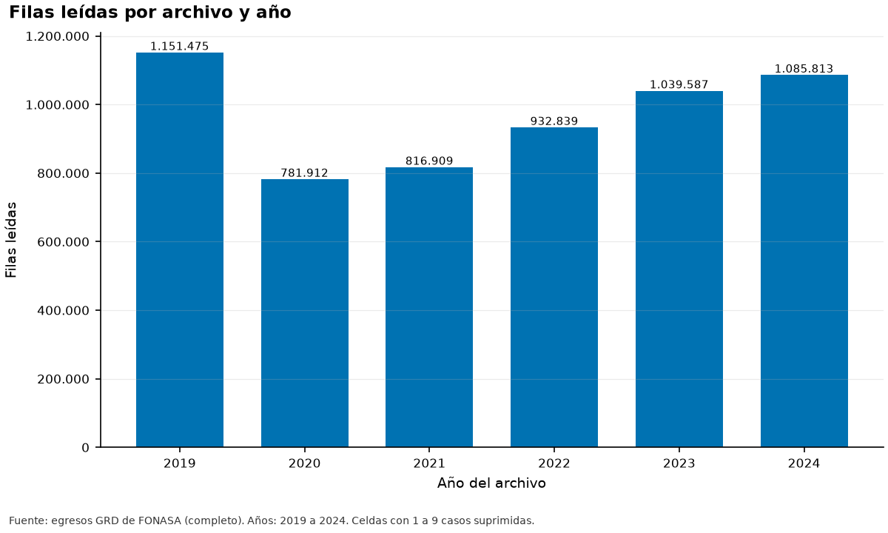
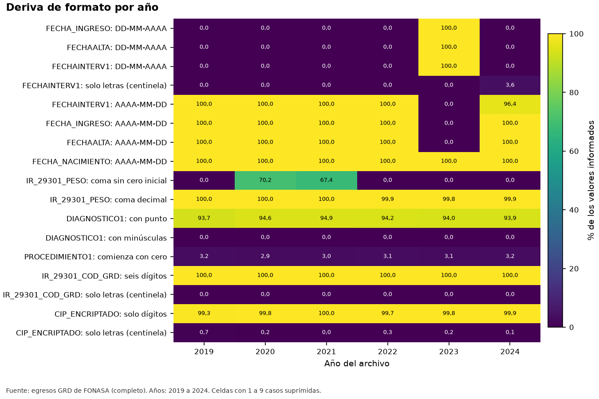

# Informe de recolección inicial de los datos (CRISP-DM 2.1)

**Fuente de los datos: completo.** Todas las cifras provienen de los archivos completos.

## 1. Qué se recolectó

Se recolectaron 6 archivos anuales de egresos hospitalarios de FONASA (2019 a 2024). Cada archivo se leyó completo como texto, por posición de columna, con 129 columnas por archivo. En total se leyeron 5.808.535 filas y se rechazaron 1; en cada archivo las filas leídas más las rechazadas suman las líneas de datos.

| Año | Archivo | Bytes | Líneas de datos | BOM | Fin de línea | Codificación | Filas leídas | Rechazadas |
|---|---|---|---|---|---|---|---|---|
| 2019 | GRD_PUBLICO_2019.txt | 572.538.020 | 1.151.475 | no | CRLF | UTF-8 válido | 1.151.475 | 0 |
| 2020 | GRD_PUBLICO_2020.txt | 397.026.707 | 781.912 | no | CRLF | UTF-8 válido | 781.912 | 0 |
| 2021 | GRD_PUBLICO_2021.txt | 428.657.825 | 816.909 | si | CRLF | UTF-8 válido | 816.909 | 0 |
| 2022 | GRD_PUBLICO_EXTERNO_2022.txt | 484.759.822 | 932.840 | si | CRLF | UTF-8 válido | 932.839 | 1 |
| 2023 | GRD_PUBLICO_2023.txt | 542.631.069 | 1.039.587 | si | CRLF | UTF-8 válido | 1.039.587 | 0 |
| 2024 | GRD_PUBLICO_2024.txt | 571.293.588 | 1.085.813 | no | CRLF | UTF-8 válido | 1.085.813 | 0 |

*Archivos anuales y cuadratura de lectura.* *Tabla completa en `tablas/t21_archivos.csv`*

*Figura F02_01. Filas leídas por archivo y año. Datos de origen: `tablas/t21_archivos.csv`.*

## 2. Deriva de esquema

Se comparó el nombre de cada una de las 129 columnas de cada año con el esquema canónico. Número total de diferencias de nombre: 1. La segunda columna (identificador del paciente) se llama ID_BENEFICIARIO en 2024 y CIP_ENCRIPTADO en el resto; el lector la trata por posición.

| Posición | Nombre canónico | Año | Nombre en el encabezado |
|---|---|---|---|
| 2 | CIP_ENCRIPTADO | 2024 | ID_BENEFICIARIO |

*Diferencias de nombre de columna respecto del esquema canónico.* *Tabla completa en `tablas/t21_esquema_diferencias.csv`*

## 3. Deriva de formato

Se midió, para columnas clave, la proporción de valores informados en cada formato. Las fechas de ingreso, alta e intervención vienen en AAAA-MM-DD salvo en 2023, donde vienen en DD-MM-AAAA; la fecha de nacimiento mantiene el formato ISO todos los años.

*Figura F03_01. Deriva de formato por año. Datos de origen: `tablas/t21_deriva_formato.csv`.*

## 4. Bitácora de problemas de carga

La bitácora lista los problemas de carga por año con su severidad y la acción aplicada. Los conteos de líneas del archivo no se consideran casos de pacientes; los conteos de valores sí se suprimen si tienen menos de diez casos.

| Año | Problema | Severidad | N | Detalle | Acción |
|---|---|---|---|---|---|
| 2019 | Texto (centinela) en columna de formato definido | media | 8.307 | CIP_ENCRIPTADO | Contar como faltante disfrazado |
| 2019 | Texto (centinela) en columna de formato definido | media | 21 | IR_29301_COD_GRD | Contar como faltante disfrazado |
| 2020 | Peso GRD con coma y sin cero inicial | baja | 548.775 | IR_29301_PESO | Convertir coma a punto y aceptar ,xxxx |
| 2020 | Texto (centinela) en columna de formato definido | media | 1.893 | CIP_ENCRIPTADO | Contar como faltante disfrazado |
| 2021 | BOM UTF-8 al inicio del archivo | baja | 1 | El primer nombre de columna llega con BOM si no se decodifica como utf-8-sig | El lector lo retira |
| 2021 | Peso GRD con coma y sin cero inicial | baja | 550.246 | IR_29301_PESO | Convertir coma a punto y aceptar ,xxxx |
| 2022 | BOM UTF-8 al inicio del archivo | baja | 1 | El primer nombre de columna llega con BOM si no se decodifica como utf-8-sig | El lector lo retira |
| 2022 | Líneas con número de campos distinto del esperado | alta | 1 | Se rechazan con su número de línea | Informar a FONASA |
| 2022 | Texto (centinela) en columna de formato definido | media | 2.949 | CIP_ENCRIPTADO | Contar como faltante disfrazado |
| 2022 | Texto (centinela) en columna de formato definido | media | 23 | IR_29301_COD_GRD | Contar como faltante disfrazado |
| 2023 | BOM UTF-8 al inicio del archivo | baja | 1 | El primer nombre de columna llega con BOM si no se decodifica como utf-8-sig | El lector lo retira |
| 2023 | Fechas en formato DD-MM-AAAA | media | 1.039.587 | Columna FECHAALTA | El lector de fechas acepta ISO y DD-MM-AAAA |
| 2023 | Fechas en formato DD-MM-AAAA | media | 528.813 | Columna FECHAINTERV1 | El lector de fechas acepta ISO y DD-MM-AAAA |
| 2023 | Fechas en formato DD-MM-AAAA | media | 166.839 | Columna FECHATRASLADO1 | El lector de fechas acepta ISO y DD-MM-AAAA |
| 2023 | Fechas en formato DD-MM-AAAA | media | 1.039.587 | Columna FECHA_INGRESO | El lector de fechas acepta ISO y DD-MM-AAAA |
| 2023 | Texto (centinela) en columna de formato definido | media | 1.635 | CIP_ENCRIPTADO | Contar como faltante disfrazado |
| 2023 | Texto (centinela) en columna de formato definido | media | 10 | FECHA_NACIMIENTO | Contar como faltante disfrazado |
| 2023 | Texto (centinela) en columna de formato definido | media | 30 | IR_29301_COD_GRD | Contar como faltante disfrazado |
| 2024 | Nombre alternativo de la segunda columna (identificador) | media | 1 | El encabezado dice ID_BENEFICIARIO en lugar de CIP_ENCRIPTADO | Alias por posición |
| 2024 | Texto (centinela) en columna de formato definido | media | 1.037 | CIP_ENCRIPTADO | Contar como faltante disfrazado |
| 2024 | Texto (centinela) en columna de formato definido | media | 19.669 | FECHAINTERV1 | Contar como faltante disfrazado |
| 2024 | Texto (centinela) en columna de formato definido | media | 52 | FECHA_INGRESO | Contar como faltante disfrazado |
| 2024 | Texto (centinela) en columna de formato definido | media | 15 | IR_29301_COD_GRD | Contar como faltante disfrazado |

*Problemas de carga detectados.* *Tabla completa en `tablas/t21_problemas_carga.csv`*

## 5. Verificaciones contra lo documentado

Cada fila contrasta un hecho de la carga con lo que decían los documentos de la Fase 2 o con lo observado en los extractos. Una discrepancia es un hallazgo, no un error de la suite.

| Id | Descripción | Esperado | Observado | Resultado |
|---|---|---|---|---|
| V01 | Todos los archivos tienen el mismo número de columnas | 129 | 129 | COINCIDE |
| V02 | Las filas leídas más las rechazadas suman las líneas de datos | si | si | COINCIDE |
| V04 | Años en que la segunda columna se llama ID_BENEFICIARIO | 2019 | 2024 | DISCREPA |
| V05 | Años con FECHA_INGRESO en DD-MM-AAAA | 2023 | 2023 | COINCIDE |
| V06 | FECHA_NACIMIENTO viene en formato ISO en todos los años | si | no | DISCREPA |
| V07 | Años con BOM | 2021;2022;2023 | 2021;2022;2023 | COINCIDE |
| V08 | Cobertura de años | 2019;2020;2021;2022;2023;2024 | 2019;2020;2021;2022;2023;2024 | COINCIDE |

*Verificaciones de la carga.* *Tabla completa en `tablas/t21_verificaciones.csv`*

## 6. Procedencia de los datos y de los documentos

| Elemento | Estado | Evidencia | Acción |
|---|---|---|---|
| Oficio FONASA 23364/2026 (respuesta a la solicitud AO004T0010901) | AUSENTE | no se encontró el archivo en la carpeta del proyecto | Agregar el oficio al expediente |
| Respuesta de FONASA por los microdatos de egresos 2019 a 2024 | AUSENTE | no hay en la carpeta un documento de respuesta que acompañe los archivos de egresos | Incorporar la respuesta (con su número de oficio y fecha) al expediente |
| Condiciones de uso y de publicación de resultados por hospital | NO DOCUMENTADAS | el oficio 23364 es un catálogo técnico, sin registros de pacientes, y no se pronuncia sobre publicación por hospital | Consultar por escrito a FONASA (Fase 1, sección 14.4); decisión 10 sigue abierta |
| Diccionario oficial de todas las versiones del agrupador | NO EXISTE SEGÚN EL OFICIO | el oficio advierte que identificar el CDM y el grupo base por la estructura del código no equivale a un diccionario oficial de las versiones históricas | Usar el catálogo GRDs_T10901.xlsx solo como referencia de códigos vigentes |
| Archivo de egresos 2019 | PRESENTE | GRD_PUBLICO_2019.txt; SHA-256 0737c1e13f7efee5; 1151475 líneas de datos | Conservar sin modificar (regla R4) |
| Archivo de egresos 2020 | PRESENTE | GRD_PUBLICO_2020.txt; SHA-256 890c2e2e02c48888; 781912 líneas de datos | Conservar sin modificar (regla R4) |
| Archivo de egresos 2021 | PRESENTE | GRD_PUBLICO_2021.txt; SHA-256 254c5a76fd6fb6f9; 816909 líneas de datos | Conservar sin modificar (regla R4) |
| Archivo de egresos 2022 | PRESENTE | GRD_PUBLICO_EXTERNO_2022.txt; SHA-256 600b7f529f0ae3d9; 932840 líneas de datos | Conservar sin modificar (regla R4) |
| Archivo de egresos 2023 | PRESENTE | GRD_PUBLICO_2023.txt; SHA-256 b217aa2b76f47bab; 1039587 líneas de datos | Conservar sin modificar (regla R4) |
| Archivo de egresos 2024 | PRESENTE | GRD_PUBLICO_2024.txt; SHA-256 0f1d8732f4c722d7; 1085813 líneas de datos | Conservar sin modificar (regla R4) |

*Hoja de procedencia.* *Tabla completa en `tablas/t21_procedencia.csv`*

## 7. Límites

- Los hashes SHA-256 completos están en `tablas/t21_archivos.csv` y en el manifiesto de la corrida.
- Falta la respuesta de FONASA por los microdatos y la confirmación de las condiciones de publicación por hospital.
- Los datos de 2024 se usan solo para estructura y calidad; las columnas de resultado de 2024 llegan enmascaradas.
