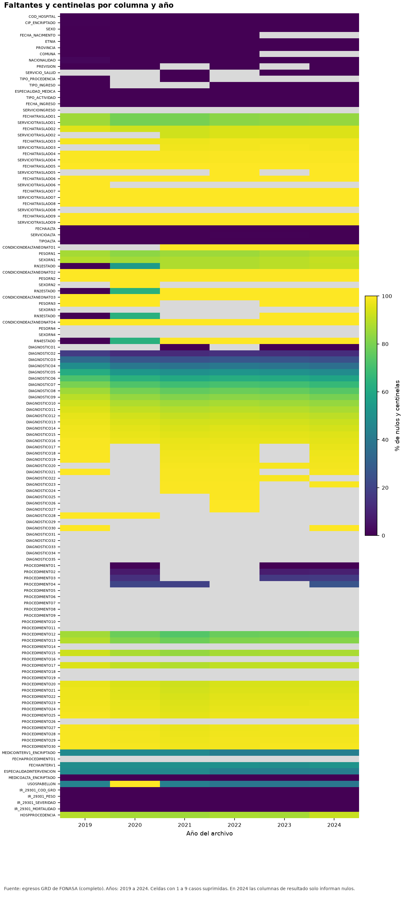
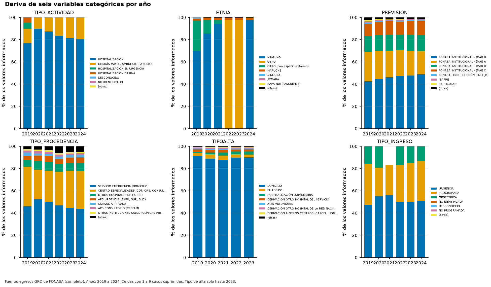
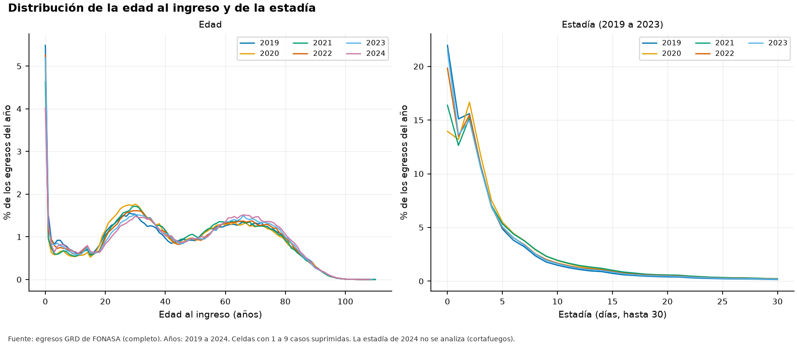

# Informe de descripción de los datos (CRISP-DM 2.2)

**Fuente de los datos: completo.** Todas las cifras provienen de los archivos completos.

## 1. Alcance y método

Se perfilaron las 129 columnas de los archivos anuales: nulos, valores centinela, cardinalidad con el estimador Chao1, tipo inferido, rangos robustos y patrones de caracteres. Los conteos con menos de diez casos se suprimen. Las columnas de resultado de 2024 se entregan enmascaradas y solo informan nulos y patrón.

## 2. Faltantes y valores centinela

2 columnas están vacías en todos los años y 86 columnas tienen valores centinela (por ejemplo DESCONOCIDO) que el diccionario no cuenta como faltantes.

*Figura F04_01. Faltantes y centinelas por columna y año. Datos de origen: `tablas/t22_perfil_columnas.csv`.*

## 3. Cardinalidad observada y estimada

En un extracto la cardinalidad observada subestima la de los datos completos; el estimador Chao1 corrige parte de ese sesgo si el muestreo fuera aleatorio, algo que los extractos no garantizan. La tabla compara con las cifras del diccionario.

| Columna | Período | Observado | Chao1 | Documentado |
|---|---|---|---|---|
| COD_HOSPITAL | 2019-2023 | 68 | 68 | n/d |
| COD_HOSPITAL | 2019-2024 | 72 | 72 | n/d |
| COMUNA | 2019-2023 | 347 | 347 | n/d |
| COMUNA | 2019-2024 | 347 | 347 | n/d |
| DIAGNOSTICO1 | 2019-2023 | 9.525 | 10.185 | 9.500 |
| DIAGNOSTICO1 | 2019-2024 | 9.712 | 10.400 | 9.500 |
| ESPECIALIDAD_MEDICA | 2019-2023 | 101 | 102 | 158 |
| ESPECIALIDAD_MEDICA | 2019-2024 | 104 | 104 | 158 |
| ETNIA | 2019-2023 | 15 | 15 | n/d |
| ETNIA | 2019-2024 | 15 | 15 | n/d |
| HOSPPROCEDENCIA | 2019-2023 | 536 | 568 | n/d |
| HOSPPROCEDENCIA | 2019-2024 | 542 | 574 | n/d |
| IR_29301_COD_GRD | 2019-2023 | 1.062 | 1.066 | n/d |
| IR_29301_COD_GRD | 2019-2024 | 1.064 | 1.068 | n/d |
| NACIONALIDAD | 2019-2023 | 208 | 251 | n/d |
| NACIONALIDAD | 2019-2024 | 218 | 261 | n/d |
| PREVISION | 2019-2023 | 15 | 15 | 19 |
| PREVISION | 2019-2024 | 15 | 15 | 19 |
| PROVINCIA | 2019-2023 | 58 | 58 | n/d |
| PROVINCIA | 2019-2024 | 58 | 58 | n/d |
| SERVICIOINGRESO | 2019-2023 | 91 | 92 | n/d |
| SERVICIOINGRESO | 2019-2024 | 93 | 93 | n/d |
| SERVICIO_SALUD | 2019-2023 | 32 | 32 | n/d |
| SERVICIO_SALUD | 2019-2024 | 32 | 32 | n/d |
| TIPOALTA | 2019-2023 | 12 | 12 | 18 |
| TIPO_ACTIVIDAD | 2019-2023 | 6 | 6 | n/d |
| TIPO_ACTIVIDAD | 2019-2024 | 6 | 6 | n/d |
| TIPO_INGRESO | 2019-2023 | 6 | 6 | n/d |
| TIPO_INGRESO | 2019-2024 | 6 | 6 | n/d |
| TIPO_PROCEDENCIA | 2019-2023 | 20 | 20 | 25 |
| TIPO_PROCEDENCIA | 2019-2024 | 20 | 20 | 25 |

*Cardinalidad acumulada por período.* *Tabla completa en `tablas/t22_cardinalidades.csv`*

## 4. Deriva de categorías

Las seis variables categóricas cambian entre años. El PSI máximo entre años consecutivos o contra el primer año fue 17,94; los valores de 0,10 o más indican cambio moderado y los de 0,25 o más, cambio grande.

*Figura F04_02. Deriva de seis variables categóricas por año. Datos de origen: `tablas/t22_deriva_categorias.csv`.*

| Columna | Año base | Año comparado | PSI | Clasificación | Categorías |
|---|---|---|---|---|---|
| ETNIA | 2.023 | 2.024 | 17,941 | alto | 11 |
| ETNIA | 2.021 | 2.022 | 17,816 | alto | 12 |
| ETNIA | 2.019 | 2.022 | 17,386 | alto | 15 |
| ETNIA | 2.019 | 2.023 | 17,382 | alto | 15 |
| ETNIA | 2.019 | 2.024 | 2,298 | alto | 14 |
| TIPO_ACTIVIDAD | 2.019 | 2.024 | 0,668 | alto | 6 |
| TIPO_ACTIVIDAD | 2.019 | 2.020 | 0,663 | alto | 6 |
| TIPO_ACTIVIDAD | 2.019 | 2.023 | 0,662 | alto | 6 |
| TIPO_ACTIVIDAD | 2.019 | 2.022 | 0,653 | alto | 6 |
| TIPO_ACTIVIDAD | 2.019 | 2.021 | 0,651 | alto | 6 |
| ETNIA | 2.019 | 2.021 | 0,609 | alto | 14 |
| TIPO_PROCEDENCIA | 2.021 | 2.022 | 0,241 | moderado | 18 |
| TIPO_PROCEDENCIA | 2.019 | 2.022 | 0,235 | moderado | 18 |
| ETNIA | 2.019 | 2.020 | 0,197 | moderado | 14 |
| TIPO_PROCEDENCIA | 2.019 | 2.023 | 0,159 | moderado | 18 |

*Mayores PSI entre años.* *Se muestran las primeras 15 de 52 filas. Tabla completa en `tablas/t22_psi.csv`*

## 5. Edad y estadía

*Figura F04_03. Distribución de la edad al ingreso y de la estadía. Datos de origen: `tablas/t22_hist_edad.csv`.*

## 6. Conciliación con el diccionario

La conciliación compara, columna por columna, los registros sin dato del diccionario con lo medido (exacta (datos completos)). Resultado: 0 columnas coinciden, 125 discrepan y 4 no son evaluables por tratarse de eventos raros. De las que discrepan, 0 difieren en 0,5 puntos porcentuales o más (magnitud relevante); en un extracto no aleatorio, las demás son diferencias despreciables aunque superen el umbral de z.

| Columna | % sin dato (diccionario) | % sin dato (medido) | Diferencia (pp) | z | Observación |
|---|---|---|---|---|---|

*Columnas con discrepancia relevante.* *Tabla completa en `tablas/t22_conciliacion.csv`*

## 7. Bloque de recién nacidos y pares de traslados

En RN2ESTADO, RN3ESTADO y RN4ESTADO, el valor más frecuente concentra al menos 99,4 % de los valores informados, lo que indica relleno constante más que información clínica.

| Columna | Informados | Distintos | Valor modal | N modal | Proporción modal |
|---|---|---|---|---|---|
| CONDICIONDEALTANEONATO1 | 128.946 | 2 | VIVO | 128.158 | 99,4 % |
| PESORN1 | 795.973 | 4.676 | 3300 | 4.478 | 0,6 % |
| SEXORN1 | 647.342 | 3 | HOMBRE | 328.464 | 50,7 % |
| RN1ESTADO | 1.919.691 | 13 | 0 | 1.273.078 | 66,3 % |
| CONDICIONDEALTANEONATO2 | 1.576 | 2 | VIVO | 1.534 | 97,3 % |
| PESORN2 | 8.596 | 1.374 | 2320 | 60 | 0,7 % |
| SEXORN2 | 8.591 | 3 | MUJER | 4.314 | 50,2 % |
| RN2ESTADO | 1.444.072 | 12 | 0 | 1.435.674 | 99,4 % |
| CONDICIONDEALTANEONATO3 | 0 | 0 | n/d | 0 | n/d |
| PESORN3 | 75 | 69 | 3400 | <10 | n/d |
| SEXORN3 | 75 | 3 | MUJER | 38 | 50,7 % |
| RN3ESTADO | 1.437.610 | 8 | 0 | 1.437.540 | 100,0 % |
| CONDICIONDEALTANEONATO4 | 0 | 0 | n/d | 0 | n/d |
| PESORN4 | <10 | 1 | 780 | <10 | n/d |
| SEXORN4 | <10 | 2 | MUJER | <10 | n/d |
| RN4ESTADO | 1.437.552 | 2 | 0 | <10 | n/d |

*Bloque de recién nacidos.* *Tabla completa en `tablas/t22_bloque_rn.csv`*

| Traslado | Con fecha | Con servicio | Solo fecha | Solo servicio | Diferencia |
|---|---|---|---|---|---|
| 1 | 1.001.017 | 1.001.016 | 17 | 16 | -1 |
| 2 | <10 | 333.372 | <10 | <10 | n/d |
| 3 | <10 | 103.621 | <10 | <10 | n/d |
| 4 | <10 | 37.348 | <10 | <10 | n/d |
| 5 | <10 | 13.751 | <10 | <10 | n/d |
| 6 | 6.200 | 6.200 | 0 | 0 | 0 |
| 7 | 3.073 | 3.073 | 0 | 0 | 0 |
| 8 | 1.693 | 1.693 | 0 | 0 | 0 |
| 9 | 973 | 973 | 0 | 0 | 0 |

*Pares fecha-servicio de traslados internos.* *Tabla completa en `tablas/t22_pares_traslado.csv`*

## 8. Etiquetas truncadas

Se detectaron 4 etiquetas categóricas que parecen cortadas por un límite de largo (paréntesis sin cerrar). Una unión exacta con los roles de tipo de alta pierde esos casos.

| Columna | Etiqueta | Largo | N |
|---|---|---|---|
| TIPOALTA | DERIVACIÓN A OTROS CENTROS (CÁRCEL, HOGAR DE | 44 | 18.296 |
| TIPOALTA | DERIVACIÓN INST. PRIVADA (COMPRA DE SERVICIOS | 45 | 15.788 |
| TIPO_PROCEDENCIA | OTRAS INSTITUCIONES (CÁRCEL, HOGARES DE ANCIANOS, SENAME, EC | 60 | 28.499 |
| TIPO_PROCEDENCIA | OTRAS INSTITUCIONES SALUD (CLÍNICAS PRIVADAS, DE REHABILITAC | 60 | 73.282 |

*Etiquetas que parecen cortadas.* *Tabla completa en `tablas/t22_etiquetas_truncadas.csv`*

## 9. Límites

- Los extractos no son una muestra aleatoria simple: las comparaciones de proporciones son indicativas.
- Los intervalos ignoran el agrupamiento por paciente y por hospital.
- La estadía de 2024 no se analiza por el cortafuegos.
