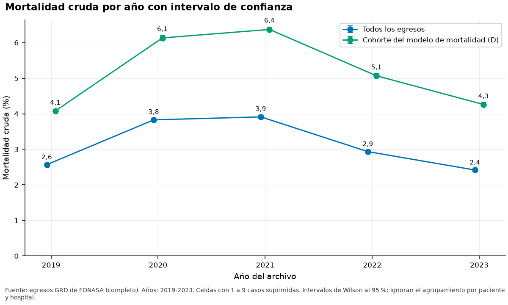
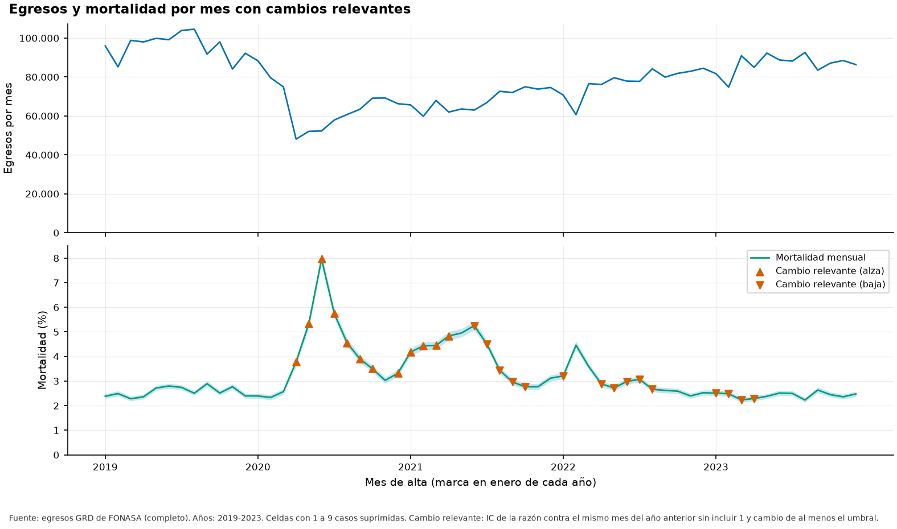
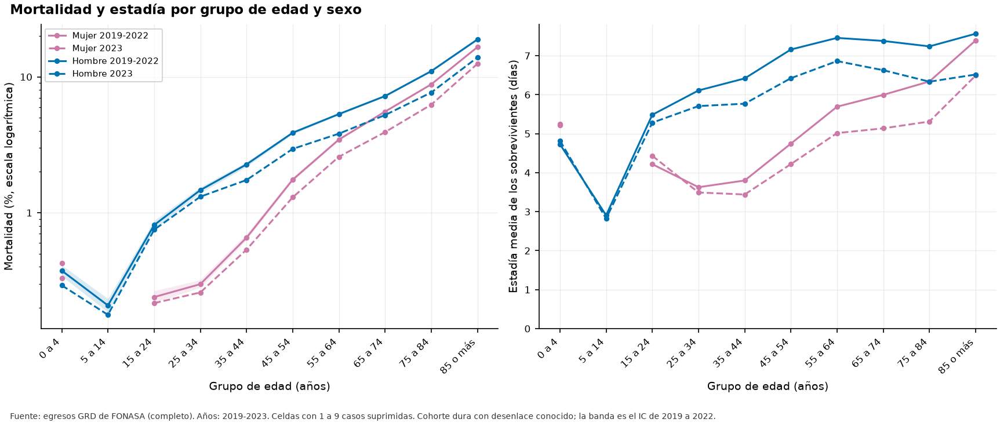
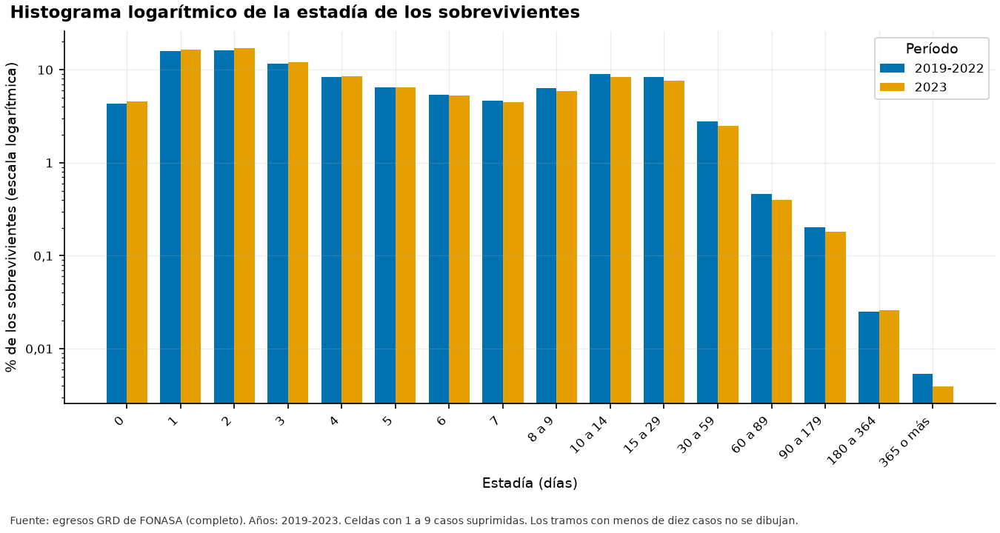
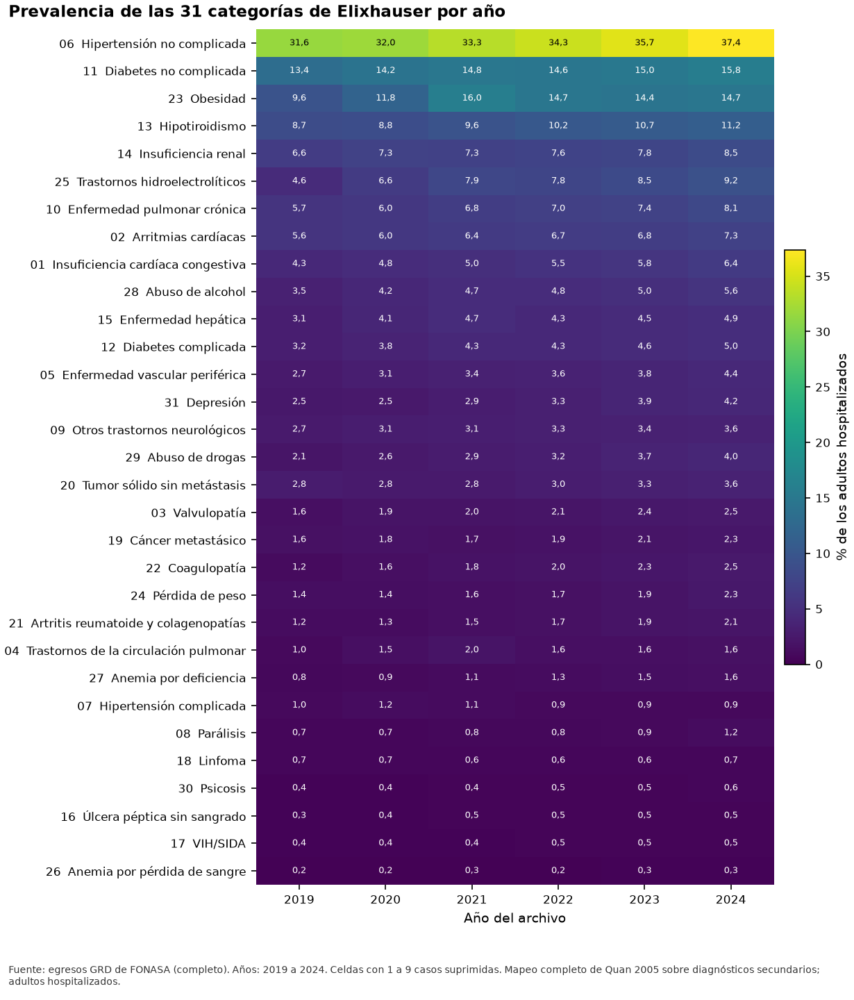
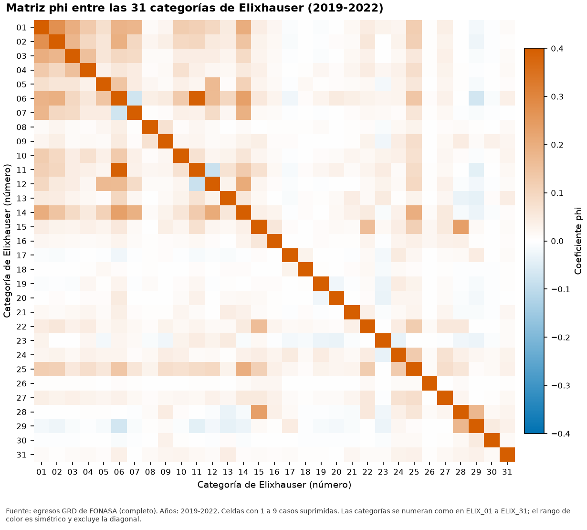
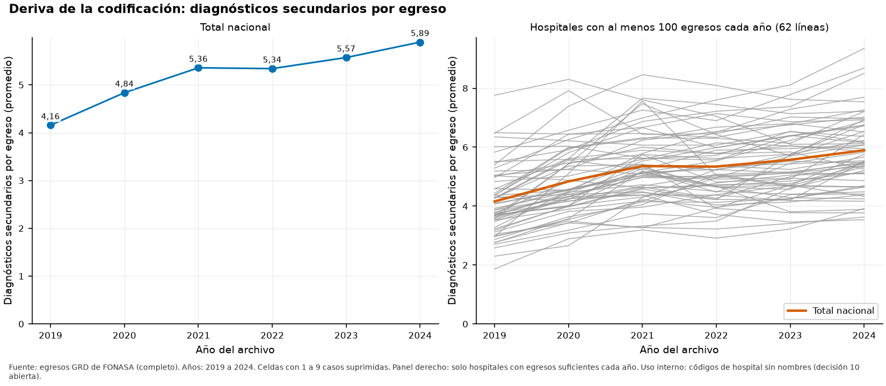
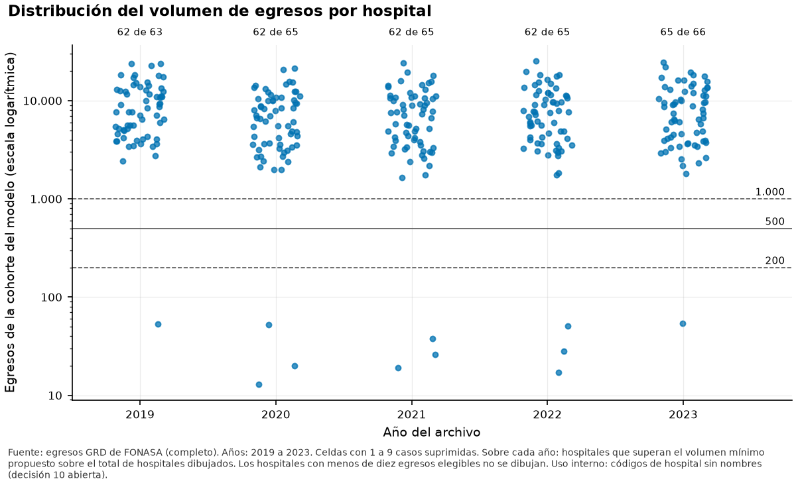
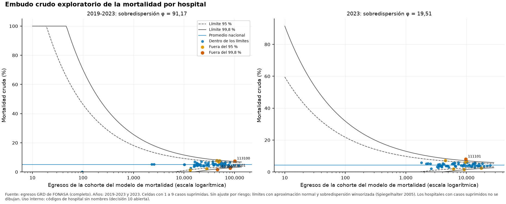
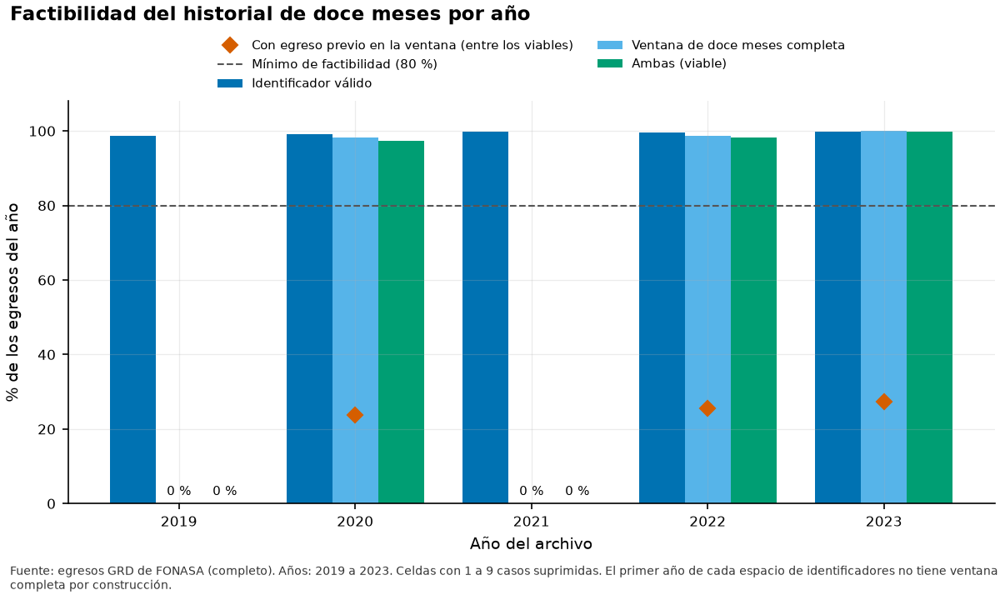

# Informe de exploración de los datos (CRISP-DM 2.3)

**Fuente de los datos: completo.** Todas las cifras provienen de los archivos completos.

Este informe reúne la exploración de los datos: la cohorte, el resultado y la estadía (Tarea 7), la comorbilidad (Tarea 8) y los hospitales (Tarea 9).

## 1. Cohorte y cascada de exclusiones

La cascada resta, en orden, los egresos que quedan fuera de cada variante de cohorte. Cada paso excluye solo lo que queda del anterior, así que la cohorte final y las exclusiones suman el total en cada año. Los pasos EX01 a EX03 no miran el desenlace: la cohorte dura A no depende de quién falleció. Entre 2019 y 2023 se midieron 4.722.722 egresos.

*Figura F07_01. Cascada de exclusiones y variantes de cohorte (2019-2023). Datos de origen: `tablas/t23_cascada.csv`.*

| Paso | Descripción | Egresos | % del total | Usa el desenlace |
|---|---|---|---|---|
| TOTAL | Egresos leídos | 4.722.722 | 100,00 % | no |
| EX01 | GRD no agrupable: sin código, centinela, formato inválido o MDC 99 | 3.583 | 0,08 % | no |
| EX02 | Recién nacidos (MDC 15) | 124.604 | 2,64 % | no |
| EX03 | Obstétricos sin comorbilidades (MDC 14 sin categorías de Elixhauser) | 372.932 | 7,90 % | no |
| A | Variante A: cohorte dura | 4.221.603 | 89,39 % | no |
| EX04 | Menores de 18 años o con edad desconocida | 675.590 | 14,31 % | no |
| B | Variante B: adultos | 3.546.013 | 75,08 % | no |
| EX05 | Actividad distinta de hospitalización | 684.599 | 14,50 % | no |
| C | Variante C: adultos hospitalizados | 2.861.414 | 60,59 % | no |
| EX06 | Censurados por tipo de alta o sin dato de desenlace | 221.353 | 4,69 % | si |
| D | Variante D: cohorte del modelo de mortalidad | 2.640.061 | 55,90 % | si |
| EX07 | Fallecidos (salen del modelo de estadía) | 134.857 | 2,86 % | si |
| EX08 | Sobrevivientes con estadía de 0 días o desconocida | 108.848 | 2,30 % | si |
| E | Variante E: cohorte del modelo de estadía | 2.396.356 | 50,74 % | si |

*Cascada de 2019 a 2023.* *Tabla completa en `tablas/t23_cascada.csv`*

Los GRD no agrupables (EX01) suman 3.583 egresos (0,08 %); los recién nacidos (EX02), 124.604 (2,6 %); y los obstétricos sin comorbilidades (EX03), 372.932 (7,9 %). La cohorte dura A queda con 4.221.603 egresos (89,4 %). Los menores de 18 años o con edad desconocida suman 675.590, la actividad distinta de hospitalización 684.599 y los censurados por tipo de alta 221.353.

Las exclusiones que dependen del desenlace (EX06 a EX08) solo existen para 2019 a 2023, y el año expuesto 2024 aporta únicamente los pasos que no lo usan. El intento de leer el desenlace de 2024 fue rechazado por el cortafuegos y quedó en el registro de accesos.

## 2. Prevalencia de la mortalidad por variante de cohorte

La decisión 5 limita la población a adultos y la decisión 15 a la actividad de hospitalización. La prevalencia se informa de dos formas: sobre todos los egresos de la variante y sobre los egresos con desenlace conocido (fallecidos más sobrevivientes, sin censurados). Al pasar de A a B la prevalencia con desenlace conocido cambia de 3,58 % a 4,22 %, y llega a 5,11 % en la variante C. En 2023 la variante C tiene 3,89 % sobre todos sus egresos y 4,26 % con desenlace conocido.

| Período | Variante | Egresos | Fallecidos | Censurados | Prevalencia (todos) | Prevalencia (conocido) | IC bajo | IC alto | Cambio (pp) |
|---|---|---|---|---|---|---|---|---|---|
| 2019-2023 | A | 4.221.603 | 141.429 | 265.787 | 3,35 % | 3,58 % | 3,56 % | 3,59 % | n/d |
| 2019-2023 | B | 3.546.013 | 139.499 | 240.412 | 3,93 % | 4,22 % | 4,20 % | 4,24 % | 0,64 |
| 2019-2023 | C | 2.861.414 | 134.857 | 221.353 | 4,71 % | 5,11 % | 5,08 % | 5,13 % | 0,89 |
| 2019-2023 | D | 2.640.061 | 134.857 | 0 | 5,11 % | 5,11 % | 5,08 % | 5,13 % | 0,00 |
| 2019-2023 | E | 2.396.356 | 0 | 0 | n/d | n/d | n/d | n/d | n/d |
| 2023 | A | 948.573 | 24.624 | 62.218 | 2,60 % | 2,78 % | 2,74 % | 2,81 % | n/d |
| 2023 | B | 791.069 | <10 | <10 | n/d | n/d | n/d | n/d | n/d |
| 2023 | C | 623.137 | 24.235 | 54.400 | 3,89 % | 4,26 % | 4,21 % | 4,31 % | 0,97 |
| 2023 | D | 568.737 | 24.235 | 0 | 4,26 % | 4,26 % | 4,21 % | 4,31 % | 0,00 |
| 2023 | E | 519.833 | 0 | 0 | n/d | n/d | n/d | n/d | n/d |

*Variantes de cohorte; intervalos de Wilson indicativos.* *Tabla completa en `tablas/t23_cascada_variantes.csv`*

La definición del pipeline se reproduce de forma aproximada (mapeo de comorbilidades de tres caracteres y exclusión de obstétricos solo si sobreviven), porque el código original no está en el repositorio revisado. Su cascada se compara con las cifras documentadas en el cierre.

| Paso | Descripción | Egresos | % del total |
|---|---|---|---|
| TOTAL | Egresos leídos | 4.722.722 | 100,00 % |
| EX01 | GRD no agrupable | 3.583 | 0,08 % |
| EX02 | Recién nacidos (MDC 15) | 124.604 | 2,64 % |
| EX03_SIN_DESENLACE | MDC 14 sin comorbilidades con mapeo de tres caracteres, sin mirar el desenlace (cota superior de EX03) | 377.712 | 8,00 % |
| AMBULATORIA | Actividad distinta de hospitalización (se solapa con las demás) | 795.727 | 16,85 % |
| EX03_PIPELINE | Obstétricos sin comorbilidades, solo sobrevivientes (mapeo de tres caracteres) | 375.607 | 7,95 % |
| COHORTE_DURA_PIPELINE | Cohorte dura con la definición del pipeline | 4.218.928 | 89,33 % |
| ESTANCIA_CERO | Estadía de 0 días (se solapa con las demás) | 904.416 | 19,15 % |
| FALLECIDOS | Fallecidos (se solapan con las demás) | 144.009 | 3,05 % |
| CENSURADOS | Censurados por tipo de alta | 277.524 | 5,88 % |
| COHORTE_ESTANCIA_PIPELINE | Cohorte dura del pipeline sin estadía de 0 días, actividad ambulatoria ni fallecidos | 3.105.441 | 65,76 % |
| COHORTE_ESTANCIA_PIPELINE_SIN_CENSURADOS | Lectura alternativa: la cohorte anterior sin censurados | 2.873.972 | 60,85 % |

*Cascada con la definición aproximada del pipeline.* *Tabla completa en `tablas/t23_cascada_pipeline.csv`*

## 3. Desenlace: tipo de alta y mortalidad

El rol de cada tipo de alta viene de la decisión de la Fase 1 (archivo de roles): los fallecidos son el evento, el alta a domicilio, la voluntaria y la fuga son no evento, y los traslados y la hospitalización domiciliaria son censurados. Las etiquetas cortadas se asignan por prefijo.

| Tipo de alta | Rol | Egresos | % del total |
|---|---|---|---|
| DOMICILIO | NO_EVENTO | 4.237.698 | 89,73 % |
| FALLECIDO | EVENTO | 144.009 | 3,05 % |
| HOSPITALIZACIÓN DOMICILIARIA | CENSURADO | 102.168 | 2,16 % |
| DERIVACIÓN OTRO HOSPITAL DEL SERVICIO | CENSURADO | 98.362 | 2,08 % |
| ALTA VOLUNTARIA | NO_EVENTO | 47.630 | 1,01 % |
| DERIVACIÓN OTRO HOSPITAL DE LA RED NACIONAL | CENSURADO | 36.491 | 0,77 % |
| DERIVACIÓN A OTROS CENTROS (CÁRCEL, HOGAR) | CENSURADO | 18.296 | 0,39 % |
| FUGA DEL PACIENTE | NO_EVENTO | 15.861 | 0,34 % |
| DERIVACIÓN INST. PRIVADA (COMPRA DE SERVICIOS) | CENSURADO | 15.788 | 0,33 % |
| DERIVACIÓN INST. PRIVADA (VOLUNTARIO) | CENSURADO | 6.317 | 0,13 % |
| NO IDENTIFICADA | CENSURADO | 80 | 0,00 % |
| DESCONOCIDO | CENSURADO | 22 | 0,00 % |

*Tipo de alta de 2019 a 2023.* *Tabla completa en `tablas/t23_tipoalta.csv`*

La mortalidad cruda sobre todos los egresos fue 2,57 % en 2019, 3,83 % en 2020, 3,91 % en 2021, 2,94 % en 2022, 2,42 % en 2023. La mortalidad agrupada de 2020-2022 es 1,37 veces la de 2019 (IC 1,35 a 1,39), evidencia para la decisión 17. Un año se marca como alza o baja cuando el intervalo de la razón contra el año previo excluye la igualdad y el cambio relativo alcanza 20,0 %.

*Figura F07_02. Mortalidad cruda por año con intervalo de confianza. Datos de origen: `tablas/t23_resultado_anio.csv`.*

| Año | Base | Egresos | Fallecidos | Mortalidad | IC bajo | IC alto | Razón vs año previo | Cambio anual |
|---|---|---|---|---|---|---|---|---|
| 2019 | todos | 1.151.475 | 29.587 | 2,57 % | 2,54 % | 2,60 % | n/d | n/d |
| 2019 | D | 585.631 | 23.896 | 4,08 % | 4,03 % | 4,13 % | n/d | n/d |
| 2020 | todos | 781.912 | 29.942 | 3,83 % | 3,79 % | 3,87 % | 1,49 | alza |
| 2020 | D | 474.341 | 29.093 | 6,13 % | 6,07 % | 6,20 % | 1,50 | alza |
| 2021 | todos | 816.909 | 31.965 | 3,91 % | 3,87 % | 3,96 % | 1,02 | no |
| 2021 | D | 488.799 | 31.145 | 6,37 % | 6,30 % | 6,44 % | 1,04 | no |
| 2022 | todos | 932.839 | 27.379 | 2,94 % | 2,90 % | 2,97 % | 0,75 | baja |
| 2022 | D | 522.553 | 26.488 | 5,07 % | 5,01 % | 5,13 % | 0,80 | baja |
| 2023 | todos | 1.039.587 | 25.136 | 2,42 % | 2,39 % | 2,45 % | 0,82 | no |
| 2023 | D | 568.737 | 24.235 | 4,26 % | 4,21 % | 4,31 % | 0,84 | no |

*Mortalidad cruda por año; base D es la cohorte del modelo de mortalidad.* *Tabla completa en `tablas/t23_resultado_anio.csv`*

La serie mensual compara cada mes con el mismo mes del año anterior, lo que controla la estacionalidad. De los 48 meses con referencia, 12 muestran un alza relevante y 15 una baja relevante. Los intervalos no se ajustan por comparaciones múltiples y son indicativos.

*Figura F07_04. Egresos y mortalidad por mes con cambios relevantes. Datos de origen: `tablas/t23_serie_mensual.csv`.*

La mortalidad y la estadía también cambian con la edad y el sexo, y la cohorte dura incluye a los menores hasta que la decisión 5 los saque.

*Figura F07_05. Mortalidad y estadía por grupo de edad y sexo. Datos de origen: `tablas/t23_resultado_edad_sexo.csv`.*

## 4. Estadía de los sobrevivientes

En 2019 a 2022 la estadía de los sobrevivientes de la variante E tiene mediana 4 días, media 7,5 y varianza 154,3. El índice de dispersión (varianza sobre media) es 20,6; un valor mayor que uno indica sobredispersión frente a la distribución de Poisson, evidencia para elegir entre Poisson y Tweedie en la decisión 9. En 2023 el índice es 17,5.

*Figura F07_03. Histograma logarítmico de la estadía de los sobrevivientes. Datos de origen: `tablas/t23_estancia_hist.csv`.*

| Período | Sobrevivientes | Media | Varianza | Índice de dispersión | Mediana | p90 | p99 | Máximo |
|---|---|---|---|---|---|---|---|---|
| 2019 | 538.814 | 7,2 | 150,1 | 20,9 | 4 | 16 | 51 | 2.211 |
| 2020 | 426.076 | 7,6 | 142,7 | 18,9 | 4 | 17 | 52 | 1.066 |
| 2021 | 437.842 | 7,8 | 170,0 | 21,7 | 4 | 17 | 54 | 3.146 |
| 2022 | 473.791 | 7,4 | 154,5 | 20,8 | 4 | 17 | 53 | 1.685 |
| 2023 | 519.833 | 7,1 | 123,7 | 17,5 | 4 | 16 | 50 | 696 |
| 2019-2022 | 1.876.523 | 7,5 | 154,3 | 20,6 | 4 | 17 | 53 | 3.146 |
| 2019-2023 | 2.396.356 | 7,4 | 147,7 | 20,0 | 4 | 16 | 52 | 3.146 |

*Estadía en días de los sobrevivientes de la variante E.* *Tabla completa en `tablas/t23_estancia_dispersion.csv`*

La decisión 7 se evalúa con 2019 a 2022 y se confirma con 2023. El corte más bajo que afecta a no más de 1,0 % de los sobrevivientes es la regla p99, con 53 días: afectaría a 0,96 % de los sobrevivientes de 2019 a 2022 y a 0,85 % de los de 2023. El máximo observado en 2019 a 2022 fue de 3.146 días.

| Regla | Corte (días) | Afectados 2019-2022 | % 2019-2022 | Cumple | Afectados 2023 | % 2023 | Cumple 2023 | Propuesta |
|---|---|---|---|---|---|---|---|---|
| p99 | 53 | 17.995 | 0,96 % | si | 4.442 | 0,85 % | si | si |
| p99,5 | 68 | 9.356 | 0,50 % | si | 2.278 | 0,44 % | si | no |
| p99,9 | 121 | 1.835 | 0,10 % | si | 472 | 0,09 % | si | no |
| 365 días | 365 | 104 | 0,01 % | si | 21 | 0,00 % | si | no |

*Reglas de corte de estadías largas, base E.* *Tabla completa en `tablas/t23_cola_estancia.csv`*

## 5. Estadía cero y actividad ambulatoria

De los 904.416 egresos con estadía cero en 2019 a 2023, 78,0 % son de actividad ambulatoria, 1,26 % fallecieron el mismo día y 2,92 % son censurados. Entre los 795.727 egresos de actividad ambulatoria, 88,7 % tienen estadía cero. Entre los egresos con estadía cero y desenlace conocido, la mortalidad es 1,29 %.

| Actividad | Desenlace | Egresos | Con estadía de 0 días |
|---|---|---|---|
| CIRUGÍA MAYOR AMBULATORIA (CMA) | CENSURADO | <10 | <10 |
| CIRUGÍA MAYOR AMBULATORIA (CMA) | EVENTO | <10 | <10 |
| CIRUGÍA MAYOR AMBULATORIA (CMA) | NO_EVENTO | 675.181 | 631.141 |
| DESCONOCIDO | CENSURADO | <10 | 0 |
| HOSPITALIZACIÓN | CENSURADO | 256.821 | 17.544 |
| HOSPITALIZACIÓN | EVENTO | 139.326 | 9.527 |
| HOSPITALIZACIÓN | NO_EVENTO | 3.530.848 | 171.585 |
| HOSPITALIZACIÓN DIURNA | CENSURADO | <10 | <10 |
| HOSPITALIZACIÓN DIURNA | EVENTO | <10 | <10 |
| HOSPITALIZACIÓN DIURNA | NO_EVENTO | 53.865 | 53.081 |
| HOSPITALIZACIÓN EN URGENCIA | CENSURADO | 16.648 | 5.292 |
| HOSPITALIZACIÓN EN URGENCIA | EVENTO | <10 | 1.777 |
| HOSPITALIZACIÓN EN URGENCIA | NO_EVENTO | <10 | 10.860 |
| NO IDENTIFICADO | NO_EVENTO | <10 | 0 |

*Estadías cero por actividad y desenlace, 2019 a 2023.* *Tabla completa en `tablas/t23_estancia_cero.csv`*

Para la decisión 15 se compara la mortalidad de cada estrato con la del resto en adultos de la cohorte dura con desenlace conocido. Si la razón es menor que 0,25, el estrato diluye el cociente observado sobre esperado y se propone sacarlo del modelo de mortalidad. La decisión final es humana.

| Período | Variable | Estrato | Egresos | Fallecidos | Mortalidad | Razón vs resto | IC bajo | IC alto | Bajo el umbral |
|---|---|---|---|---|---|---|---|---|---|

*Estratos de la decisión 15.* *Tabla completa en `tablas/t23_resultado_estratos.csv`*

## 6. Límites

- Los intervalos de confianza ignoran el agrupamiento por paciente y por hospital.
- La cascada del pipeline es una reproducción aproximada de su definición.
- El desenlace y la fecha de alta de 2024 no se leen: el cortafuegos lo impide y deja registro del intento.

## 7. Prevalencia de las categorías de Elixhauser

Las 31 categorías se calculan con el mapeo de Quan et al., contrastado con una segunda fuente pública, sobre los diagnósticos secundarios (regla R3) y con las jerarquías habituales: la hipertensión complicada anula a la no complicada, la diabetes complicada a la no complicada y el cáncer metastásico al tumor sólido. La base son los adultos hospitalizados. Considerando todos los años, la categoría más frecuente es Hipertensión no complicada (34,1 %), seguida de Diabetes no complicada (14,6 %) y Obesidad (13,5 %).

*Figura F08_01. Prevalencia de las 31 categorías de Elixhauser por año. Datos de origen: `tablas/t23_elix_prevalencia.csv`.*

| Rango | Categoría | Nombre | Egresos | Prevalencia | IC bajo | IC alto |
|---|---|---|---|---|---|---|
| 1 | ELIX_06 | Hipertensión no complicada | 1.346.439 | 34,1 % | 34,1 % | 34,2 % |
| 2 | ELIX_11 | Diabetes no complicada | 577.403 | 14,6 % | 14,6 % | 14,7 % |
| 3 | ELIX_23 | Obesidad | 532.339 | 13,5 % | 13,5 % | 13,5 % |
| 4 | ELIX_13 | Hipotiroidismo | 390.896 | 9,9 % | 9,9 % | 9,9 % |
| 5 | ELIX_14 | Insuficiencia renal | 297.620 | 7,5 % | 7,5 % | 7,6 % |
| 6 | ELIX_25 | Trastornos hidroelectrolíticos | 293.255 | 7,4 % | 7,4 % | 7,5 % |
| 7 | ELIX_10 | Enfermedad pulmonar crónica | 270.725 | 6,9 % | 6,8 % | 6,9 % |
| 8 | ELIX_02 | Arritmias cardíacas | 255.450 | 6,5 % | 6,5 % | 6,5 % |
| 9 | ELIX_01 | Insuficiencia cardíaca congestiva | 209.696 | 5,3 % | 5,3 % | 5,3 % |
| 10 | ELIX_28 | Abuso de alcohol | 182.470 | 4,6 % | 4,6 % | 4,6 % |
| 11 | ELIX_15 | Enfermedad hepática | 168.109 | 4,3 % | 4,2 % | 4,3 % |
| 12 | ELIX_12 | Diabetes complicada | 165.429 | 4,2 % | 4,2 % | 4,2 % |

*Las doce categorías más frecuentes, todos los años.* *Tabla completa en `tablas/t23_elix_prevalencia.csv`*

## 8. Mapeo completo frente al de tres caracteres

El mapeo del repositorio compara solo tres caracteres del código, así que no reconoce las categorías que Quan define con cuatro. La diabetes no complicada pasa de 14,6 % con el mapeo completo a 0,0 % con tres caracteres, y la complicada de 4,2 % a 0,0 %. De las 31 categorías, 11 difieren en más de 20,0 % de su prevalencia relativa; el supuesto S02 se rechaza: el mapeo de tres caracteres no equivale al completo.

| Categoría | Nombre | Largos de prefijo | Prevalencia completa | Prevalencia con 3 caracteres | Diferencia relativa |
|---|---|---|---|---|---|
| ELIX_11 | Diabetes no complicada | 4 | 14,64 % | 0,00 % | -100,0 % |
| ELIX_12 | Diabetes complicada | 4 | 4,19 % | 0,00 % | -100,0 % |
| ELIX_16 | Úlcera péptica sin sangrado | 4 | 0,45 % | 0,00 % | -100,0 % |
| ELIX_26 | Anemia por pérdida de sangre | 4 | 0,27 % | 0,00 % | -100,0 % |
| ELIX_27 | Anemia por deficiencia | 3 y 4 | 1,20 % | 0,27 % | -77,5 % |
| ELIX_22 | Coagulopatía | 3 y 4 | 1,90 % | 0,74 % | -61,0 % |
| ELIX_05 | Enfermedad vascular periférica | 3 y 4 | 3,51 % | 1,51 % | -56,9 % |
| ELIX_15 | Enfermedad hepática | 3 y 4 | 4,26 % | 2,16 % | -49,4 % |
| ELIX_28 | Abuso de alcohol | 3 y 4 | 4,63 % | 3,35 % | -27,6 % |
| ELIX_18 | Linfoma | 3 y 4 | 0,66 % | 0,50 % | -24,1 % |
| ELIX_02 | Arritmias cardíacas | 3 y 4 | 6,48 % | 5,02 % | -22,5 % |

*Categorías que superan el umbral de diferencia relativa.* *Tabla completa en `tablas/t23_elix_vs_3c.csv`*

## 9. Diagnóstico principal y regla R3

La regla R3 calcula las categorías solo con diagnósticos secundarios, porque el diagnóstico principal es el motivo del ingreso y no una comorbilidad previa. Si se incluyera, la categoría con mayor aumento sería Tumor sólido sin metástasis, que pasaría de 3,1 % a 6,4 % de los adultos hospitalizados (109,4 % más).

| Categoría | Nombre | Con la categoría (secundarios) | Con la categoría (principal) | Prevalencia (secundarios) | Prevalencia (con principal) | Aumento relativo |
|---|---|---|---|---|---|---|
| ELIX_20 | Tumor sólido sin metástasis | 120.878 | 179.810 | 3,06 % | 6,42 % | 109,4 % |
| ELIX_30 | Psicosis | 18.890 | 18.080 | 0,48 % | 0,87 % | 81,8 % |
| ELIX_18 | Linfoma | 26.174 | 13.280 | 0,66 % | 0,99 % | 49,2 % |
| ELIX_12 | Diabetes complicada | 165.429 | 52.469 | 4,19 % | 5,36 % | 27,7 % |
| ELIX_04 | Trastornos de la circulación pulmonar | 60.396 | 17.620 | 1,53 % | 1,94 % | 26,4 % |
| ELIX_17 | VIH/SIDA | 17.534 | 7.089 | 0,44 % | 0,56 % | 25,5 % |
| ELIX_01 | Insuficiencia cardíaca congestiva | 209.696 | 63.577 | 5,32 % | 6,66 % | 25,3 % |
| ELIX_07 | Hipertensión complicada | 39.797 | 6.882 | 1,01 % | 1,18 % | 16,8 % |

*Las categorías que más cambiarían al incluir el diagnóstico principal.* *Tabla completa en `tablas/t23_elix_principal.csv`*

## 10. Asociación entre categorías

El mayor coeficiente phi entre dos categorías distintas en 2019-2022 es 0,39, entre ELIX_06 y ELIX_11. 0 de 462 pares con casos suficientes alcanzan el umbral de redundancia de 0,80; las categorías de Elixhauser se mantienen como indicadores separados y la agrupación formal de variables redundantes se hace en la selección de variables.

*Figura F08_03. Matriz phi entre las 31 categorías de Elixhauser (2019-2022). Datos de origen: `tablas/t23_elix_phi.csv`.*

| Categoría A | Nombre A | Categoría B | Nombre B | Egresos con ambas | Phi |
|---|---|---|---|---|---|
| ELIX_06 | Hipertensión no complicada | ELIX_11 | Diabetes no complicada | 281.128 | 0,39 |
| ELIX_01 | Insuficiencia cardíaca congestiva | ELIX_02 | Arritmias cardíacas | 43.869 | 0,27 |
| ELIX_15 | Enfermedad hepática | ELIX_28 | Abuso de alcohol | 28.135 | 0,24 |
| ELIX_06 | Hipertensión no complicada | ELIX_14 | Insuficiencia renal | 131.083 | 0,23 |
| ELIX_12 | Diabetes complicada | ELIX_14 | Insuficiencia renal | 33.181 | 0,21 |
| ELIX_01 | Insuficiencia cardíaca congestiva | ELIX_14 | Insuficiencia renal | 37.467 | 0,20 |
| ELIX_14 | Insuficiencia renal | ELIX_25 | Trastornos hidroelectrolíticos | 44.491 | 0,20 |
| ELIX_01 | Insuficiencia cardíaca congestiva | ELIX_03 | Valvulopatía | 17.062 | 0,20 |
| ELIX_02 | Arritmias cardíacas | ELIX_06 | Hipertensión no complicada | 107.283 | 0,20 |
| ELIX_07 | Hipertensión complicada | ELIX_14 | Insuficiencia renal | 14.749 | 0,19 |

*Los diez pares con mayor asociación.* *Tabla completa en `tablas/t23_elix_phi.csv`*

## 11. Deriva de la codificación

El promedio de diagnósticos secundarios por egreso de adultos hospitalizados pasa de 4,16 en 2019 a 5,89 en 2024, un cambio relativo de 41,8 % (IC 41,4 % a 42,2 %). Si la codificación crece sin que cambien los pacientes, el puntaje de comorbilidad sube y un modelo entrenado en los años antiguos subestima el riesgo de los nuevos; es evidencia para la decisión 17.

*Figura F08_02. Deriva de la codificación: diagnósticos secundarios por egreso. Datos de origen: `tablas/t23_deriva_codificacion.csv`.*

Entre los 62 hospitales con al menos 100 egresos en el primer y el último año, el cambio relativo del promedio va de 7,7 % (percentil diez) a 93,0 % (percentil noventa), y 61 aumentan. La codificación no cambia igual en todos los hospitales, por eso el cambio pesa sobre la comparación entre ellos. Esta figura es de uso interno: muestra códigos de hospital y no nombres.

| Año | Adultos hospitalizados | Promedio | IC bajo | IC alto | Cambio relativo | IC bajo del cambio | IC alto del cambio |
|---|---|---|---|---|---|---|---|
| 2019 | 710.458 | 4,16 | 4,15 | 4,17 | n/d | n/d | n/d |
| 2020 | 591.619 | 4,84 | 4,83 | 4,85 | 16,3 % | 16,0 % | 16,7 % |
| 2021 | 600.352 | 5,36 | 5,35 | 5,37 | 28,9 % | 28,5 % | 29,2 % |
| 2022 | 635.565 | 5,34 | 5,33 | 5,35 | 28,4 % | 28,1 % | 28,8 % |
| 2023 | 687.018 | 5,57 | 5,56 | 5,58 | 34,0 % | 33,6 % | 34,4 % |
| 2024 | 719.782 | 5,89 | 5,88 | 5,91 | 41,8 % | 41,4 % | 42,2 % |

*Promedio de diagnósticos secundarios, total nacional.* *Tabla completa en `tablas/t23_deriva_codificacion.csv`*

- Las categorías no distinguen comorbilidades presentes al ingreso de complicaciones de la hospitalización: los diagnósticos están codificados al egreso y no hay marcador de presente al ingreso.
- Los intervalos ignoran el agrupamiento por hospital y son indicativos.

## 12. Hospitales: perfil y volumen

En el último año con desenlace (2023) hay 68 hospitales con egresos, 3 de ellos pediátricos o monográficos (más de 50,0 % de sus egresos son de menores) y 0 fuera del catálogo. Con el volumen mínimo propuesto (500 egresos elegibles y 10 muertes esperadas) cumplen 65. Las muertes esperadas salen de estandarizar por edad y sexo con las tasas nacionales del mismo año. En 2023, 1,5 % de los hospitales tienen menos de 10 egresos elegibles y quedan con la celda suprimida.

| Año | Hospitales | Fuera del catálogo | Pediátricos o monográficos | Con cohorte | Cumplen el volumen | Celdas bajo el mínimo |
|---|---|---|---|---|---|---|
| 2019 | 65 | 0 | 3 | 65 | 62 | 1,5 % |
| 2020 | 65 | 0 | 3 | 65 | 62 | 0,0 % |
| 2021 | 65 | 0 | 3 | 65 | 62 | 0,0 % |
| 2022 | 65 | 0 | 3 | 65 | 62 | 0,0 % |
| 2023 | 68 | 0 | 3 | 68 | 65 | 1,5 % |
| 2024 | 72 | 1 | 3 | n/d | n/d | n/d |

*Hospitales por año.* *Tabla completa en `tablas/t23_hospitales_resumen.csv`*

| Egresos mínimos | Muertes esperadas mínimas | Hospitales | Cumplen egresos | Cumplen muertes | Cumplen ambos | Ambos, sin pediátricos |
|---|---|---|---|---|---|---|
| 200 | 5 | 68 | 65 | 65 | 65 | 65 |
| 200 | 10 | 68 | 65 | 65 | 65 | 65 |
| 200 | 20 | 68 | 65 | 65 | 65 | 65 |
| 500 | 5 | 68 | 65 | 65 | 65 | 65 |
| 500 | 10 | 68 | 65 | 65 | 65 | 65 |
| 500 | 20 | 68 | 65 | 65 | 65 | 65 |
| 1.000 | 5 | 68 | 65 | 65 | 65 | 65 |
| 1.000 | 10 | 68 | 65 | 65 | 65 | 65 |
| 1.000 | 20 | 68 | 65 | 65 | 65 | 65 |

*Cuadrícula de volumen mínimo en el último año con desenlace.* *Tabla completa en `tablas/t23_volumen_umbrales.csv`*

*Figura F09_02. Distribución del volumen de egresos por hospital. Datos de origen: `tablas/t23_hospitales_volumen.csv`.*

## 13. Embudo crudo exploratorio

El embudo del período 2019-2023 compara la mortalidad cruda de cada hospital con el promedio nacional de la cohorte del modelo (5,11 %) y dibuja los límites de control al 95 % y al 99,8 % que corresponden a su volumen. Se estima un factor de sobredispersión de 91,17 con los puntajes z winsorizados (método de Spiegelhalter). De 68 hospitales evaluables, 9 quedan fuera del límite de 95 % y 3 fuera del de 99,8 %. Es una vista exploratoria sin ajuste por riesgo: no es el indicador. La figura incluye también el último año solo, con su propio factor.

*Figura F09_01. Embudo crudo exploratorio de la mortalidad por hospital. Datos de origen: `tablas/t23_embudo.csv`.*

## 14. Identificador, historial y traslados

El identificador del paciente forma 2 espacios sin pacientes en común (2019-2020; 2021-2023). El historial de doce meses solo es posible dentro de un espacio, y el primer año de cada uno no tiene ventana completa por construcción. Un egreso es viable si su identificador es válido y su ventana queda dentro del espacio.

| Año | Espacio de identificadores | Egresos | Identificador válido | Ventana completa | Viable | Con egreso previo | Cumple el mínimo |
|---|---|---|---|---|---|---|---|
| 2019 | 2019-2020 | 1.151.475 | 98,6 % | 0,0 % | 0,0 % | n/d | no |
| 2020 | 2019-2020 | 781.912 | 99,0 % | 98,3 % | 97,4 % | 23,8 % | si |
| 2021 | 2021-2023 | 816.909 | 99,7 % | 0,0 % | 0,0 % | n/d | no |
| 2022 | 2021-2023 | 932.839 | 99,7 % | 98,6 % | 98,3 % | 25,5 % | si |
| 2023 | 2021-2023 | 1.039.587 | 99,8 % | 100,0 % | 99,8 % | 27,4 % | si |

*Factibilidad del historial.* *Tabla completa en `tablas/t23_historial_factibilidad.csv`*

*Figura F09_03. Factibilidad del historial de doce meses por año. Datos de origen: `tablas/t23_historial_factibilidad.csv`.*

En 2023 la factibilidad del historial es 99,8 %, igual o superior al mínimo de 80,0 % de la decisión 1. El porcentaje de egresos con un egreso previo dentro de la ventana es 27,4 % entre los viables.

| Período | Dirección | Ventana (días) | Traslados | Sin identificador válido | Elegibles | Enlazados | Tasa de enlace | IC bajo | IC alto |
|---|---|---|---|---|---|---|---|---|---|
| 2019-2023 | entrante | 1 | 300.265 | 1.314 | 295.498 | 32.830 | 11,1 % | 11,0 % | 11,2 % |
| 2023 | entrante | 1 | 63.933 | 60 | 63.873 | 8.493 | 13,3 % | 13,0 % | 13,6 % |
| 2019-2023 | entrante | 2 | 300.265 | 1.314 | 295.171 | 33.184 | 11,2 % | 11,1 % | 11,4 % |
| 2023 | entrante | 2 | 63.933 | 60 | 63.873 | 8.560 | 13,4 % | 13,1 % | 13,7 % |
| 2019-2023 | entrante | 7 | 300.265 | 1.314 | 293.495 | 33.488 | 11,4 % | 11,3 % | 11,5 % |
| 2023 | entrante | 7 | 63.933 | 60 | 63.873 | 8.674 | 13,6 % | 13,3 % | 13,8 % |
| 2019-2023 | entrante | 30 | 300.265 | 1.314 | 285.619 | 33.490 | 11,7 % | 11,6 % | 11,8 % |
| 2023 | entrante | 30 | 63.933 | 60 | 63.873 | 8.902 | 13,9 % | 13,7 % | 14,2 % |
| 2019-2023 | saliente | 1 | 99.128 | 402 | 98.660 | 39.389 | 39,9 % | 39,6 % | 40,2 % |
| 2023 | saliente | 1 | 22.509 | 25 | 22.458 | 9.595 | 42,7 % | 42,1 % | 43,4 % |
| 2019-2023 | saliente | 2 | 99.128 | 402 | 98.563 | 39.956 | 40,5 % | 40,2 % | 40,8 % |
| 2023 | saliente | 2 | 22.509 | 25 | 22.418 | 9.698 | 43,3 % | 42,6 % | 43,9 % |
| 2019-2023 | saliente | 7 | 99.128 | 402 | 98.072 | 40.660 | 41,5 % | 41,2 % | 41,8 % |
| 2023 | saliente | 7 | 22.509 | 25 | 22.087 | 9.821 | 44,5 % | 43,8 % | 45,1 % |
| 2019-2023 | saliente | 30 | 99.128 | 402 | 95.404 | 41.009 | 43,0 % | 42,7 % | 43,3 % |
| 2023 | saliente | 30 | 22.509 | 25 | 20.593 | 9.617 | 46,7 % | 46,0 % | 47,4 % |

*Enlace de traslados salientes y entrantes.* *Tabla completa en `tablas/t23_enlaces_traslado.csv`*

En 2023, 46,7 % de los 20.593 traslados salientes elegibles se enlaza con un ingreso en otro hospital dentro de 30 días. Esa tasa alcanza el mínimo de 30,0 % que justifica el rastreo (decisión 13). Un traslado cuyo plazo de enlace se sale del último día observado no se cuenta como no enlazado: se excluye del denominador. Los ingresos de 2024 no se buscan.

## 15. Hospital de procedencia

HOSPPROCEDENCIA trae el nombre del hospital de procedencia. En 31,6 % de los egresos que lo informan, el nombre coincide con el del hospital del egreso (31,5 % con nombres idénticos tras normalizar). El criterio de la decisión 2 acepta hasta 5,0 %: se supera, así que HOSPPROCEDENCIA no sirve para definir el traslado entrante y se propone usar TIPO_PROCEDENCIA.

| Tipo de procedencia | Egresos | Con hospital de procedencia | Del mismo hospital | % del mismo hospital |
|---|---|---|---|---|
| (todas) | 1.039.587 | 140.126 | 45.389 | 32,4 % |
| OTROS HOSPITALES DE LA RED | 71.394 | 70.952 | 774 | 1,1 % |
| SERVICIO EMERGENCIA (DOMICILIO) | 464.982 | 23.733 | 22.357 | n/d |
| CENTRO ESPECIALIDADES (CDT, CRS, CONSULTORIO ADOS. ESP) | 346.334 | 18.163 | 17.642 | n/d |
| OTROS HOSPITALES RED NACIONAL | 11.783 | 11.621 | <10 | n/d |
| OTRAS INSTITUCIONES SALUD (CLÍNICAS PRIVADAS, DE REHABILITAC | 11.697 | 10.744 | 118 | 1,1 % |
| CARDIOCIRUGÍA PAGO GRD | 3.264 | 1.683 | <10 | n/d |
| PLAN DE RESOLUCIÓN LE | 16.937 | 929 | 834 | 89,8 % |

*Hospital de procedencia por tipo de procedencia, último año con desenlace.* *Tabla completa en `tablas/t23_procedencia_autorref.csv`*

## 16. Mortalidad de los traslados entrantes

Se llama entrante al ingreso cuyo TIPO_PROCEDENCIA es otro hospital de la red. En adultos de la cohorte dura con desenlace conocido, la mortalidad de los entrantes es 7,88 % y la de los demás ingresos 3,93 %; la razón es 2,00 (IC 1,97 a 2,03). Es evidencia para la decisión 16, que decide si se excluyen los entrantes o solo los enlazados con un traslado saliente.

| Período | Entrante | Egresos | Fallecidos | Mortalidad | IC bajo | IC alto | Razón vs no entrantes |
|---|---|---|---|---|---|---|---|
| 2019 | si | 49.786 | 3.627 | 7,29 % | 7,06 % | 7,52 % | 2,18 |
| 2019 | no | 743.435 | 24.883 | 3,35 % | 3,31 % | 3,39 % | n/d |
| 2020 | si | 45.996 | 3.977 | 8,65 % | 8,39 % | 8,91 % | 1,71 |
| 2020 | no | 497.137 | 25.121 | 5,05 % | 4,99 % | 5,11 % | n/d |
| 2021 | si | 47.531 | 4.414 | 9,29 % | 9,03 % | 9,55 % | 1,84 |
| 2021 | no | 529.848 | 26.741 | 5,05 % | 4,99 % | 5,11 % | n/d |
| 2022 | si | 45.367 | 3.539 | 7,80 % | 7,56 % | 8,05 % | 2,07 |
| 2022 | no | 610.229 | 22.958 | 3,76 % | 3,71 % | 3,81 % | n/d |
| 2023 | si | 50.631 | 3.296 | 6,51 % | 6,30 % | 6,73 % | 2,13 |
| 2023 | no | 685.641 | 20.943 | 3,05 % | 3,01 % | 3,10 % | n/d |
| 2019-2023 | si | 239.311 | 18.853 | 7,88 % | 7,77 % | 7,99 % | 2,00 |
| 2019-2023 | no | 3.066.290 | 120.646 | 3,93 % | 3,91 % | 3,96 % | n/d |

*Mortalidad cruda de entrantes y no entrantes.* *Tabla completa en `tablas/t23_resultado_entrantes.csv`*

## 17. Límites

- Los intervalos y el embudo ignoran el agrupamiento por paciente y por hospital.
- El embudo es crudo: sin ajuste por riesgo, no es el indicador de desempeño.
- El factor de sobredispersión multiplicativo crece con el volumen de cada hospital, por lo que no es comparable entre períodos de distinta duración: el período agrupado da un factor mayor que un año solo.
- La comparación de nombres de hospital es aproximada: un nombre escrito distinto puede quedar como no coincidente.
- Los enlaces y el historial dependen de que el identificador sea consistente; las inconsistencias de nacimiento y sexo por identificador están en el informe de calidad.
- Las figuras por hospital son de uso interno y usan códigos, no nombres, mientras la decisión 10 siga abierta.
