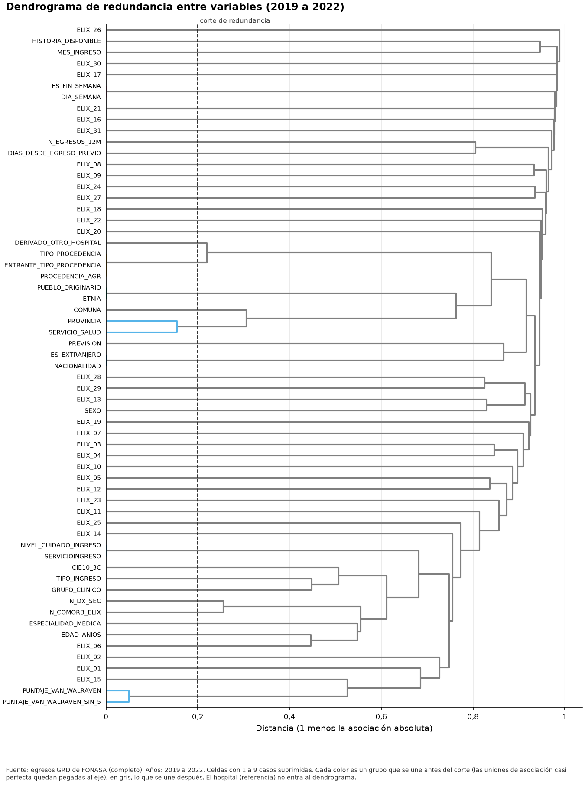
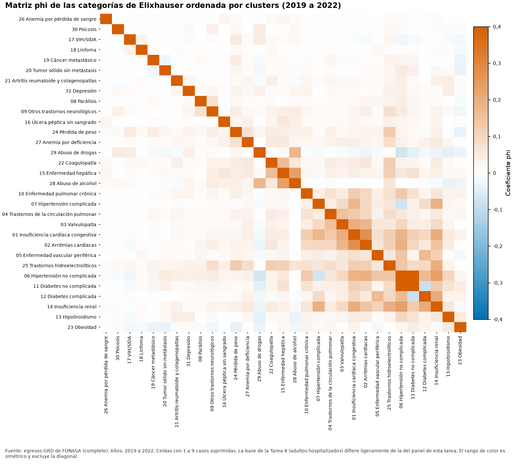

# Informe de selección estadística de variables (CRISP-DM 2.3)

**Fuente de los datos: completo.** Todas las cifras provienen de los archivos completos.

Este informe reúne la evidencia estadística para elegir variables: la asociación, la redundancia y la multicolinealidad (Tarea 10) y la selección, los proxies del hospital, la fuga y la matriz de decisión (Tarea 11). La evidencia estadística se contrasta con el criterio clínico y no lo reemplaza.

## 1. Qué se midió y con qué medidas

Se analizan 61 variables del panel de adultos hospitalizados con desenlace conocido: 7 numéricas, 38 binarias y 16 categóricas. Se agrega el hospital de egreso como referencia: se mide, pero no entra a los grupos de redundancia ni al VIF. Cada tipo de par usa su propia medida y todas van de cero a uno: el valor absoluto de rho de Spearman entre dos numéricas, el valor absoluto de phi entre dos binarias, la raíz de eta al cuadrado entre una numérica y una binaria o una categórica, y la V de Cramér corregida por sesgo (Bergsma) cuando interviene una categórica y no una numérica. Los faltantes se eliminan por pares, sin imputar, y el nivel sin dato de una categórica cuenta como un nivel más. La ventana de ranking (2019-2022) reúne 2.071.324 egresos y la de confirmación (2023), 568.737. El panel usa todos los egresos de la cohorte de cada año, sin muestreo.

| Tipo de variable | Variables |
|---|---|
| Numéricas | 7 |
| Binarias | 38 |
| Categóricas | 16 |
| Referencia (hospital de egreso) | 1 |

*Variables del análisis por tipo.* *Tabla completa en `tablas/clusters_variables.csv`*

## 2. La matriz de asociación y su lectura

La figura F10_01 ordena las variables por similitud con un agrupamiento jerárquico de enlace promedio sobre la distancia de uno menos la asociación absoluta, de modo que las variables parecidas quedan juntas. Los recuadros marcan los grupos que se mantienen unidos al corte de redundancia (0,80) y la última fila y columna son la referencia. La asociación más alta entre dos variables distintas es 1,000, entre ENTRANTE_TIPO_PROCEDENCIA y PROCEDENCIA_AGR. De 1.830 pares, 9 alcanzan el umbral de redundancia; forman 7 clusters de variables encadenadas por pares redundantes, que reúnen 15 variables, y el mayor tiene 3 variables. Las celdas grises no tienen valor: la variable es constante, no hay datos suficientes o la celda se suprimió.

*Figura F10_01. Asociación entre variables, agrupada por similitud (2019 a 2022). Datos de origen: `tablas/matriz_asociacion.csv`.*

## 3. Pares y clusters redundantes

Un cluster de redundancia es una componente conexa: reúne las variables enlazadas por pares con asociación igual o superior al umbral, aunque dos de ellas no estén asociadas entre sí (A con B y B con C bastan). El grupo del dendrograma es lo que queda junto al cortar el árbol (F10_02): cada grupo está contenido en un cluster, pero un cluster puede partirse en varios grupos. La selección de variables usa los clusters y la figura muestra los grupos. De los 9 pares redundantes con medición en 2023, 9 mantienen una asociación igual o superior al umbral.

*Figura F10_02. Dendrograma de redundancia entre variables (2019 a 2022). Datos de origen: `tablas/t23_dendrograma.csv`.*

La figura F10_04 repite el ordenamiento por clusters con las categorías de Elixhauser, a partir de la matriz phi de la Tarea 8. Esa matriz se calcula sobre adultos hospitalizados y no sobre la cohorte del panel, de modo que las dos bases difieren ligeramente.

*Figura F10_04. Matriz phi de las categorías de Elixhauser ordenada por clusters (2019 a 2022). Datos de origen: `tablas/t23_elix_phi.csv`.*

| Variable A | Variable B | Medida | Asociación 2019-2022 | Asociación 2023 | Se mantiene en 2023 | Cluster |
|---|---|---|---|---|---|---|
| ES_FIN_SEMANA | DIA_SEMANA | v_cramer_bergsma | 1,00 | 1,00 | si | 6 |
| ENTRANTE_TIPO_PROCEDENCIA | PROCEDENCIA_AGR | v_cramer_bergsma | 1,00 | 1,00 | si | 20 |
| PUEBLO_ORIGINARIO | ETNIA | v_cramer_bergsma | 1,00 | 1,00 | si | 21 |
| PROCEDENCIA_AGR | TIPO_PROCEDENCIA | v_cramer_bergsma | 1,00 | 1,00 | si | 20 |
| ENTRANTE_TIPO_PROCEDENCIA | TIPO_PROCEDENCIA | v_cramer_bergsma | 1,00 | 1,00 | si | 20 |
| ES_EXTRANJERO | NACIONALIDAD | v_cramer_bergsma | 1,00 | 1,00 | si | 25 |
| NIVEL_CUIDADO_INGRESO | SERVICIOINGRESO | v_cramer_bergsma | 1,00 | 1,00 | si | 41 |
| PUNTAJE_VAN_WALRAVEN | PUNTAJE_VAN_WALRAVEN_SIN_5 | spearman | 0,95 | 0,95 | si | 53 |
| PROVINCIA | SERVICIO_SALUD | v_cramer_bergsma | 0,85 | 0,87 | si | 23 |

*Los quince pares más asociados, con su valor de 2023 y si se mantiene.* *Tabla completa en `tablas/pares_redundantes.csv`*

| Cluster | Variables | Miembros |
|---|---|---|
| 6 | 2 | ES_FIN_SEMANA, DIA_SEMANA |
| 20 | 3 | TIPO_PROCEDENCIA, ENTRANTE_TIPO_PROCEDENCIA, PROCEDENCIA_AGR |
| 21 | 2 | PUEBLO_ORIGINARIO, ETNIA |
| 23 | 2 | PROVINCIA, SERVICIO_SALUD |
| 25 | 2 | ES_EXTRANJERO, NACIONALIDAD |
| 41 | 2 | NIVEL_CUIDADO_INGRESO, SERVICIOINGRESO |
| 53 | 2 | PUNTAJE_VAN_WALRAVEN, PUNTAJE_VAN_WALRAVEN_SIN_5 |

*Clusters de redundancia con más de una variable.* *Tabla completa en `tablas/clusters_variables.csv`*

## 4. VIF y colinealidad exacta

El factor de inflación de la varianza (VIF) mide cuánto se amplía la varianza de un coeficiente por la correlación de la variable con las demás. Solo se calcula para variables numéricas y binarias, sobre los 2.055.649 egresos que tienen todos los datos. Quedan fuera de ese conjunto de casos completos las variables constantes y las que tienen faltante igual o superior a 20,0 % (2 en esta corrida), para no reducir la población de todo el cálculo. Sin los agregados de comorbilidad, el VIF más alto es 2,47 (ENTRANTE_TIPO_PROCEDENCIA); con ellos, sin contar las variables con colinealidad exacta, es 968.680.099,56 (ELIX_21). En el conjunto base, 0 variables tienen VIF de alerta (desde 5) y 0 son críticas (desde 10).

Con los agregados de comorbilidad aparece colinealidad exacta: la matriz de correlación tiene 43 columnas y rango 40, es decir 3 relaciones lineales exactas independientes, y 26 variables participan en ellas (su VIF no se calcula y la figura lo muestra como exacta). Se verificó con los datos que el conteo de categorías es la suma de los indicadores y que cada puntaje de van Walraven es la combinación con sus pesos: la diferencia máxima absoluta es 0,00 para el conteo, 0,00 para el puntaje completo y 0,00 para el puntaje sin las cinco categorías sospechosas.

*Figura F10_03. VIF de las variables numéricas y binarias (2019 a 2022). Datos de origen: `tablas/t23_vif.csv`.*

| Variable | VIF | R cuadrado | Clasificación |
|---|---|---|---|
| ENTRANTE_TIPO_PROCEDENCIA | 2,47 | 0,595 | bajo |
| DERIVADO_OTRO_HOSPITAL | 2,46 | 0,593 | bajo |
| EDAD_ANIOS | 1,75 | 0,428 | bajo |
| ELIX_06 | 1,69 | 0,409 | bajo |
| ELIX_11 | 1,23 | 0,184 | bajo |
| ELIX_01 | 1,19 | 0,162 | bajo |
| ELIX_14 | 1,18 | 0,155 | bajo |
| ELIX_02 | 1,16 | 0,137 | bajo |
| ELIX_12 | 1,12 | 0,107 | bajo |
| ELIX_25 | 1,12 | 0,106 | bajo |

*Las diez variables con mayor VIF en el conjunto base.* *Tabla completa en `tablas/t23_vif.csv`*

## 5. Límites

- Las asociaciones tratan cada egreso como independiente: ignoran el agrupamiento por paciente y por hospital y no llevan intervalo de confianza; los intervalos de la selección de variables tampoco lo consideran.
- La V de Cramér depende del número de niveles de las variables: por eso se corrige por sesgo y las categóricas tienen un tope de niveles, con el resto agrupado en OTROS.
- El VIF solo cubre variables numéricas y binarias; las categóricas se resumen con la V de Cramér, que no es comparable con un VIF.
- La razón de correlación eta tiene un sesgo pequeño hacia valores altos cuando hay muchos niveles y pocos casos por nivel.
- La estabilidad en 2023 solo se evalúa en los pares redundantes de la ventana de ranking: un par que no alcanzó el umbral en 2019 a 2022 no se reestima.
- La matriz phi de las categorías de Elixhauser (F10_04) viene de la Tarea 8 y se calcula sobre adultos hospitalizados, no sobre la cohorte del panel; las dos bases difieren ligeramente.
- La tabla de pares redundantes lleva la reestimación de 2023 en columnas aparte de la misma fila; por eso se escribe por bloques de supresión en lugar de separarla en dos tablas, que es la regla general de privacidad del proyecto. Cada bloque suprime solo sus propias cifras y todos los conteos quedan registrados para el escáner de privacidad.

## 6. Universo de variables y disponibilidad

El universo que cubre la matriz de decisión reúne las 199 variables de la documentación: 129 columnas crudas y 70 derivadas o nombradas por las reglas de la Fase 1 (`reglas_variables.csv`). Por evaluabilidad: evaluables en el panel, 64; parciales (ETNIA y PUEBLO_ORIGINARIO se describen, pero no se analizan frente a los resultados, decisión 4), 4; no evaluables (el panel las resume en otra variable, no las construye o no pertenecen a la cohorte), 131. Cada una lleva su motivo, su rol en la Fase 1 y su faltante por año en `disponibilidad_variables.csv`.

| Motivo | Variables | Ejemplos |
|---|---|---|
| se evalúa mediante las categorías de Elixhauser y N_DX_SEC | 34 | DIAGNOSTICO10, DIAGNOSTICO11, DIAGNOSTICO12 |
| se resume en N_PROCEDIMIENTOS (solo fuga) | 30 | PROCEDIMIENTO1, PROCEDIMIENTO10, PROCEDIMIENTO11 |
| se resume en N_TRASLADOS_INTERNOS (solo fuga) | 18 | FECHATRASLADO1, FECHATRASLADO2, FECHATRASLADO3 |
| bloque de recién nacidos descartado por la Fase 1: no entra al panel | 16 | CONDICIONDEALTANEONATO1, CONDICIONDEALTANEONATO2, CONDICIONDEALTANEONATO3 |
| ocurre durante la hospitalización: rol PROHIBIDA_FUGA, no se construye en el panel | 3 | ESPECIALIDADINTERVENCION, FECHAINTERV1, MEDICOINTERV1_ENCRIPTADO |
| filtro de cohorte: no es predictor | 2 | GRD_BASE, MDC |
| variable de resultado: no es candidata | 2 | ESTANCIA, ESTANCIA_DIAS |
| constante en la cohorte D: filtro de cohorte | 1 | TIPO_ACTIVIDAD |
| descartada por la Fase 1: menos de diez valores, con estructura de RUT | 1 | FECHAPROCEDIMIENTO1 |
| exige una fuente externa de vulnerabilidad por comuna | 1 | INDICE_PRIVACION |
| filtro de cohorte: el agrupador se calcula con datos del alta | 1 | IR_29301_COD_GRD |
| identificador interno: solo sirve para cruces | 1 | ID_EPISODIO |
| identificador: solo para el historial | 1 | CIP_ENCRIPTADO |
| información del egreso (regla R1): solo se usa para calcular la estadía | 1 | FECHAALTA |
| llave de partición temporal: no es predictor | 1 | ANIO_EGRESO |
| llave de partición temporal: un año como predictor no extrapola al año de prueba | 1 | ANIO_INGRESO |
| mapeo de PREVISION a tramos no definido en la documentación; solo las categorías institucionales A a D son directas | 1 | TRAMO_FONASA |
| marca de cohorte (decisión pendiente): el panel usa ENTRANTE_TIPO_PROCEDENCIA | 1 | ES_TRASLADO_ENTRANTE |
| no existe un mapeo de las especialidades a macro grupos | 1 | ESPECIALIDAD_MACRO |
| pendiente: depende de la aprobación del historial; no se construye en el panel | 1 | HISTORIAL_INCOMPLETO |
| referencia del análisis de proxy, no es candidata | 1 | COD_HOSPITAL |
| requiere la verificación f2_06 antes de usarse: no se construye en el panel | 1 | INGRESO_CRITICO |
| se evalúa como DERIVADO_OTRO_HOSPITAL | 1 | HOSPPROCEDENCIA |
| se evalúa como EDAD_ANIOS | 1 | FECHA_NACIMIENTO |
| se evalúa como EDAD_ANIOS, MES_INGRESO, DIA_SEMANA y ES_FIN_SEMANA | 1 | FECHA_INGRESO |
| se evalúa como GRUPO_CLINICO y CIE10_3C | 1 | DIAGNOSTICO1 |
| se evalúa como IR_29301_PESO (solo fuga) | 1 | IR_29301_PESO_NUM |
| se genera al alta: rol PROHIBIDA_FUGA, no se construye en el panel | 1 | MEDICOALTA_ENCRIPTADO |
| solo análisis de sensibilidad: no se construye en el panel | 1 | FLAG_PANDEMIA |
| solo auditoría: el panel construye N_DX_SEC | 1 | N_DX_TOTAL |

*Variables no evaluables por motivo.* *Se muestran las primeras 30 de 33 filas. Tabla completa en `tablas/disponibilidad_variables.csv`*

Las tres variables de historial (`N_EGRESOS_12M`, `DIAS_DESDE_EGRESO_PREVIO` y `HISTORIA_DISPONIBLE`) entran al panel con los datos completos y se evalúan con la hipótesis H01c.

## 7. Señal univariada

El AUC univariado mide cuánto separa una variable los egresos con muerte de los que sobreviven: un AUC de un medio es la ausencia de señal. Se calcula en 2019-2022 y se confirma en 2023 con la dirección fijada en el ranking, de modo que un cambio de signo aparece como un AUC de 2023 por debajo de ese valor. Entran al ranking 59 candidatas y la de mayor señal es ESPECIALIDAD_MEDICA, con 0,812. Por clase de señal: alta (desde 0,70), 9; media (desde 0,60), 6; débil (desde 0,55), 5; baja, 39. Las categóricas puntúan con la tasa por nivel estimada en la misma ventana, así que su AUC en muestra es optimista: se ordenan por validación cruzada dejando un año fuera. Variables con faltante en alerta (desde 20,0 %): 0; en nivel alto (desde 50,0 %): 2; con faltante informativo del desenlace: 0. Filas del ranking con cifras anuladas por tener pocos casos: 0.

*Figura F11_01. Señal univariada frente a la mortalidad (2019 a 2022 y 2023). Datos de origen: `tablas/t23_ranking_variables.csv`.*

| Posición | Variable | Tipo | AUC 2019-2022 | Límite inferior | Límite superior | AUC 2023 | Señal | Faltante |
|---|---|---|---|---|---|---|---|---|
| 1 | ESPECIALIDAD_MEDICA | cat | 0,812 | 0,810 | 0,813 | 0,820 | alta | 0,0 % |
| 2 | N_DX_SEC | num | 0,810 | 0,808 | 0,812 | 0,829 | alta | 0,0 % |
| 3 | SERVICIOINGRESO | cat | 0,795 | 0,794 | 0,797 | 0,801 | alta | 0,1 % |
| 4 | GRUPO_CLINICO | cat | 0,788 | 0,787 | 0,790 | 0,771 | alta | 0,0 % |
| 5 | CIE10_3C | cat | 0,778 | 0,777 | 0,780 | 0,749 | alta | 0,0 % |
| 6 | EDAD_ANIOS | num | 0,768 | 0,766 | 0,769 | 0,757 | alta | 0,0 % |
| 7 | PUNTAJE_VAN_WALRAVEN | num | 0,766 | 0,764 | 0,768 | 0,801 | alta | 0,0 % |
| 8 | N_COMORB_ELIX | num | 0,748 | 0,746 | 0,750 | 0,769 | alta | 0,0 % |
| 9 | PUNTAJE_VAN_WALRAVEN_SIN_5 | num | 0,718 | 0,716 | 0,719 | 0,748 | alta | 0,0 % |
| 10 | TIPO_INGRESO | cat | 0,673 | 0,671 | 0,674 | 0,699 | media | 0,0 % |
| 11 | TIPO_PROCEDENCIA | cat | 0,639 | 0,637 | 0,641 | 0,655 | media | 0,0 % |
| 12 | NIVEL_CUIDADO_INGRESO | bin | 0,617 | 0,615 | 0,619 | 0,629 | media | 0,1 % |

*Las doce variables con mayor señal univariada en 2019 a 2022, con su AUC de 2023.* *Tabla completa en `tablas/t23_ranking_variables.csv`*

## 8. Estabilidad y deriva

La estabilidad repite el AUC año por año con el puntaje y la dirección fijos del ranking. Una variable cambia de signo si, entre los años con efecto suficiente (al menos 0,01 de distancia al valor sin señal), hay AUC por encima y por debajo de él. Variables con cambio de signo: 0. El índice de estabilidad poblacional (PSI) compara la distribución de cada variable en 2019-2022 con la de 2023; variables con PSI alto (desde 0,25): 3; moderado (desde 0,10): 3. Evidencia de la hipótesis H17a (2019 frente a 2020-2022): variables clave, es decir candidatas evaluables cuyo rol en la Fase 1 no es excluyente, con PSI medido: 50; con PSI alto: 7, que son 14,0 %; la mayoría de las variables clave no supera ese nivel. La decisión sobre la ventana de entrenamiento es humana.

*Figura F11_03. Estabilidad por año de la señal de cada variable (2019 a 2023). Datos de origen: `tablas/t23_estabilidad.csv`.*

| Variable | Tipo | PSI contra 2023 | Clase contra 2023 | PSI de 2019 contra 2020-2022 | Clase de 2019 contra 2020-2022 |
|---|---|---|---|---|---|
| ETNIA | cat | 5,925 | alto | 0,085 | estable |
| N_EGRESOS_12M | num | 3,450 | alto | 5,963 | alto |
| HISTORIA_DISPONIBLE | bin | 3,447 | alto | 6,452 | alto |
| DIAS_DESDE_EGRESO_PREVIO | num | 0,176 | moderado | 0,901 | alto |
| GRUPO_CLINICO | cat | 0,105 | moderado | 0,380 | alto |
| ESPECIALIDAD_MEDICA | cat | 0,102 | moderado | 0,763 | alto |
| SERVICIOINGRESO | cat | 0,096 | estable | 0,300 | alto |
| CIE10_3C | cat | 0,096 | estable | 0,368 | alto |
| NACIONALIDAD | cat | 0,032 | estable | 0,044 | estable |
| ES_EXTRANJERO | bin | 0,028 | estable | 0,042 | estable |

*Las diez variables con mayor PSI contra 2023.* *Tabla completa en `tablas/t23_estabilidad.csv`*

## 9. Proxy del hospital

Una variable es un proxy del hospital si identifica el establecimiento de egreso: un modelo que la use podría estar aprendiendo qué hospital atendió al paciente y no su estado. Se mide la asociación de cada candidata con el hospital con la misma medida de la Tarea 10 (V de Cramér corregida o razón de correlación). Variables con asociación alta (desde 0,30): 5; moderada (desde 0,15): 10. Hipótesis H02a: la proporción de ingresos a cuidados especiales varía entre hospitales, con una sobredispersión de 529,55 y una razón entre los percentiles noventa y diez de 4,82. Hipótesis H02b: niveles de ESPECIALIDAD_MEDICA, 93; de ellos, usados por un solo hospital y que por sí solos identifican al establecimiento, 9.

*Figura F11_02. Mapa de proxies: asociación con el resultado y con el hospital (2019 a 2022). Datos de origen: `tablas/t23_proxy_hospital.csv`.*

| Variable | Rol en la Fase 1 | Asociación 2019-2022 | Asociación 2023 | Clase de proxy | Asociación con el resultado |
|---|---|---|---|---|---|
| SERVICIO_SALUD | LLAVE_AGREGACION | 0,908 | 0,945 | alto | 0,045 |
| PROVINCIA | AUDITORIA_SENSIBILIDAD | 0,722 | 0,726 | alto | 0,047 |
| COMUNA | AUDITORIA_SENSIBILIDAD | 0,656 | 0,653 | alto | 0,043 |
| DERIVADO_OTRO_HOSPITAL | CONDICIONAL | 0,565 | 0,586 | alto | 0,032 |
| PUEBLO_ORIGINARIO | AUDITORIA_SENSIBILIDAD | 0,403 | 0,373 | alto | n/d |
| ENTRANTE_TIPO_PROCEDENCIA | FILTRO_COHORTE | 0,273 | 0,275 | moderado | 0,041 |
| SERVICIOINGRESO | CONDICIONAL | 0,253 | 0,299 | moderado | 0,287 |
| ES_EXTRANJERO | AUDITORIA_SENSIBILIDAD | 0,253 | 0,272 | moderado | 0,035 |
| ETNIA | AUDITORIA_SENSIBILIDAD | 0,241 | 0,218 | moderado | n/d |
| N_DX_SEC | AUDITORIA_SENSIBILIDAD | 0,227 | 0,250 | moderado | 0,299 |
| ELIX_12 | FEATURE_BASAL | 0,202 | 0,195 | moderado | 0,045 |
| PROCEDENCIA_AGR | FEATURE_BASAL | 0,201 | 0,204 | moderado | 0,122 |

*Las doce variables más asociadas con el hospital.* *Tabla completa en `tablas/t23_proxy_hospital.csv`*

## 10. Comorbilidad de Elixhauser

Para cada categoría de Elixhauser (ELIX_01 a ELIX_31) se estima el odds ratio crudo y el ajustado por edad y sexo contra la mortalidad. Categorías con odds ratio ajustado relevante (desde 1,20, con un intervalo de confianza que deja fuera la ausencia de efecto): 23. La sensibilidad de estadía (decisión 8) ordena las categorías con un índice de complicación probable: el promedio de dos rangos, el de la razón de prevalencias entre el tramo de mayor estadía y el de menor, y el del odds ratio de estadía larga, ambos con el límite inferior de su intervalo. Categorías que cumplen las condiciones de tamaño y tienen índice: 31. Las cinco primeras son ELIX_24; ELIX_04; ELIX_25; ELIX_27; ELIX_22. Coincidencias de esas cinco con las que sospecha la Fase 1: 4; con la lista del repositorio: 3. Esa correspondencia, la lista final y el sentido clínico de cada categoría quedan pendientes de revisión clínica (decisión 12): la tabla informa y no decide.

*Figura F11_04. Odds ratio de las categorías de Elixhauser, crudo y ajustado (2019 a 2022). Datos de origen: `tablas/t23_or_elix.csv`.*

| Rango | Categoría | Nombre | Razón de prevalencias | OR de estadía larga | Índice | Sospechosa en la Fase 1 | En la lista del repositorio |
|---|---|---|---|---|---|---|---|
| 1 | ELIX_24 | Pérdida de peso | 14,15 | 4,94 | 1,000 | si | si |
| 2 | ELIX_04 | Trastornos de la circulación pulmonar | 11,48 | 4,22 | 0,967 | si | no |
| 3 | ELIX_25 | Trastornos hidroelectrolíticos | 9,74 | 3,37 | 0,917 | si | si |
| 4 | ELIX_27 | Anemia por deficiencia | 6,20 | 3,11 | 0,883 | no | no |
| 5 | ELIX_22 | Coagulopatía | 5,52 | 3,00 | 0,850 | si | si |
| 6 | ELIX_30 | Psicosis | 4,63 | 4,06 | 0,800 | no | no |
| 7 | ELIX_08 | Parálisis | 4,67 | 2,51 | 0,733 | no | no |
| 8 | ELIX_03 | Valvulopatía | 5,21 | 2,13 | 0,733 | no | no |
| 9 | ELIX_01 | Insuficiencia cardíaca congestiva | 5,20 | 2,01 | 0,733 | no | no |
| 10 | ELIX_05 | Enfermedad vascular periférica | 4,54 | 2,08 | 0,700 | no | no |

*Las diez categorías con mayor índice de complicación probable.* *Tabla completa en `tablas/t23_sensibilidad_elix.csv`*

## 11. Valor incremental e importancia

El valor incremental es la mejora del AUC de 2023 al agregar una variable a un modelo base con edad y sexo ajustado en 2019-2022. Como referencias se usan dos modelos: el de edad y sexo, con un AUC de 0,760 en 2023, y el de las categorías de Elixhauser solas (ELIX_01 a ELIX_31, sin edad ni sexo), con 0,827. El modelo con penalización L1 reúne las variables que la Fase 1 no excluye y elige su penalización por validación cruzada (C igual a 0,464); su AUC en 2023 es 0,927. Variables que sobreviven en él: 46. Variables que importan al permutarlas (caída del AUC de al menos 0,001): 12. Los coeficientes y las importancias de las demás variables están condicionados a la presencia de las condicionales cercanas a ser proxy del hospital (las de trama en la figura), cuyos coeficientes pueden codificar el hospital.

*Figura F11_05. Importancia por permutación de las variables en 2023. Datos de origen: `tablas/t23_importancia.csv`.*

| Variable | Clase de proxy | Incremento de AUC | Sobrevive en L1 | Caída del AUC | Desviación | Importa |
|---|---|---|---|---|---|---|
| EDAD_ANIOS | bajo | n/d | si | 0,0448 | 0,0004 | si |
| ESPECIALIDAD_MEDICA | moderado | 0,098 | si | 0,0322 | 0,0006 | si |
| CIE10_3C | bajo | 0,070 | si | 0,0221 | 0,0003 | si |
| TIPO_INGRESO | moderado | 0,057 | si | 0,0152 | 0,0004 | si |
| GRUPO_CLINICO | bajo | 0,057 | si | 0,0152 | 0,0003 | si |
| PUNTAJE_VAN_WALRAVEN | bajo | 0,074 | si | 0,0146 | 0,0001 | si |
| SERVICIOINGRESO | moderado | 0,095 | si | 0,0098 | 0,0001 | si |
| PROCEDENCIA_AGR | moderado | 0,043 | si | 0,0027 | 0,0002 | si |
| NIVEL_CUIDADO_INGRESO | moderado | 0,048 | si | 0,0016 | 0,0000 | si |
| ELIX_06 | bajo | 0,000 | si | 0,0012 | 0,0001 | si |
| ELIX_22 | bajo | 0,023 | si | 0,0012 | 0,0000 | si |
| ELIX_25 | bajo | 0,046 | si | 0,0010 | 0,0000 | si |

*Las doce variables del modelo L1 con mayor importancia por permutación en 2023.* *Tabla completa en `tablas/t23_importancia.csv`*

## 12. Fuga

Las variables que solo existen al alta o durante la hospitalización, prohibidas por la Fase 1, y las condicionales que podrían codificar lo que ocurre después del ingreso se miden con el mismo AUC univariado y se comparan con dos modelos basales y con el umbral de sospecha de fuga (0,85). Variables que alcanzan el umbral en el ranking o en la confirmación: 3. `IR_29301_MORTALIDAD` queda prohibida siempre (R6), aunque su señal sea baja. La concordancia entre SERVICIOINGRESO y SERVICIOALTA (S09) es de 99,2 % en los egresos sin traslado interno y de 15,8 % en los que tienen traslado.

*Figura F11_06. Evidencia de fuga frente a las referencias basales (2019 a 2023). Datos de origen: `tablas/t23_fuga.csv`.*

| Variable | Categoría | AUC 2019-2022 | AUC 2023 | Referencia mayor | Supera a los basales | Supera el umbral |
|---|---|---|---|---|---|---|
| IR_29301_MORTALIDAD | solo_fuga | 0,862 | 0,876 | MODELO_ELIX31 | si | si |
| IR_29301_SEVERIDAD | solo_fuga | 0,847 | 0,861 | MODELO_ELIX31 | si | si |
| SERVICIOALTA | solo_fuga | 0,856 | 0,859 | MODELO_ELIX31 | si | si |
| N_PROCEDIMIENTOS | solo_fuga | 0,804 | 0,825 | MODELO_ELIX31 | no | no |
| ESPECIALIDAD_MEDICA | condicional | 0,822 | 0,820 | MODELO_ELIX31 | no | no |
| IR_29301_PESO | solo_fuga | 0,806 | 0,809 | MODELO_ELIX31 | no | no |
| SERVICIOINGRESO | condicional | 0,799 | 0,801 | MODELO_ELIX31 | no | no |
| USOSPABELLON | solo_fuga | 0,630 | 0,663 | MODELO_ELIX31 | no | no |
| NIVEL_CUIDADO_INGRESO | condicional | 0,617 | 0,629 | MODELO_ELIX31 | no | no |
| N_TRASLADOS_INTERNOS | solo_fuga | 0,581 | 0,587 | MODELO_ELIX31 | no | no |
| DERIVADO_OTRO_HOSPITAL | condicional | 0,524 | 0,521 | MODELO_ELIX31 | no | no |

*AUC de las variables de solo fuga y de las condicionales frente a los modelos basales.* *Tabla completa en `tablas/t23_fuga.csv`*

## 13. Matriz de decisión y contraste con la Fase 1

La matriz de decisión (`matriz_decision_variables.csv`) tiene una fila por cada una de las 199 variables del universo y aplica el árbol de `arbol_decision.csv`. Se evalúan las nueve reglas para cada variable y se guardan todas las que se activan; la regla decisiva es la primera que corresponde en este orden: la exclusión por la Fase 1, la sospecha de fuga, el proxy del hospital (alto y moderado), la calidad o la estabilidad, la redundancia, la baja señal y, como refinamiento de esta, el criterio clínico. Si no se activa ninguna y la medición está completa, la variable se mantiene. Todas las comparaciones usan los valores redondeados que se publican en las tablas. La matriz recomienda; la decisión es humana: ninguna columna se llama decisión y todo lo clínico queda pendiente de revisión clínica (decisión 12).

La tabla siguiente reparte las variables según la recomendación de la matriz; el texto de cada recomendación sale de `arbol_decision.csv`.

| Recomendación | Regla decisiva | Variables |
|---|---|---|
| EXCLUIR (regla de la Fase 1) | R_FASE1 | 110 |
| EXCLUIR por sospecha de fuga (revisar) | FUGA | 0 |
| EXCLUIR por proxy de hospital (R2) | PROXY | 1 |
| CONDICIONAL: verificar proxy de hospital | PROXY_MOD | 6 |
| CONDICIONAL: calidad o estabilidad | CALIDAD | 3 |
| ELIMINAR por redundancia (conservar el representante) | REDUNDANTE | 1 |
| BAJA SEÑAL: candidata a eliminar | BAJA_SENAL | 8 |
| MANTENER por criterio clínico (sostiene una variable de baja señal) | CLINICO | 12 |
| MANTENER | MANTENER | 19 |
| NO EVALUABLE | (ninguna) | 39 |

*Variables por recomendación de la matriz.* *Tabla completa en `tablas/matriz_decision_variables.csv`*

Todas las candidatas evaluables del panel se midieron por completo en esta corrida.

El contraste con la Fase 1 compara lo que esa fase ya decidió con lo que la estadística objeta. Se dice que la estadística objeta cuando se activa alguna de las reglas de fuga, proxy, calidad, redundancia o baja señal, aunque el criterio clínico la compense después. Variables que la Fase 1 excluye y la estadística también objeta (coinciden): 12. Variables que la Fase 1 excluye y la estadística no objeta, solo las medidas por completo: 6. Variables que la Fase 1 permite y la estadística objeta: 12. Categorías de Elixhauser que la Fase 1 exige conservar y la estadística objeta: 19. Las tablas siguientes muestran cada caso.

| Variable | Rol en la Fase 1 | Reglas activadas | Regla decisiva | Recomendación |
|---|---|---|---|---|
| PREVISION | AUDITORIA_SENSIBILIDAD | R_FASE1 | R_FASE1 | EXCLUIR (regla de la Fase 1) |
| USOSPABELLON | PROHIBIDA_FUGA | R_FASE1 | R_FASE1 | EXCLUIR (regla de la Fase 1) |
| IR_29301_PESO | PROHIBIDA_FUGA | R_FASE1 | R_FASE1 | EXCLUIR (regla de la Fase 1) |
| PUNTAJE_VAN_WALRAVEN_SIN_5 | AUDITORIA_SENSIBILIDAD | R_FASE1 | R_FASE1 | EXCLUIR (regla de la Fase 1) |
| N_PROCEDIMIENTOS | PROHIBIDA_FUGA | R_FASE1 | R_FASE1 | EXCLUIR (regla de la Fase 1) |
| N_TRASLADOS_INTERNOS | PROHIBIDA_FUGA | R_FASE1 | R_FASE1 | EXCLUIR (regla de la Fase 1) |

*La Fase 1 excluye y la estadística no objeta (solo variables medidas por completo).* *Tabla completa en `tablas/matriz_decision_variables.csv`*

| Variable | Rol en la Fase 1 | Reglas activadas | Regla decisiva | Recomendación |
|---|---|---|---|---|
| TIPO_INGRESO | FEATURE_BASAL | PROXY_MOD | PROXY_MOD | CONDICIONAL: verificar proxy de hospital |
| ESPECIALIDAD_MEDICA | CONDICIONAL | PROXY_MOD | PROXY_MOD | CONDICIONAL: verificar proxy de hospital |
| SERVICIOINGRESO | CONDICIONAL | PROXY_MOD | PROXY_MOD | CONDICIONAL: verificar proxy de hospital |
| MES_INGRESO | FEATURE_BASAL | BAJA_SENAL | BAJA_SENAL | BAJA SEÑAL: candidata a eliminar |
| DIA_SEMANA | FEATURE_BASAL | REDUNDANTE; BAJA_SENAL | REDUNDANTE | ELIMINAR por redundancia (conservar el representante) |
| ES_FIN_SEMANA | FEATURE_BASAL | BAJA_SENAL | BAJA_SENAL | BAJA SEÑAL: candidata a eliminar |
| N_EGRESOS_12M | FEATURE_BASAL | CALIDAD; BAJA_SENAL | CALIDAD | CONDICIONAL: calidad o estabilidad |
| DIAS_DESDE_EGRESO_PREVIO | FEATURE_BASAL | CALIDAD; BAJA_SENAL | CALIDAD | CONDICIONAL: calidad o estabilidad |
| HISTORIA_DISPONIBLE | FEATURE_BASAL | CALIDAD; BAJA_SENAL | CALIDAD | CONDICIONAL: calidad o estabilidad |
| DERIVADO_OTRO_HOSPITAL | CONDICIONAL | PROXY; BAJA_SENAL | PROXY | EXCLUIR por proxy de hospital (R2) |
| NIVEL_CUIDADO_INGRESO | CONDICIONAL | PROXY_MOD; REDUNDANTE | PROXY_MOD | CONDICIONAL: verificar proxy de hospital |
| PROCEDENCIA_AGR | FEATURE_BASAL | PROXY_MOD; REDUNDANTE | PROXY_MOD | CONDICIONAL: verificar proxy de hospital |

*La Fase 1 permite y la estadística objeta.* *Tabla completa en `tablas/matriz_decision_variables.csv`*

| Variable | Rol en la Fase 1 | Reglas activadas | Regla decisiva | Recomendación |
|---|---|---|---|---|
| ELIX_03 | FEATURE_BASAL | BAJA_SENAL | BAJA_SENAL | BAJA SEÑAL: candidata a eliminar |
| ELIX_05 | FEATURE_BASAL | BAJA_SENAL; CLINICO | CLINICO | MANTENER por criterio clínico (sostiene una variable de baja señal) |
| ELIX_07 | FEATURE_BASAL | BAJA_SENAL; CLINICO | CLINICO | MANTENER por criterio clínico (sostiene una variable de baja señal) |
| ELIX_08 | FEATURE_BASAL | BAJA_SENAL; CLINICO | CLINICO | MANTENER por criterio clínico (sostiene una variable de baja señal) |
| ELIX_10 | FEATURE_BASAL | BAJA_SENAL; CLINICO | CLINICO | MANTENER por criterio clínico (sostiene una variable de baja señal) |
| ELIX_12 | FEATURE_BASAL | PROXY_MOD; BAJA_SENAL; CLINICO | PROXY_MOD | CONDICIONAL: verificar proxy de hospital |
| ELIX_13 | FEATURE_BASAL | BAJA_SENAL; CLINICO | CLINICO | MANTENER por criterio clínico (sostiene una variable de baja señal) |
| ELIX_16 | FEATURE_BASAL | BAJA_SENAL; CLINICO | CLINICO | MANTENER por criterio clínico (sostiene una variable de baja señal) |
| ELIX_17 | FEATURE_BASAL | BAJA_SENAL; CLINICO | CLINICO | MANTENER por criterio clínico (sostiene una variable de baja señal) |
| ELIX_18 | FEATURE_BASAL | BAJA_SENAL; CLINICO | CLINICO | MANTENER por criterio clínico (sostiene una variable de baja señal) |
| ELIX_20 | FEATURE_BASAL | BAJA_SENAL; CLINICO | CLINICO | MANTENER por criterio clínico (sostiene una variable de baja señal) |
| ELIX_21 | FEATURE_BASAL | BAJA_SENAL; CLINICO | CLINICO | MANTENER por criterio clínico (sostiene una variable de baja señal) |
| ELIX_23 | FEATURE_BASAL | BAJA_SENAL | BAJA_SENAL | BAJA SEÑAL: candidata a eliminar |
| ELIX_26 | FEATURE_BASAL | BAJA_SENAL | BAJA_SENAL | BAJA SEÑAL: candidata a eliminar |
| ELIX_27 | FEATURE_BASAL | BAJA_SENAL | BAJA_SENAL | BAJA SEÑAL: candidata a eliminar |
| ELIX_28 | FEATURE_BASAL | BAJA_SENAL; CLINICO | CLINICO | MANTENER por criterio clínico (sostiene una variable de baja señal) |
| ELIX_29 | FEATURE_BASAL | BAJA_SENAL | BAJA_SENAL | BAJA SEÑAL: candidata a eliminar |
| ELIX_30 | FEATURE_BASAL | BAJA_SENAL; CLINICO | CLINICO | MANTENER por criterio clínico (sostiene una variable de baja señal) |
| ELIX_31 | FEATURE_BASAL | BAJA_SENAL | BAJA_SENAL | BAJA SEÑAL: candidata a eliminar |

*La Fase 1 exige conservar y la estadística objeta.* *Tabla completa en `tablas/matriz_decision_variables.csv`*

Las categorías de Elixhauser llevan en `restriccion_fase1` la regla R3 de la Fase 1: las 31 deben estar en el modelo principal. Es una exigencia de la Fase 1 y no una discrepancia con la estadística: aunque la matriz proponga eliminar una de ellas por baja señal o condicionarla por calidad, el texto de la recomendación no cambia por esta restricción y la etiqueta de contraste le indica a quien decide que debe conservarse por la Fase 1.

Filas con alguna cifra anulada en la matriz publicada: 4. La fila de su tabla fuente quedó suprimida por tener pocos casos; la regla decisiva y la recomendación de esas filas se calcularon con los valores reales y no cambian.

La hipótesis H01c pregunta si `N_EGRESOS_12M` y `DIAS_DESDE_EGRESO_PREVIO` aportan señal sobre la edad y el sexo sin ser un proxy del hospital. La tabla reúne, para cada variable de historial, el incremento de AUC sobre la edad y el sexo y la asociación con el hospital. La factibilidad del historial en 2023 es 99,8 %, frente a un mínimo de 80,0 %. El criterio de la hipótesis recomienda incluirlas solo si la factibilidad se cumple, el incremento supera 0,005 y la asociación con el hospital es menor que 0,15; el veredicto lo calcula la Tarea 12 con ese criterio.

| Variable | Incremento de AUC | Asociación con el hospital | Regla decisiva | Recomendación |
|---|---|---|---|---|
| N_EGRESOS_12M | 0,000 | 0,098 | CALIDAD | CONDICIONAL: calidad o estabilidad |
| DIAS_DESDE_EGRESO_PREVIO | 0,003 | 0,079 | CALIDAD | CONDICIONAL: calidad o estabilidad |
| HISTORIA_DISPONIBLE | -0,000 | 0,032 | CALIDAD | CONDICIONAL: calidad o estabilidad |

*Variables de historial: incremento, proxy y recomendación de la matriz.* *Tabla completa en `tablas/matriz_decision_variables.csv`*

La matriz recomienda; la decisión es humana.

## 14. Advertencias y límites

- Los intervalos de confianza ignoran el agrupamiento por paciente y por hospital, y los de la selección de variables tampoco lo consideran.
- Las categóricas puntuadas con la tasa de la misma ventana son optimistas; por eso se ordenan por validación cruzada y se marcan en las figuras.
- ETNIA y PUEBLO_ORIGINARIO no se analizan frente a los resultados (decisión 4); solo se describen y se mide su asociación con el hospital.
- El año 2023 sirve a la vez de confirmación de la selección y de calibración del modelo final: seleccionar con él puede volver levemente optimista la calibración. El año 2024 no se lee.
- Los odds ratio y la importancia por permutación pueden subestimar variables correlacionadas entre sí (los clusters de la Tarea 10).
- El criterio clínico está pendiente de la decisión 12: solo las fichas «verificada en fuente» activan la regla de mantener por criterio clínico; el resto queda pendiente de revisión clínica y la lista de pendientes está en el diseño.
- Los coeficientes y las importancias de las demás variables están condicionados a la presencia de las condicionales cercanas a proxy del hospital (las de clase de proxy moderada o alta), cuyos coeficientes pueden codificar el hospital.
- El relleno de los nulos con la mediana del entrenamiento más un indicador de nulos solo ocurre dentro de los modelos exploratorios; la regla R5 de la Fase 1 lo admite para las líneas base y el panel conserva los nulos.
- Las tablas de proxy, importancia y fuga llevan conteos de dos ventanas (2019-2022 y 2023) en la misma fila; por eso se escriben por bloques de supresión en lugar de separarlas en dos tablas, que es la regla general de privacidad del proyecto. Cada bloque suprime solo sus propias cifras y todos los conteos quedan registrados para el escáner de privacidad.

Las constantes técnicas de la tarea, con su valor y los resultados que afectan, están en la tabla siguiente. Ninguna es un umbral del protocolo.

| Módulo | Parámetro | Valor | Para qué sirve | Qué afecta |
|---|---|---|---|---|
| estadistica | SUAVIZADO_M | 20 | Pseudoegresos con la tasa global que se suman a cada nivel de una categórica para estimar su tasa | auc_cv, auc_senal, el representante de cada cluster, BAJA_SENAL y FUGA para las categóricas |
| estadistica | EPS_COLINEALIDAD | 0,000000001 | Criterio de colinealidad exacta: una variable es combinación lineal de las demás si su R cuadrado supera uno menos este valor | VIF nulo con colinealidad exacta |
| estadistica | DECIMALES_PUBLICADOS | 6 | Decimales con que se escriben los flotantes y con que se comparan los umbrales | Todas las reglas del árbol de decisión y las marcas de las tablas |
| estadistica | SEPARACION_COEF_MAX | 12 | Un coeficiente de la regresión logística con valor absoluto mayor se declara con separación | Solo anula el OR de ese coeficiente, nunca un AUC |
| estadistica | SEPARACION_SE_MAX | 1000 | Un coeficiente con error estándar mayor se declara con separación | Solo anula el OR de ese coeficiente, nunca un AUC |
| modelos | RIDGE_AUC | 1 | Ridge de los diseños que entregan un AUC (equivale a C igual a uno de scikit-learn) | Incremento de AUC, referencias y modelo base |
| modelos | RIDGE_WALD | 0 | Ridge de los diseños que entregan un OR con error de Wald (cero: el OR no tiene sesgo de penalización) | OR ajustado y OR de estadía larga de Elixhauser |
| modelos | TOPE_FILAS_MODELOS | sin tope | Tope de filas de entrenamiento de los modelos (muestra reproducible si la ventana lo supera) | Referencias, incremento de AUC y modelo L1 |
| modelos | TOPE_FILAS_L1 | 400000 | Filas con que se ajusta el modelo L1 (muestra reproducible); su AUC e importancia se evalúan con todas las filas | Modelo L1 |
| modelos | CS_L1 | 0,001; 0,004642; 0,02154; 0,1; 0,4642; 2,154; 10 | Valores de C (inverso de la penalización) que explora el modelo L1 | Variables que sobreviven en el modelo L1 y su importancia |
| modelos | PLIEGUES_CV | 3 | Pliegues de la validación cruzada del modelo L1 (el valor del encargo) | C elegido y variables que sobreviven en el modelo L1 |
| modelos | REPETICIONES_PERMUTACION | 10 | Repeticiones de la importancia por permutación de cada variable | Importancia por permutación y su desviación |
| sospechas | MIN_FILAS_HOSPITAL | 100 | Un hospital entra a las medidas de variación entre hospitales solo con al menos este número de filas válidas | Variación de los ingresos a cuidados especiales y cardinalidad de ESPECIALIDAD_MEDICA por hospital |
| sospechas | ETIQUETA_V_RESULTADO | 0,1 | Umbral de visualización de F11_02: se rotulan los puntos con asociación con el resultado de al menos este valor | Solo las etiquetas de la figura F11_02 |
| modelos | relleno_nulos_modelos | mediana del entrenamiento más indicador de nulos | Los nulos de numéricas y binarias se rellenan con la mediana de entrenamiento (cero en binarias) más una columna indicadora, solo dentro de los modelos exploratorios; la regla R5 de la Fase 1 lo admite para las líneas base y el panel conserva los nulos | Modelo base, referencias, incremento de AUC y modelo L1 |

*Parámetros técnicos de la selección de variables.* *Tabla completa en `tablas/t23_parametros_seleccion.csv`*
