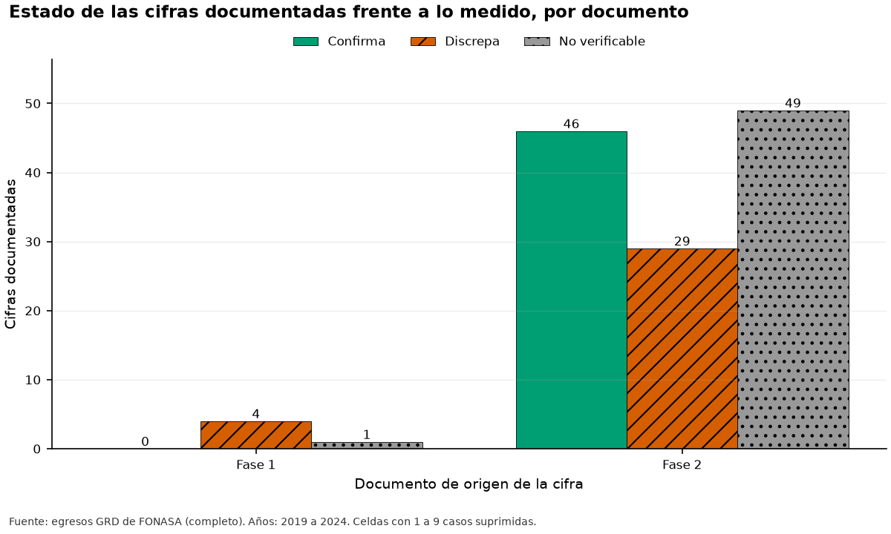
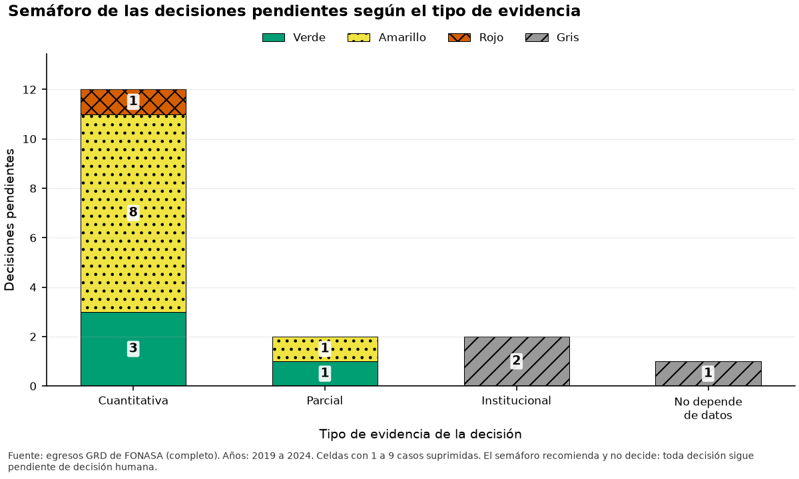

# Informe de evidencia para las decisiones de la Fase 1 (CRISP-DM 2.3)

**Fuente de los datos: completo.** Todas las cifras provienen de los archivos completos.

Este informe contrasta las cifras documentadas de la Fase 1 y de la Fase 2 con lo medido, resume la evidencia de cada decisión pendiente de la Fase 1 y sugiere cambios a los documentos. La evidencia recomienda y no decide.

## 1. Cifras documentadas frente a lo medido

El ledger compara 129 cifras de los informes de la Fase 1 y de la Fase 2 con lo que midió esta corrida. 46 quedan confirmadas, 33 discrepan (3 con una diferencia relevante) y 50 no se pueden verificar con esta fuente. Una cifra solo se confirma o se contradice cuando la suite midió lo mismo, en el mismo alcance de años y con la misma definición; en cualquier otro caso queda no verificable y se dice por qué.

- Proporciones: la diferencia se contrasta con un error estándar (el del intervalo de la métrica o el binomial de la Tarea 4) y discrepa si supera 3,0 errores estándar; la magnitud se rotula relevante desde 0,5 puntos porcentuales. La cifra documentada está redondeada: si media unidad de su último decimal bastara para que la discrepancia desapareciera, el motivo lo dice y el estado no cambia.
- Conteos absolutos: con los datos completos se exige igualdad al redondeo documentado. En un extracto un conteo de la población completa no es comparable, salvo la hipótesis de que la cifra de la Fase 1 proviene del extracto y la cota inferior de los conteos de valores distintos.
- Cifras que requieren el desenlace y abarcan 2024: el desenlace de 2024 nunca se lee. Un conteo se compara con el intervalo entre el conteo de 2019 a 2023 y ese conteo más la cota del año expuesto; sin cota queda no verificable. La diferencia que se publica es siempre la que hay entre lo medido y lo documentado, aunque la compatibilidad se juzgue con el intervalo.
- Conteos de uno a nueve casos: no se publican ni se comparan.

*Figura F12_02. Estado de las cifras documentadas frente a lo medido, por documento. Datos de origen: `tablas/ledger_cifras.csv`.*

## 2. Discrepancias y cifras no verificables

Se listan las discrepancias, primero las de magnitud relevante. Una diferencia de tamaño despreciable puede ser estadísticamente distinta de cero sin importar en la práctica; una discrepancia de un conteo contra un extracto solo se afirma cuando el extracto es una cota inferior de la población.

| Cifra | Documento | Descripción | Documentado | Medido | Diferencia relativa | z | Magnitud | Motivo |
|---|---|---|---|---|---|---|---|---|
| C050 | Fase 2 | Actividad ambulatoria (%) | 15,32 % | 17,35 % | 13,2 % | n/d | relevante | igualdad al redondeo de 2 decimales con los datos completos: se midió 17,35 |
| C076 | Fase 2 | Aumento de la codificación entre 2019 y 2024 (%) | 44 % | 42 % | 5,1 % | n/d | relevante | igualdad al redondeo de 0 decimales con los datos completos: se midió 41,77 |
| C119 | Fase 2 | Traslados enlazados con un ingreso en otro hospital en 30 días (%) | 45,2 % | 46,7 % | 3,3 % | n/d | relevante | igualdad al redondeo de 1 decimales con los datos completos: se midió 46,70 |
| C004 | Fase 2 | Episodios 2022 | 932.840 | 932.839 | 0,0 % | n/d | no aplica | igualdad al redondeo de 0 decimales con los datos completos: se midió 932.839 |
| C007 | Fase 2 | Episodios totales | 5.808.536 | 5.808.535 | 0,0 % | n/d | no aplica | igualdad al redondeo de 0 decimales con los datos completos: se midió 5.808.535 |
| C018 | Fase 2 | El identificador se llamaba ID_BENEFICIARIO en este año | 2019 | 2024 | 0,2 % | n/d | no aplica | igualdad al redondeo de 0 decimales con los datos completos: se midió 2024 |
| C030 | Fase 2 | IR_29301_COD_GRD sin dato | 75 | 0 | 100,0 % | n/d | no aplica | igualdad al redondeo de 0 decimales con los datos completos: se midió 0 |
| C062 | Fase 2 | Hipertensión no complicada (%) | 27,8 % | 27,5 % | 1,2 % | n/d | despreciable | igualdad al redondeo de 1 decimales con los datos completos: se midió 27,48 |
| C065 | Fase 2 | Insuficiencia renal (%) | 5,6 % | 5,7 % | 0,9 % | n/d | despreciable | igualdad al redondeo de 1 decimales con los datos completos: se midió 5,65 |
| C066 | Fase 2 | Arritmias cardíacas (%) | 3,6 % | 3,7 % | 1,4 % | n/d | despreciable | igualdad al redondeo de 1 decimales con los datos completos: se midió 3,65 |
| C070 | Fase 2 | Promedio de diagnósticos secundarios en adultos hospitalizados 2019 | 4,08 | 4,16 | 1,9 % | n/d | no aplica | igualdad al redondeo de 2 decimales con los datos completos: se midió 4,16 |
| C072 | Fase 2 | Promedio de diagnósticos secundarios en adultos hospitalizados 2021 | 5,37 | 5,36 | 0,2 % | n/d | no aplica | igualdad al redondeo de 2 decimales con los datos completos: se midió 5,36 |
| C073 | Fase 2 | Promedio de diagnósticos secundarios en adultos hospitalizados 2022 | 5,33 | 5,34 | 0,2 % | n/d | no aplica | igualdad al redondeo de 2 decimales con los datos completos: se midió 5,34 |
| C074 | Fase 2 | Promedio de diagnósticos secundarios en adultos hospitalizados 2023 | 5,56 | 5,57 | 0,2 % | n/d | no aplica | igualdad al redondeo de 2 decimales con los datos completos: se midió 5,57 |
| C075 | Fase 2 | Promedio de diagnósticos secundarios en adultos hospitalizados 2024 | 5,88 | 5,89 | 0,3 % | n/d | no aplica | igualdad al redondeo de 2 decimales con los datos completos: se midió 5,89 |
| C077 | Fase 2 | Hospitales del repositorio en 2023 | 65 | 68 | 4,6 % | n/d | no aplica | igualdad al redondeo de 0 decimales con los datos completos: se midió 68 |
| C078 | Fase 1 | Hospitales declarados por la Fase 1 | 68 | 72 | 5,9 % | n/d | no aplica | igualdad al redondeo de 0 decimales con los datos completos: se midió 72 |
| C086 | Fase 2 | Edad sobre 110 años | 26 | 24 | 7,7 % | n/d | no aplica | igualdad al redondeo de 0 decimales con los datos completos: se midió 24 |
| C090 | Fase 2 | ETNIA con valor OTRO sin espacio (conteo) | 1.929.130 | 1.929.129 | 0,0 % | n/d | no aplica | igualdad al redondeo de 0 decimales con los datos completos: se midió 1.929.129 |
| C100 | Fase 2 | GRD sin código (seis años) | 90 | 0 | 100,0 % | n/d | no aplica | igualdad al redondeo de 0 decimales con los datos completos: se midió 0 |
| C101 | Fase 2 | Fechas de nacimiento vacías (repositorio) | 37 | 0 | 100,0 % | n/d | no aplica | igualdad al redondeo de 0 decimales con los datos completos: se midió 0 |
| C102 | Fase 2 | Fechas de ingreso vacías (repositorio) | 71 | 0 | 100,0 % | n/d | no aplica | igualdad al redondeo de 0 decimales con los datos completos: se midió 0 |
| C103 | Fase 2 | Cascada: GRD no agrupable (EX01) | 5.073 | 5.072 | 0,0 % | n/d | no aplica | igualdad al redondeo de 0 decimales con los datos completos: se midió 5.072 |
| C108 | Fase 2 | Cascada: actividad ambulatoria | 889.868 | 1.007.768 | 13,2 % | n/d | no aplica | igualdad al redondeo de 0 decimales con los datos completos: se midió 1.007.768 |
| C112 | Fase 1 | Estimado de la Fase 1: GRD no agrupable | 75 | 5.072 | 6.662,7 % | n/d | no aplica | igualdad al redondeo de 0 decimales con los datos completos: se midió 5.072 |
| C113 | Fase 1 | Estimado de la Fase 1: recién nacidos MDC 15 | 7.760 | 146.928 | 1.793,4 % | n/d | no aplica | igualdad al redondeo de 0 decimales con los datos completos: se midió 146.928 |
| C114 | Fase 1 | Estimado de la Fase 1: obstétricos sin comorbilidades | 22.303 | 375.607 | 1.584,1 % | n/d | no aplica | intervalo compatible de 375.607 (alcance 2019-2023) a 432.116 (más la cota de 2024); la cifra documentada cae fuera |
| C118 | Fase 2 | Traslados salientes de adultos hospitalizados en 2023 | 25.555 | 22.509 | 11,9 % | n/d | no aplica | igualdad al redondeo de 0 decimales con los datos completos: se midió 22.509 |
| C122 | Fase 2 | Especialidades médicas distintas | 158 | 104 | 34,2 % | n/d | no aplica | igualdad al redondeo de 0 decimales con los datos completos: se midió 104 |
| C123 | Fase 2 | Categorías de previsión | 19 | 15 | 21,1 % | n/d | no aplica | igualdad al redondeo de 0 decimales con los datos completos: se midió 15 |
| C124 | Fase 2 | Categorías de TIPO_PROCEDENCIA | 25 | 20 | 20,0 % | n/d | no aplica | igualdad al redondeo de 0 decimales con los datos completos: se midió 20 |
| C128 | Fase 2 | Los estimados de la Fase 1 eran entre 10 y 20 veces más bajos que lo medido (razón mínima) | 10 | 4 | 60,3 % | n/d | no aplica | razones de la Fase 2 sobre la Fase 1: cascada.n_censurados = 3,97; cascada.n_ex01 = 67,64; cascada.n_ex02 = 18,93; cascada.n_ex03_pipeline = 19,36 |
| C129 | Fase 2 | Los estimados de la Fase 1 eran entre 10 y 20 veces más bajos que lo medido (razón máxima) | 20 | 68 | 238,2 % | n/d | no aplica | razones de la Fase 2 sobre la Fase 1: cascada.n_censurados = 3,97; cascada.n_ex01 = 67,64; cascada.n_ex02 = 18,93; cascada.n_ex03_pipeline = 19,36 |

*Cifras documentadas con discrepancia.* *Tabla completa en `tablas/ledger_cifras.csv`*

| Motivo | Cifras | Cifras afectadas |
|---|---|---|
| el alcance documentado incluye 2024; el desenlace de 2024 no se lee y no hay cota | 27 | C013; C014; C033; C034; C035; C036; C037; C038; C039; C040; C041; C042; C043; C044; C045; C046; C047; C049; C051; C052; C053; C106; C107; C109; C110; C111; C115 |
| la métrica no trae valor | 9 | C029; C055; C056; C057; C058; C059; C060; C061; C081 |
| la corrida no produjo la métrica | 6 | C084; C087; C088; C099; C126; C127 |
| cifra con menos de diez casos: no se publica | 5 | C031; C080; C082; C085; C097 |
| definiciones distintas de la cohorte de adultos hospitalizados: la prevalencia de los scripts exploratorios no usa la cohorte de la variante C de la suite | 1 | C117 |
| la Fase 2 compara tres definiciones de cohorte y de prevalencia y dice que la cifra de la Fase 1 no coincide con ninguna cohorte medida; la variante de la suite no es la cohorte de los scripts exploratorios | 1 | C116 |
| la métrica de la suite cubre todas las columnas de diagnóstico y el documento solo los diez primeros campos | 1 | C089 |

*Cifras no verificables por motivo.* *Tabla completa en `tablas/ledger_motivos.csv`*

## 3. Evidencia por decisión

Cada una de las 17 decisiones pendientes de la Fase 1 recibe un semáforo que resume la evidencia de esta corrida: verde cuando la evidencia respalda la propuesta, amarillo cuando la matiza o es condicional, rojo cuando la contradice y gris cuando no se puede evaluar con un extracto, depende de los datos completos o es una decisión institucional. Hay 4 decisiones en verde, 9 en amarillo, 1 en rojo y 3 en gris. El semáforo recomienda y no decide: las 17 decisiones siguen pendientes de decisión humana.

| Decisión | Tema | Tipo de evidencia | Semáforo |
|---|---|---|---|
| 1 | Historial del paciente | cuantitativa | rojo |
| 2 | Variables condicionales | cuantitativa | amarillo |
| 3 | Análisis de equidad | parcial | verde |
| 4 | Etnia | no depende de datos | gris |
| 5 | Población | cuantitativa | amarillo |
| 6 | Volumen mínimo y cifras pequeñas | cuantitativa | amarillo |
| 7 | Estadías muy largas | cuantitativa | verde |
| 8 | Sensibilidad de Elixhauser | cuantitativa | amarillo |
| 9 | Meta del O/E de estadía | parcial | amarillo |
| 10 | Nombres de hospitales | institucional | gris |
| 11 | Valores con forma de RUT | cuantitativa | verde |
| 12 | Revisión clínica | institucional | gris |
| 13 | Rastreo de traslados salientes | cuantitativa | amarillo |
| 14 | Severidad del GRD | cuantitativa | verde |
| 15 | Estadía de 0 días y actividad ambulatoria en mortalidad | cuantitativa | amarillo |
| 16 | Qué traslados entrantes se excluyen | cuantitativa | amarillo |
| 17 | Ventana de entrenamiento | cuantitativa | amarillo |

*Semáforo de las decisiones pendientes.* *Tabla completa en `tablas/decisiones_evidencia.csv`*

*Figura F12_01. Semáforo de las decisiones pendientes según el tipo de evidencia. Datos de origen: `tablas/decisiones_evidencia.csv`.*

## 4. Detalle por decisión

Para cada decisión se muestran la propuesta de la Fase 1, el veredicto que sale del criterio de cada hipótesis, las cifras leídas de las tablas y lo que falta con los datos completos. Una hipótesis informativa solo describe: no tiene un umbral de decisión.

Decisión 1, Historial del paciente. Propuesta de la Fase 1: Usar hospitalizaciones de los últimos 12 meses y días desde el egreso previo como predictores. Tipo de evidencia: cuantitativa; semáforo: rojo. Veredicto: 1 respalda, 1 matiza, 1 contradice, 0 no evaluable | H01a: el identificador tiene 1 quiebre entre años consecutivos: el historial no cruza el quiebre | H01b: el historial de doce meses es viable en todos los años evaluables | H01c: ninguna variable de historial aporta señal sin ser proxy del hospital. Evidencia: H01a: quiebres del identificador entre años consecutivos = 1 (2020 a 2021); espacios de identificadores = 2019 a 2020; 2021 a 2024 | H01b: años evaluables = 3; cumplen el mínimo = 3 (2020: 97,4 %; 2022: 98,3 %; 2023: 99,8 %); mínimo = 80 % | H01c: N_EGRESOS_12M: incremento de AUC = 0,000, asociación con el hospital = 0,098; DIAS_DESDE_EGRESO_PREVIO: incremento de AUC = 0,003, asociación con el hospital = 0,079; incremento mínimo = 0,005; proxy moderado desde 0,15 | S01 RECHAZADO: IDs con fecha de nacimiento inconsistente = 2,30 %; con sexo inconsistente = 0,81 %; máximo aceptado = 1 %; base: IDs con dos o más episodios = 1.033.551 (nacimiento) y 1.033.444 (sexo conocido en dos o más episodios). Falta con los datos completos: nada pendiente de datos; falta la decisión humana. Estado: pendiente de decisión humana.

Decisión 2, Variables condicionales. Propuesta de la Fase 1: Servicio de ingreso; especialidad médica; paciente derivado. Tipo de evidencia: cuantitativa; semáforo: amarillo. Veredicto: 0 respalda, 3 matiza, 0 contradice, 0 no evaluable | H02a: el servicio de ingreso queda condicional por su asociación con el hospital | H02b: la especialidad médica queda condicional por su asociación con el hospital | H02c: HOSPPROCEDENCIA no define el traslado entrante: se propone usar TIPO_PROCEDENCIA. Evidencia: H02a: SERVICIOINGRESO: asociación con el hospital = 0,253 (moderado); no supera el umbral de fuga de 0,85 | H02b: ESPECIALIDAD_MEDICA: asociación con el hospital = 0,169 (moderado); niveles en total = 93; niveles usados por un solo hospital = 9 | H02c: HOSPPROCEDENCIA con el hospital del egreso = 31,5 % (máximo aceptado 5 %) | S09 ACEPTADO: el servicio de ingreso coincide con el de alta en 99,2 % de los egresos sin traslado interno (intervalo de 99,2 % a 99,2 %) y en 15,8 % de los egresos con traslado interno (intervalo de 15,7 % a 15,9 %). Falta con los datos completos: nada pendiente de datos; falta la decisión humana. Estado: pendiente de decisión humana.

Decisión 3, Análisis de equidad. Propuesta de la Fase 1: Reservar previsión; nacionalidad; provincia; comuna y nivel socioeconómico fuera del modelo principal. Tipo de evidencia: parcial; semáforo: verde. Veredicto: 1 respalda, 0 matiza, 0 contradice, 0 no evaluable | H03: alguna variable de equidad es proxy del hospital: conviene mantenerlas fuera del modelo principal. Evidencia: H03: asociación con el hospital: PREVISION 0,089 (bajo); NACIONALIDAD 0,077 (bajo); ES_EXTRANJERO 0,253 (moderado); PROVINCIA 0,722 (alto); COMUNA 0,656 (alto). Falta con los datos completos: nada pendiente de datos; falta la decisión humana. Estado: pendiente de decisión humana.

Decisión 4, Etnia. Propuesta de la Fase 1: Guardarla en la tabla de equidad sin analizarla en esta tesis. Tipo de evidencia: no depende de datos; semáforo: gris. Veredicto: 0 respalda, 0 matiza, 0 contradice, 1 no evaluable | H04 (solo informa): decisión metodológica de la Fase 1: la Fase 2 solo documenta la calidad. Evidencia: H04: categorías distintas de ETNIA en los archivos = 15. Falta con los datos completos: decisión metodológica de la Fase 1: la Fase 2 solo documenta la calidad de la etnia. Estado: pendiente de decisión humana.

Decisión 5, Población. Propuesta de la Fase 1: Analizar solo adultos de 18 años o más. Tipo de evidencia: cuantitativa; semáforo: amarillo. Veredicto: 0 respalda, 2 matiza, 0 contradice, 0 no evaluable | H05a (solo informa): limitar la cohorte a adultos cambia la prevalencia; el efecto se informa y la decisión es humana | H05b (solo informa): hay hospitales pediátricos o monográficos que la restricción a adultos deja fuera; el efecto se informa. Evidencia: H05a: 2019-2023: prevalencia entre los egresos con desenlace conocido de la cohorte dura (A) = 3,58 %; solo adultos (B) = 4,22 %; diferencia = 0,64 puntos porcentuales (calculada con los valores sin redondear) | H05b: 2023: hospitales pediátricos o monográficos = 3 de 68 | S10 ACEPTADO: identidades de la cascada verificadas = 36; que no cuadran = 0. Falta con los datos completos: nada pendiente de datos; falta la decisión humana. Estado: pendiente de decisión humana.

Decisión 6, Volumen mínimo y cifras pequeñas. Propuesta de la Fase 1: 500 egresos y 10 muertes esperadas por hospital; no publicar cifras con menos de 10 casos. Tipo de evidencia: cuantitativa; semáforo: amarillo. Veredicto: 0 respalda, 2 matiza, 0 contradice, 0 no evaluable | H06a (solo informa): se informa cuántos hospitales cumplen el volumen mínimo propuesto en cada año | H06b (solo informa): se informa la proporción de celdas por hospital que queda suprimida. Evidencia: H06a: hospitales que cumplen 500 egresos y 10 muertes esperadas: 2019: 62 de 65; 2020: 62 de 65; 2021: 62 de 65; 2022: 62 de 65; 2023: 65 de 68 | H06b: celdas de hospital bajo el mínimo publicable: 2019: 1,5 %; 2020: 0,0 %; 2021: 0,0 %; 2022: 0,0 %; 2023: 1,5 % | H05b (también afecta a esta decisión): 2023: hospitales pediátricos o monográficos = 3 de 68 | S08 RECHAZADO: máximo de hospitales distintos en un año = 72; documentados = 65 y 68; códigos de hospital fuera del catálogo = 1. Falta con los datos completos: nada pendiente de datos; falta la decisión humana. Estado: pendiente de decisión humana.

Decisión 7, Estadías muy largas. Propuesta de la Fase 1: Definir la regla con datos de 2019 a 2022 solamente. Tipo de evidencia: cuantitativa; semáforo: verde. Veredicto: 1 respalda, 0 matiza, 0 contradice, 0 no evaluable | H07: la regla propuesta se cumple en la definición y se confirma en el año de confirmación. Evidencia: H07: regla p99 (base E): corte en 53 días, definición si, confirmación si; regla p99 (base D_sobrevivientes): corte en 52 días, definición si, confirmación si; pérdida máxima = 1,0 %. Falta con los datos completos: nada pendiente de datos; falta la decisión humana. Estado: pendiente de decisión humana.

Decisión 8, Sensibilidad de Elixhauser. Propuesta de la Fase 1: Repetir el análisis sin las cinco categorías más propensas a ser complicaciones. Tipo de evidencia: cuantitativa; semáforo: amarillo. Veredicto: 0 respalda, 1 matiza, 0 contradice, 0 no evaluable | H08: la lista de la Fase 1 coincide solo en parte con las categorías más propensas a ser complicaciones; la lista final queda pendiente de revisión clínica. Evidencia: H08: cinco categorías con mayor índice de complicación = ELIX_24; ELIX_04; ELIX_25; ELIX_27; ELIX_22; coinciden con la lista de la Fase 1 = 4; con la del repositorio = 3 | S02 RECHAZADO: categorías cuya prevalencia con tres caracteres difiere más del umbral = 11 de 31 | S03 RECHAZADO: diagnósticos principales normalizados que son válidos en CIE-10 = 99,9989 %. Falta con los datos completos: nada pendiente de datos; falta la decisión humana. Estado: pendiente de decisión humana.

Decisión 9, Meta del O/E de estadía. Propuesta de la Fase 1: Rango entre 0,95 y 1,05. Tipo de evidencia: parcial; semáforo: amarillo. Veredicto: 0 respalda, 1 matiza, 0 contradice, 0 no evaluable | H09 (solo informa): la dispersión de la estadía es evidencia complementaria para elegir entre las distribuciones Poisson y Tweedie. Evidencia: H09: 2019-2023: índice de dispersión de la estadía de los sobrevivientes (varianza sobre media) = 20,00; media = 7,38 días. Falta con los datos completos: nada pendiente de datos; falta la decisión humana. Estado: pendiente de decisión humana.

Decisión 10, Nombres de hospitales. Propuesta de la Fase 1: Definir si el prototipo los muestra con nombre o solo en un entorno académico. Tipo de evidencia: institucional; semáforo: gris. Veredicto: 0 respalda, 0 matiza, 0 contradice, 1 no evaluable | H10 (solo informa): decisión institucional: se aplica la salvaguarda de códigos y aviso de uso interno en los gráficos por hospital. Evidencia: sin cifras: la decisión no depende de datos. Falta con los datos completos: decisión institucional sobre si el prototipo muestra los nombres de los hospitales. Estado: pendiente de decisión humana.

Decisión 11, Valores con forma de RUT. Propuesta de la Fase 1: Definir como se tratan sin guardar su contenido. Tipo de evidencia: cuantitativa; semáforo: verde. Veredicto: 1 respalda, 0 matiza, 0 contradice, 0 no evaluable | H11: hay valores con estructura de RUT: se cuentan sin guardarlos y su columna no se usa. Evidencia: H11: valores con estructura de RUT = 22. Falta con los datos completos: nada pendiente de datos; falta la decisión humana. Estado: pendiente de decisión humana.

Decisión 12, Revisión clínica. Propuesta de la Fase 1: Definir quién revisa las decisiones del dominio. Tipo de evidencia: institucional; semáforo: gris. Veredicto: 0 respalda, 0 matiza, 0 contradice, 1 no evaluable | H12 (solo informa): decisión institucional: lo no verificable queda marcado como pendiente de revisión clínica. Evidencia: sin cifras: la decisión no depende de datos. Falta con los datos completos: decisión institucional sobre quién revisa las decisiones del dominio. Estado: pendiente de decisión humana.

Decisión 13, Rastreo de traslados salientes. Propuesta de la Fase 1: Rastrear con el identificador encriptado; atribuir al hospital que trasladó. Tipo de evidencia: cuantitativa; semáforo: amarillo. Veredicto: 0 respalda, 1 matiza, 0 contradice, 0 no evaluable | H13: la tasa de enlace alcanza el mínimo dentro de un espacio de identificadores, pero el quiebre del identificador impide rastrear en todo el período. Evidencia: H13: tasa de enlace de los traslados salientes a 30 días en 2023 = 46,7 %; mínimo = 30 %; quiebre del identificador = sí | H01a (también afecta a esta decisión): quiebres del identificador entre años consecutivos = 1 (2020 a 2021); espacios de identificadores = 2019 a 2020; 2021 a 2024 | S01 RECHAZADO: IDs con fecha de nacimiento inconsistente = 2,30 %; con sexo inconsistente = 0,81 %; máximo aceptado = 1 %; base: IDs con dos o más episodios = 1.033.551 (nacimiento) y 1.033.444 (sexo conocido en dos o más episodios). Falta con los datos completos: nada pendiente de datos; falta la decisión humana. Estado: pendiente de decisión humana.

Decisión 14, Severidad del GRD. Propuesta de la Fase 1: Usarla solo en un análisis de sensibilidad aparte. Tipo de evidencia: cuantitativa; semáforo: verde. Veredicto: 1 respalda, 0 matiza, 0 contradice, 0 no evaluable | H14: la severidad del GRD revela el desenlace: queda prohibida, también en los análisis de sensibilidad (R6). Evidencia: H14: IR_29301_SEVERIDAD: AUC de ranking = 0,847 y de confirmación = 0,861; supera a las variables basales; supera el umbral de fuga de 0,85 en la confirmación de 2023; IR_29301_MORTALIDAD (prohibida siempre por R6): AUC de ranking = 0,862 y de confirmación = 0,876. Falta con los datos completos: nada pendiente de datos; falta la decisión humana. Estado: pendiente de decisión humana.

Decisión 15, Estadía de 0 días y actividad ambulatoria en mortalidad. Propuesta de la Fase 1: Decidir con la evidencia de f2_03 y f2_04. Tipo de evidencia: cuantitativa; semáforo: amarillo. Veredicto: 0 respalda, 2 matiza, 0 contradice, 0 no evaluable | H15a (solo informa): se informa la composición de las estadías de cero días; la decisión es humana | H15b: algún estrato tiene una mortalidad relativa bajo el umbral: se propone sacarlo del modelo de mortalidad (variante C). Evidencia: H15a: estadías de cero días = 904.416; de actividad ambulatoria = 78,0 %; con fallecimiento = 1,3 %; censuradas = 2,9 % | H15b: 2019-2023: mortalidad del estrato ambulatorio = 0,14 veces la del resto; del estrato de estadía cero = 0,30 veces; umbral = 0,25 veces | S04 ACEPTADO: etiquetas de TIPOALTA con 10 casos o más y sin rol asignado = 0 de 12 con esos casos; no cuentan 0 etiquetas con menos casos, suprimidas o ausentes de los datos | S10 ACEPTADO: identidades de la cascada verificadas = 36; que no cuadran = 0. Falta con los datos completos: nada pendiente de datos; falta la decisión humana. Estado: pendiente de decisión humana.

Decisión 16, Qué traslados entrantes se excluyen. Propuesta de la Fase 1: Excluir solo los que se enlazan con un traslado saliente. Tipo de evidencia: cuantitativa; semáforo: amarillo. Veredicto: 0 respalda, 2 matiza, 0 contradice, 0 no evaluable | H16a (solo informa): se informa la proporción de entrantes que se enlaza con un traslado saliente previo | H16b (solo informa): se informa la diferencia de mortalidad de los entrantes con su intervalo; la decisión es humana. Evidencia: H16a: 2019-2023: entrantes enlazados con un traslado saliente previo a 30 días = 11,7 % de 285.619 elegibles | H16b: 2019-2023: mortalidad de los entrantes = 7,88 %; de los demás ingresos = 3,93 %; razón = 2,00 (intervalo de 1,97 a 2,03) | H02c (también afecta a esta decisión): HOSPPROCEDENCIA con el hospital del egreso = 31,5 % (máximo aceptado 5 %) | H13 (también afecta a esta decisión): tasa de enlace de los traslados salientes a 30 días en 2023 = 46,7 %; mínimo = 30 %; quiebre del identificador = sí | S04 ACEPTADO: etiquetas de TIPOALTA con 10 casos o más y sin rol asignado = 0 de 12 con esos casos; no cuentan 0 etiquetas con menos casos, suprimidas o ausentes de los datos. Falta con los datos completos: nada pendiente de datos; falta la decisión humana. Estado: pendiente de decisión humana.

Decisión 17, Ventana de entrenamiento. Propuesta de la Fase 1: 2019 a 2022 (plan) o 2020 a 2022 (repositorio). Tipo de evidencia: cuantitativa; semáforo: amarillo. Veredicto: 1 respalda, 1 matiza, 0 contradice, 0 no evaluable | H17a: no hay deriva ni quiebre del identificador que justifique acortar la ventana de entrenamiento | H17b: la serie mensual tiene quiebres: se evalúa si justifican cambiar la ventana de entrenamiento. Evidencia: H17a: variables clave con PSI alto contra 2023 = 7 de 50; quiebre del identificador = sí, pero no afecta: el historial no se usa; PSI alto desde 0,25 | H17b: meses con quiebre al alza = 12; a la baja = 15 de 48 meses evaluados | H01a (también afecta a esta decisión): quiebres del identificador entre años consecutivos = 1 (2020 a 2021); espacios de identificadores = 2019 a 2020; 2021 a 2024 | H01b (también afecta a esta decisión): años evaluables = 3; cumplen el mínimo = 3 (2020: 97,4 %; 2022: 98,3 %; 2023: 99,8 %); mínimo = 80 % | S11 ACEPTADO: aumento relativo del promedio de diagnósticos secundarios entre el primer y el último año = 41,8 % (intervalo de 41,4 % a 42,2 %). Falta con los datos completos: nada pendiente de datos; falta la decisión humana. Estado: pendiente de decisión humana.

## 5. Supuestos verificados

De los 15 supuestos de datos, 6 se aceptan, 7 se rechazan y 2 no se pueden evaluar con esta fuente. Un supuesto rechazado señala una afirmación de las fases anteriores que los datos no sostienen y alimenta los cambios sugeridos; un supuesto cuyo criterio no trae una regla numérica queda no evaluable.

| Supuesto | Afirmación | Estado | Cifra | Tabla |
|---|---|---|---|---|
| S01 | El identificador es consistente entre años (una fecha de nacimiento y un sexo por ID) | RECHAZADO | IDs con fecha de nacimiento inconsistente = 2,30 %; con sexo inconsistente = 0,81 %; máximo aceptado = 1 %; base: IDs con dos o más episodios = 1.033.551 (nacimiento) y 1.033.444 (sexo conocido en dos o más episodios) | t24_id_consistencia.csv |
| S02 | El mapeo de Elixhauser por prefijo de 3 caracteres equivale al mapeo completo | RECHAZADO | categorías cuya prevalencia con tres caracteres difiere más del umbral = 11 de 31 | t23_elix_vs_3c.csv |
| S03 | Los diagnósticos vienen con punto en forma homogénea | RECHAZADO | diagnósticos principales normalizados que son válidos en CIE-10 = 99,9989 % | t24_validez_codigos.csv |
| S04 | TIPOALTA tiene doce valores con rol asignado | ACEPTADO | etiquetas de TIPOALTA con 10 casos o más y sin rol asignado = 0 de 12 con esos casos; no cuentan 0 etiquetas con menos casos, suprimidas o ausentes de los datos | t24_tipoalta_etiquetas.csv |
| S05 | Las cardinalidades del diccionario son correctas (especialidades, previsión, procedencia, TIPOALTA, DIAGNOSTICO1) | RECHAZADO | ESPECIALIDAD_MEDICA: observados 104, documentados 158; PREVISION: observados 15, documentados 19; TIPO_PROCEDENCIA: observados 20, documentados 25; TIPOALTA: observados 12, documentados 18; DIAGNOSTICO1: observados 9.712, documentados 9.500 | t22_cardinalidades.csv |
| S06 | Las fechas vienen en ISO salvo en 2023 (DD-MM-YYYY) | ACEPTADO | combinaciones de año y columna de fecha que mezclan formatos = 0 de 30 con fechas | t21_deriva_formato.csv |
| S07 | El identificador cambia de nombre solo en 2019 | RECHAZADO | años con la columna del identificador llamada ID_BENEFICIARIO = 1 (el primero es 2024) | t21_esquema_diferencias.csv |
| S08 | Los hospitales son 68 (Fase 1) y 65 (informe de Fase 2) | RECHAZADO | máximo de hospitales distintos en un año = 72; documentados = 65 y 68; códigos de hospital fuera del catálogo = 1 | t24_resumen_catalogos.csv |
| S09 | SERVICIOINGRESO registra el servicio de ingreso y no el de la estadía | ACEPTADO | el servicio de ingreso coincide con el de alta en 99,2 % de los egresos sin traslado interno (intervalo de 99,2 % a 99,2 %) y en 15,8 % de los egresos con traslado interno (intervalo de 15,7 % a 15,9 %) | t23_fuga.csv |
| S10 | La cascada de exclusiones de la Fase 2 cuadra con el total | ACEPTADO | identidades de la cascada verificadas = 36; que no cuadran = 0 | t23_cascada.csv |
| S11 | La intensidad de codificación (diagnósticos secundarios) crece en el tiempo | ACEPTADO | aumento relativo del promedio de diagnósticos secundarios entre el primer y el último año = 41,8 % (intervalo de 41,4 % a 42,2 %) | t23_deriva_codificacion.csv |
| S12 | Las columnas RN2ESTADO, RN3ESTADO y RN4ESTADO están desalineadas | RECHAZADO | RN2ESTADO: 1.444.072 valores, el más frecuente es el 99,42 %; RN3ESTADO: 1.437.610 valores, el más frecuente es el 100,00 %; RN4ESTADO: 1.437.552 valores | t22_bloque_rn.csv |
| S13 | Los centinelas (DESCONOCIDO, NO IDENTIFICADA) no se cuentan como faltantes en el diccionario | ACEPTADO | columnas con centinelas donde el diccionario sigue el conteo sin centinelas = 59 de 65 | t22_conciliacion.csv |
| S14 | Las fechas imposibles son pocas (alta antes del ingreso, edades fuera de rango) | NO EVALUABLE | fechas y edades imposibles: alguna cifra está suprimida por tener menos de diez casos | t24_reglas.csv |
| S15 | No hay filas duplicadas ni episodios solapados relevantes | NO EVALUABLE | suma de las celdas visibles de 3 medidas de duplicados y solapes, que pueden contar los mismos episodios más de una vez, = 29.946; celdas suprimidas por tener menos de diez casos = 0 | t24_duplicados.csv |

*Supuestos de datos verificados.* *Tabla completa en `tablas/supuestos_verificados.csv`*

## 6. Cambios sugeridos a los documentos de las fases anteriores

Se sugieren 37 cambios a los documentos: 10 a la Fase 1 y 27 a la Fase 2. Por prioridad hay 7 altos, 26 medios y 4 bajos; por tipo, 33 correcciones, 4 aclaraciones y 0 pendientes de datos completos. Son sugerencias: esta suite no edita los documentos de las fases, y cada una trae su hallazgo, la tabla y la clave que la respaldan.

| Cambio | Ubicación | Prioridad | Tipo | Hallazgo | Texto propuesto |
|---|---|---|---|---|---|
| CF1-001 | 9.3 | alta | corrección | Bajo la hipótesis de que los estimados de la Fase 1 provienen de un extracto, coinciden 0 de 3 comparables: GRD no agrupable: el estimado 75 difiere del conteo medido 5.072; recién nacidos MDC 15: el estimado 7.760 difiere del conteo medido 146.928; obstétricos sin comorbilidades: el estimado 22.303 difiere del conteo medido 375.607 | Reemplazar los estimados por los valores medidos con los datos completos (Fase 2, sección 5.2) |
| CF1-002 | R6 y decisión 14 | alta | corrección | Variables que superan el umbral de fuga: IR_29301_SEVERIDAD: AUC de 0,847 en el ranking y de 0,861 en la confirmación, sobre 0,85 en la confirmación de 2023; IR_29301_MORTALIDAD: AUC de 0,862 en el ranking y de 0,876 en la confirmación, sobre 0,85 en el ranking de 2019 a 2022 y la confirmación de 2023; SERVICIOALTA: AUC de 0,856 en el ranking y de 0,859 en la confirmación, sobre 0,85 en el ranking de 2019 a 2022 y la confirmación de 2023 | Mantener estas variables fuera de los modelos; IR_29301_MORTALIDAD y la severidad del GRD quedan prohibidas siempre, también en los análisis de sensibilidad (R6 y decisión 14) |
| CF1-003 | 9.1 | alta | corrección | La suite midió 72 (alcance 2019-2024) en t24_hospitales_catalogo.csv | Reemplazar 68 por 72 |
| CF1-004 | decisión 7 | media | corrección | La regla p99 (corte en 53 días, base E) afecta a 0,96 % de los sobrevivientes de 2019 a 2022 y a 0,85 % en 2023; se confirma en 2023 | Fijar la regla de estadías largas en p99 (53 días), confirmada en 2023 |
| CF1-005 | 8.3 | media | corrección | Con las categorías de Elixhauser en el mismo modelo, N_COMORB_ELIX, PUNTAJE_VAN_WALRAVEN y PUNTAJE_VAN_WALRAVEN_SIN_5 son combinaciones lineales exactas de ellas: la colinealidad exacta alcanza a 23 categorías del conjunto con agregados | Usar el conteo de comorbilidades o el puntaje de van Walraven solo en la línea base simple y nunca junto con las 31 categorías en el mismo modelo |
| CF1-006 | Requisito: control de variables prohibidas en el modelo | media | corrección | El modelo L1 llega a un AUC de 0,927 en 2023, frente a 0,760 del modelo de edad y sexo y 0,827 del de las 31 categorías. Incluye variables con asociación moderada o alta con el hospital que importan al permutarlas (NIVEL_CUIDADO_INGRESO, TIPO_INGRESO, PROCEDENCIA_AGR, ESPECIALIDAD_MEDICA y SERVICIOINGRESO): están cerca de ser proxy o fuga y no hay un L1 sin ellas, de modo que ese AUC no es un desempeño esperable | No presentar el AUC del L1 como desempeño esperable y medir un L1 sin las variables cercanas a proxy o fuga antes de citarlo (pendiente de la Tarea 11) |
| CF1-007 | decisión 2 | media | corrección | SERVICIOINGRESO coincide con SERVICIOALTA en 99,2 % de los egresos sin traslado interno (intervalo de 99,2 % a 99,2 %) y en 15,8 % de los egresos con traslado interno (intervalo de 15,7 % a 15,9 %): sin traslado interno la igualdad es esperable por construcción y no distingue el ingreso de la estadía, y con traslado interno no coincide en la mayoría, lo que se espera si registra el ingreso | Dejar constancia de que, con esta evidencia, SERVICIOINGRESO registra el servicio de ingreso y no el de la estadía, de modo que la regla de descarte de la decisión 2 no se activa por esa razón; esto no levanta las sospechas de proxy del hospital ni de fuga de la Tarea 11 sobre la variable, que la matriz de decisión sigue evaluando; confirmar con los datos completos |
| CF1-008 | 9.5 | media | corrección | Prevalencia de la mortalidad (fallecidos sobre todos los egresos de la variante) en 2019-2023 según la variante de cohorte: A 3,35 %, B 3,93 %, C 4,71 %, D 5,11 %. La cifra de 4,35 % de adultos hospitalizados de 2023 usa otra definición de cohorte y no es comparable (C116 y C117) | Reemplazar la cifra por la prevalencia de la variante de cohorte que se decida (decisiones 5 y 15) |
| CF1-009 | 8.2 y decisión 8 | baja | aclaración | El índice de complicación probable ordena ELIX_24, ELIX_04, ELIX_25, ELIX_27, ELIX_22 como las cinco categorías más propensas a ser complicaciones de la hospitalización; coinciden 4 con la lista de la Fase 1 y 3 con la del repositorio (Fase 2, sección 6.1) | Dejar una sola lista de cinco categorías para la sensibilidad, a decidir con revisión clínica (decisión 12); la medición propone ELIX_24, ELIX_04, ELIX_25, ELIX_27, ELIX_22 |
| CF1-010 | 9.2 | baja | aclaración | 2 de las 12 etiquetas de TIPOALTA solo se reconocen por prefijo porque el archivo las trae cortadas; una unión exacta con el archivo de roles dejaría sin rol a 0,72 % de los egresos | Listar los valores de TIPOALTA con su rol, indicar cuáles vienen cortados y fijar la regla de prefijo para asignarlos |

*Cambios sugeridos a la Fase 1.* *Tabla completa en `tablas/cambios_fase1.csv`*

| Cambio | Ubicación | Prioridad | Tipo | Hallazgo | Texto propuesto |
|---|---|---|---|---|---|
| CF2-001 | 3.5 | alta | corrección | Con el mapeo de tres caracteres en vez del mapeo completo, 11 de 31 categorías difieren más del umbral de la prevalencia relativa en adultos hospitalizados (ELIX_02, ELIX_05, ELIX_11, ELIX_12, ELIX_15, ELIX_16, ELIX_18, ELIX_22, ELIX_26, ELIX_27 y ELIX_28); diabetes no complicada (ELIX_11) 14,6 % con el mapeo completo y 0,0 % con tres caracteres; diabetes complicada (ELIX_12) 4,2 % con el mapeo completo y 0,0 % con tres caracteres | Usar el mapeo completo de Quan (códigos de tres y de cuatro caracteres sin puntos) en la suite y en el repositorio |
| CF2-002 | 3.5 | alta | corrección | El mapeo de tres caracteres reproduce la cifra de la figura (0,0 %), mientras el mapeo completo da 14,6 % de diabetes no complicada y 4,2 % de diabetes complicada en adultos hospitalizados | Confirmar que la causa es el mapeo de tres caracteres y corregirlo con el mapeo completo antes de usar ELIX_11 y ELIX_12 |
| CF2-003 | Supuesto S01 | alta | corrección | IDs con fecha de nacimiento inconsistente = 2,30 %; con sexo inconsistente = 0,81 %; máximo aceptado = 1 %; base: IDs con dos o más episodios = 1.033.551 (nacimiento) y 1.033.444 (sexo conocido en dos o más episodios) | Reemplazar la afirmación del documento por lo medido (IDs con fecha de nacimiento inconsistente = 2,30 %; con sexo inconsistente = 0,81 %; máximo aceptado = 1 %; base: IDs con dos o más episodios = 1.033.551 (nacimiento) y 1.033.444 (sexo conocido en dos o más episodios)) e indicar la regla aplicada; criterio del supuesto: Se acepta el supuesto si las inconsistencias son menores a 1 % de los IDs. Si no, se descartan las variables de historial. |
| CF2-004 | Supuesto S03 | alta | corrección | diagnósticos principales normalizados que son válidos en CIE-10 = 99,9989 %; regla aplicada: se acepta solo con el 100 % exacto de códigos válidos, sin tolerancia; la métrica cubre el diagnóstico principal | Reemplazar la afirmación del documento por lo medido (diagnósticos principales normalizados que son válidos en CIE-10 = 99,9989 %) e indicar la regla aplicada; criterio del supuesto: Se acepta la normalización si el 100 % de los códigos normalizados es válido en CIE-10. |
| CF2-005 | 5.2 | media | corrección | Razón de lo medido sobre el estimado de la Fase 1: censurados por tipo de alta 3,97; GRD no agrupable (EX01) 67,64; recién nacidos MDC 15 (EX02) 18,93; obstétricos sin comorbilidades MDC 14, solo sobrevivientes (EX03) 19,36. Caen entre 10 y 20 veces: recién nacidos MDC 15 (EX02) y obstétricos sin comorbilidades MDC 14, solo sobrevivientes (EX03) | Reemplazar la frase por las razones medidas paso a paso o aclarar que los estimados de la Fase 1 provienen de un extracto |
| CF2-006 | 5.4 | media | corrección | HOSPPROCEDENCIA trae el nombre del hospital y coincide con el hospital del egreso en 31,5 % de los egresos que lo informan, sobre el máximo aceptado de 5 %: no sirve para definir el traslado entrante | Definir el traslado entrante con TIPO_PROCEDENCIA (otro hospital de la red) y no con HOSPPROCEDENCIA |
| CF2-007 | 3.6 | media | corrección | Medido: de 4,16 en 2019 a 5,89 en 2024, un 41,8 % más (intervalo de 41,4 % a 42,2 %); 6 de las siete cifras difieren de lo documentado por más de tres errores estándar | Reemplazar por los valores medidos con los datos completos; la tendencia creciente se confirma |
| CF2-008 | 1.2 | media | corrección | La suite midió 932.839 (alcance 2022) en t21_archivos.csv | Reemplazar 932.840 por 932.839 |
| CF2-009 | 1.2 | media | corrección | La suite midió 5.808.535 (alcance 2019-2024) en t21_archivos.csv | Reemplazar 5.808.536 por 5.808.535 |
| CF2-010 | 1.3 | media | corrección | La suite midió 2024 (alcance 2019-2024) en t21_esquema_diferencias.csv | Corregir 2019 por 2024 |
| CF2-011 | 3.3 | media | corrección | La suite midió 17,35 % (alcance 2019-2024) en t23_cascada_pipeline.csv | Reemplazar 15,32 % por 17,35 % |
| CF2-012 | 3.7 | media | corrección | La suite midió 68 (alcance 2023) en t24_hospitales_catalogo.csv | Reemplazar 65 por 68 |
| CF2-013 | 4.1 | media | corrección | La suite midió 24 (alcance 2019-2024) en t24_reglas.csv | Reemplazar 26 por 24 |
| CF2-014 | 4.1 | media | corrección | La suite midió 1.929.129 (alcance 2019-2024) en t22_top_valores.csv | Reemplazar 1.929.130 por 1.929.129 |
| CF2-015 | 4.1 | media | corrección | La suite midió 0 (alcance 2019-2024) en t22_perfil_columnas.csv | Reemplazar 37 por 0 |
| CF2-016 | 4.1 | media | corrección | La suite midió 0 (alcance 2019-2024) en t22_perfil_columnas.csv | Reemplazar 71 por 0 |
| CF2-017 | 5.2 | media | corrección | La suite midió 5.072 (alcance 2019-2024) en t23_cascada_pipeline.csv | Reemplazar 5.073 por 5.072 |
| CF2-018 | 5.2 | media | corrección | La suite midió 1.007.768 (alcance 2019-2024) en t23_cascada_pipeline.csv | Reemplazar 889.868 por 1.007.768 |
| CF2-019 | 5.4 | media | corrección | La suite midió 22.509 (alcance 2023) en t23_enlaces_traslado.csv | Reemplazar 25.555 por 22.509 |
| CF2-020 | 5.4 | media | corrección | La suite midió 46,7 % (alcance 2023) en t23_enlaces_traslado.csv | Reemplazar 45,2 % por 46,7 % |
| CF2-021 | Variables derivadas | media | corrección | La suite midió 104 (alcance 2019-2024) en t22_cardinalidades.csv | Reemplazar 158 por 104 |
| CF2-022 | Variables derivadas | media | corrección | La suite midió 15 (alcance 2019-2024) en t22_cardinalidades.csv | Reemplazar 19 por 15 |
| CF2-023 | Variables derivadas | media | corrección | La suite midió 20 (alcance 2019-2024) en t22_cardinalidades.csv | Reemplazar 25 por 20 |
| CF2-024 | Supuesto S05 | media | corrección | ESPECIALIDAD_MEDICA: observados 104, documentados 158; PREVISION: observados 15, documentados 19; TIPO_PROCEDENCIA: observados 20, documentados 25; TIPOALTA: observados 12, documentados 18; DIAGNOSTICO1: observados 9.712, documentados 9.500 | Reemplazar la afirmación del documento por lo medido (ESPECIALIDAD_MEDICA: observados 104, documentados 158; PREVISION: observados 15, documentados 19; TIPO_PROCEDENCIA: observados 20, documentados 25; TIPOALTA: observados 12, documentados 18; DIAGNOSTICO1: observados 9.712, documentados 9.500) e indicar la regla aplicada; criterio del supuesto: Se compara la cifra documentada con el observado y con Chao1. |
| CF2-025 | Supuesto S12 | media | corrección | RN2ESTADO: 1.444.072 valores, el más frecuente es el 99,42 %; RN3ESTADO: 1.437.610 valores, el más frecuente es el 100,00 %; RN4ESTADO: 1.437.552 valores; regla aplicada: una columna es relleno constante solo si su valor más frecuente es el 100 %; cualquier proporción menor cuenta como información; alguna columna trae información y no solo relleno constante | Reemplazar la afirmación del documento por lo medido (RN2ESTADO: 1.444.072 valores, el más frecuente es el 99,42 %; RN3ESTADO: 1.437.610 valores, el más frecuente es el 100,00 %; RN4ESTADO: 1.437.552 valores) e indicar la regla aplicada; criterio del supuesto: Se informa si los valores son relleno constante o información. |
| CF2-026 | 6.1 | baja | aclaración | La suite implementa 31 categorías de Elixhauser con el mapeo de Quan; la cifra de 28 categorías del repositorio no se puede medir aquí porque su código no forma parte de la suite | Indicar qué categorías implementa el repositorio y cuáles omite, o corregir la cifra, antes de dejar una sola lista (sección 6.1) |
| CF2-027 | 2.2 y 4.1 | baja | aclaración | Las dos cifras se miden con la misma columna (faltantes.n_nulos.IR_29301_COD_GRD) y el cuadro de datos las declara con el mismo alcance (2019-2024), pero la sección 4.1 de la Fase 2 ya las reconcilia: la primera se mide en cinco años y la segunda en seis, con definiciones distintas | Declarar en cada cuadro el alcance y la definición de la cifra |

*Cambios sugeridos a la Fase 2.* *Tabla completa en `tablas/cambios_fase2.csv`*
