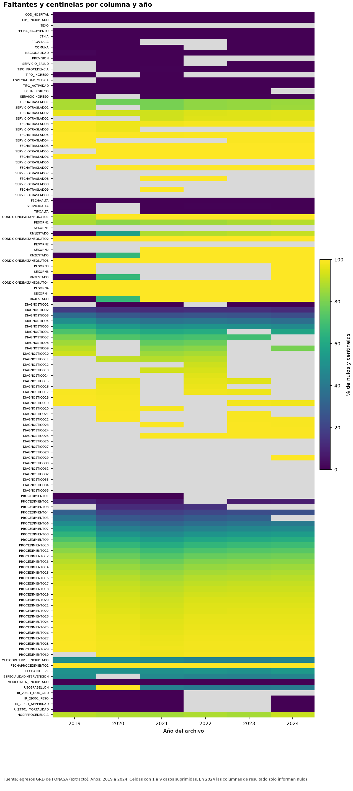
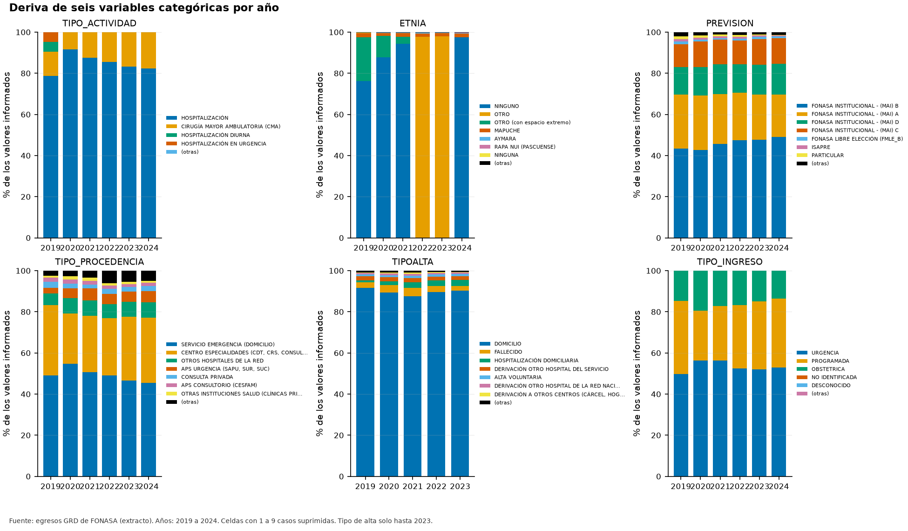
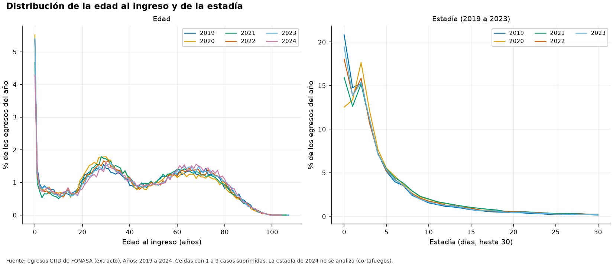

# Informe de descripción de los datos (CRISP-DM 2.2)

**Fuente de los datos: extracto.** Los extractos son una fracción menor de los datos y no son una muestra aleatoria simple: sirven para desarrollar y probar, no para conteos absolutos.

## 1. Alcance y método

Se perfilaron las 129 columnas de los archivos anuales: nulos, valores centinela, cardinalidad con el estimador Chao1, tipo inferido, rangos robustos y patrones de caracteres. Los conteos con menos de diez casos se suprimen. Las columnas de resultado de 2024 se entregan enmascaradas y solo informan nulos y patrón.

## 2. Faltantes y valores centinela

5 columnas están vacías en todos los años y 62 columnas tienen valores centinela (por ejemplo DESCONOCIDO) que el diccionario no cuenta como faltantes.

*Figura F04_01. Faltantes y centinelas por columna y año. Datos de origen: `tablas/t22_perfil_columnas.csv`.*

## 3. Cardinalidad observada y estimada

En un extracto la cardinalidad observada subestima la de los datos completos; el estimador Chao1 corrige parte de ese sesgo si el muestreo fuera aleatorio, algo que los extractos no garantizan. La tabla compara con las cifras del diccionario.

| Columna | Período | Observado | Chao1 | Documentado |
|---|---|---|---|---|
| COD_HOSPITAL | 2019-2023 | 68 | 68 | n/d |
| COD_HOSPITAL | 2019-2024 | 72 | 72 | n/d |
| COMUNA | 2019-2023 | 347 | 349 | n/d |
| COMUNA | 2019-2024 | 347 | 348 | n/d |
| DIAGNOSTICO1 | 2019-2023 | 5.920 | 7.248 | 9.500 |
| DIAGNOSTICO1 | 2019-2024 | 6.178 | 7.500 | 9.500 |
| ESPECIALIDAD_MEDICA | 2019-2023 | 89 | 89 | 158 |
| ESPECIALIDAD_MEDICA | 2019-2024 | 90 | 90 | 158 |
| ETNIA | 2019-2023 | 13 | 13 | n/d |
| ETNIA | 2019-2024 | 13 | 13 | n/d |
| HOSPPROCEDENCIA | 2019-2023 | 410 | 465 | n/d |
| HOSPPROCEDENCIA | 2019-2024 | 416 | 471 | n/d |
| IR_29301_COD_GRD | 2019-2023 | 1.006 | 1.029 | n/d |
| IR_29301_COD_GRD | 2019-2024 | 1.015 | 1.041 | n/d |
| NACIONALIDAD | 2019-2023 | 95 | 139 | n/d |
| NACIONALIDAD | 2019-2024 | 103 | 144 | n/d |
| PREVISION | 2019-2023 | 15 | 15 | 19 |
| PREVISION | 2019-2024 | 15 | 15 | 19 |
| PROVINCIA | 2019-2023 | 58 | 58 | n/d |
| PROVINCIA | 2019-2024 | 58 | 58 | n/d |
| SERVICIOINGRESO | 2019-2023 | 86 | 86 | n/d |
| SERVICIOINGRESO | 2019-2024 | 88 | 88 | n/d |
| SERVICIO_SALUD | 2019-2023 | 32 | 32 | n/d |
| SERVICIO_SALUD | 2019-2024 | 32 | 32 | n/d |
| TIPOALTA | 2019-2023 | 11 | 11 | 18 |
| TIPO_ACTIVIDAD | 2019-2023 | 4 | 4 | n/d |
| TIPO_ACTIVIDAD | 2019-2024 | 4 | 4 | n/d |
| TIPO_INGRESO | 2019-2023 | 5 | 5 | n/d |
| TIPO_INGRESO | 2019-2024 | 5 | 5 | n/d |
| TIPO_PROCEDENCIA | 2019-2023 | 19 | 19 | 25 |
| TIPO_PROCEDENCIA | 2019-2024 | 19 | 19 | 25 |

*Cardinalidad acumulada por período.* *Tabla completa en `tablas/t22_cardinalidades.csv`*

## 4. Deriva de categorías

Las seis variables categóricas cambian entre años. El PSI máximo entre años consecutivos o contra el primer año fue 17,94; los valores de 0,10 o más indican cambio moderado y los de 0,25 o más, cambio grande.

*Figura F04_02. Deriva de seis variables categóricas por año. Datos de origen: `tablas/t22_deriva_categorias.csv`.*

| Columna | Año base | Año comparado | PSI | Clasificación | Categorías |
|---|---|---|---|---|---|
| ETNIA | 2.023 | 2.024 | 17,939 | alto | 11 |
| ETNIA | 2.021 | 2.022 | 17,823 | alto | 12 |
| ETNIA | 2.019 | 2.023 | 17,447 | alto | 13 |
| ETNIA | 2.019 | 2.022 | 17,441 | alto | 13 |
| ETNIA | 2.019 | 2.024 | 1,700 | alto | 12 |
| TIPO_ACTIVIDAD | 2.019 | 2.020 | 0,619 | alto | 4 |
| TIPO_ACTIVIDAD | 2.019 | 2.024 | 0,612 | alto | 4 |
| TIPO_ACTIVIDAD | 2.019 | 2.023 | 0,606 | alto | 4 |
| TIPO_ACTIVIDAD | 2.019 | 2.022 | 0,598 | alto | 4 |
| TIPO_ACTIVIDAD | 2.019 | 2.021 | 0,597 | alto | 4 |
| ETNIA | 2.019 | 2.021 | 0,377 | alto | 12 |
| TIPO_PROCEDENCIA | 2.019 | 2.022 | 0,246 | moderado | 17 |
| TIPO_PROCEDENCIA | 2.021 | 2.022 | 0,238 | moderado | 17 |
| TIPO_PROCEDENCIA | 2.019 | 2.023 | 0,171 | moderado | 17 |
| TIPO_PROCEDENCIA | 2.019 | 2.024 | 0,157 | moderado | 17 |

*Mayores PSI entre años.* *Se muestran las primeras 15 de 52 filas. Tabla completa en `tablas/t22_psi.csv`*

## 5. Edad y estadía

*Figura F04_03. Distribución de la edad al ingreso y de la estadía. Datos de origen: `tablas/t22_hist_edad.csv`.*

## 6. Conciliación con el diccionario

La conciliación compara, columna por columna, los registros sin dato del diccionario con lo medido (por proporción ponderada por año, con error estándar (extracto)). Resultado: 53 columnas coinciden, 65 discrepan y 11 no son evaluables por tratarse de eventos raros. De las que discrepan, 17 difieren en 0,5 puntos porcentuales o más (magnitud relevante); en un extracto no aleatorio, las demás son diferencias despreciables aunque superen el umbral de z.

| Columna | % sin dato (diccionario) | % sin dato (medido) | Diferencia (pp) | z | Observación |
|---|---|---|---|---|---|
| USOSPABELLON | 49,02 % | 52,14 % | 3,12 | 15,3 |  |
| RN4ESTADO | 75,25 % | 77,75 % | 2,50 | 14,5 |  |
| RN3ESTADO | 75,25 % | 77,74 % | 2,49 | 14,5 |  |
| RN2ESTADO | 75,14 % | 77,63 % | 2,49 | 14,1 |  |
| RN1ESTADO | 66,95 % | 69,00 % | 2,05 | 6,2 |  |
| ESPECIALIDADINTERVENCION | 44,80 % | 46,56 % | 1,76 | 18,6 | tiene valores centinela que el diccionario no cuenta como faltantes |
| MEDICOINTERV1_ENCRIPTADO | 44,90 % | 46,63 % | 1,73 | 18,4 |  |
| FECHAINTERV1 | 49,48 % | 51,11 % | 1,63 | 18,2 | tiene valores centinela que el diccionario no cuenta como faltantes |
| PROCEDIMIENTO4 | 24,54 % | 23,09 % | 1,45 | -12,0 |  |
| PROCEDIMIENTO5 | 32,23 % | 30,84 % | 1,39 | -9,3 | tiene valores centinela que el diccionario no cuenta como faltantes |
| PROCEDIMIENTO6 | 39,97 % | 38,60 % | 1,37 | -8,2 |  |
| PROCEDIMIENTO3 | 16,69 % | 15,41 % | 1,28 | -13,0 | tiene valores centinela que el diccionario no cuenta como faltantes |
| PROCEDIMIENTO7 | 47,73 % | 46,48 % | 1,26 | -6,7 |  |
| PROCEDIMIENTO8 | 55,34 % | 54,24 % | 1,11 | -5,3 |  |
| PROCEDIMIENTO9 | 62,42 % | 61,45 % | 0,97 | -4,3 |  |
| PROCEDIMIENTO2 | 8,37 % | 7,53 % | 0,84 | -12,6 | tiene valores centinela que el diccionario no cuenta como faltantes |
| CONDICIONDEALTANEONATO1 | 97,78 % | 98,30 % | 0,52 | 7,3 |  |

*Columnas con discrepancia relevante.* *Tabla completa en `tablas/t22_conciliacion.csv`*

## 7. Bloque de recién nacidos y pares de traslados

En RN2ESTADO, RN3ESTADO y RN4ESTADO, el valor más frecuente concentra al menos 99,3 % de los valores informados, lo que indica relleno constante más que información clínica.

| Columna | Informados | Distintos | Valor modal | N modal | Proporción modal |
|---|---|---|---|---|---|
| CONDICIONDEALTANEONATO1 | 5.104 | 2 | VIVO | 5.074 | 99,4 % |
| PESORN1 | 41.347 | 2.526 | 3280 | 236 | 0,6 % |
| SEXORN1 | 33.502 | 3 | HOMBRE | 16.975 | 50,7 % |
| RN1ESTADO | 93.003 | 12 | 0 | 59.510 | 64,0 % |
| CONDICIONDEALTANEONATO2 | 67 | 2 | VIVO | 65 | 97,0 % |
| PESORN2 | 469 | 316 | 2640 | <10 | n/d |
| SEXORN2 | 469 | 3 | HOMBRE | 252 | 53,7 % |
| RN2ESTADO | 67.123 | 8 | 0 | 66.664 | 99,3 % |
| CONDICIONDEALTANEONATO3 | 0 | 0 | n/d | 0 | n/d |
| PESORN3 | <10 | 5 | 260 | <10 | n/d |
| SEXORN3 | <10 | 2 | MUJER | <10 | n/d |
| RN3ESTADO | 66.764 | 4 | 0 | 66.760 | 100,0 % |
| CONDICIONDEALTANEONATO4 | 0 | 0 | n/d | 0 | n/d |
| PESORN4 | 0 | 0 | n/d | 0 | n/d |
| SEXORN4 | 0 | 0 | n/d | 0 | n/d |
| RN4ESTADO | 66.759 | 1 | 0 | 66.759 | 100,0 % |

*Bloque de recién nacidos.* *Tabla completa en `tablas/t22_bloque_rn.csv`*

| Traslado | Con fecha | Con servicio | Solo fecha | Solo servicio | Diferencia |
|---|---|---|---|---|---|
| 1 | 51.402 | 51.402 | 0 | 0 | 0 |
| 2 | 16.418 | 16.418 | 0 | 0 | 0 |
| 3 | 4.954 | 4.954 | 0 | 0 | 0 |
| 4 | 1.645 | 1.645 | 0 | 0 | 0 |
| 5 | 551 | 551 | 0 | 0 | 0 |
| 6 | 249 | 249 | 0 | 0 | 0 |
| 7 | 117 | 117 | 0 | 0 | 0 |
| 8 | 65 | 65 | 0 | 0 | 0 |
| 9 | 35 | 35 | 0 | 0 | 0 |

*Pares fecha-servicio de traslados internos.* *Tabla completa en `tablas/t22_pares_traslado.csv`*

## 8. Etiquetas truncadas

Se detectaron 4 etiquetas categóricas que parecen cortadas por un límite de largo (paréntesis sin cerrar). Una unión exacta con los roles de tipo de alta pierde esos casos.

| Columna | Etiqueta | Largo | N |
|---|---|---|---|
| TIPOALTA | DERIVACIÓN A OTROS CENTROS (CÁRCEL, HOGAR DE | 44 | 1.018 |
| TIPOALTA | DERIVACIÓN INST. PRIVADA (COMPRA DE SERVICIOS | 45 | 779 |
| TIPO_PROCEDENCIA | OTRAS INSTITUCIONES (CÁRCEL, HOGARES DE ANCIANOS, SENAME, EC | 60 | 1.452 |
| TIPO_PROCEDENCIA | OTRAS INSTITUCIONES SALUD (CLÍNICAS PRIVADAS, DE REHABILITAC | 60 | 3.685 |

*Etiquetas que parecen cortadas.* *Tabla completa en `tablas/t22_etiquetas_truncadas.csv`*

## 9. Límites

- Los extractos no son una muestra aleatoria simple: las comparaciones de proporciones son indicativas.
- Los intervalos ignoran el agrupamiento por paciente y por hospital.
- La estadía de 2024 no se analiza por el cortafuegos.
