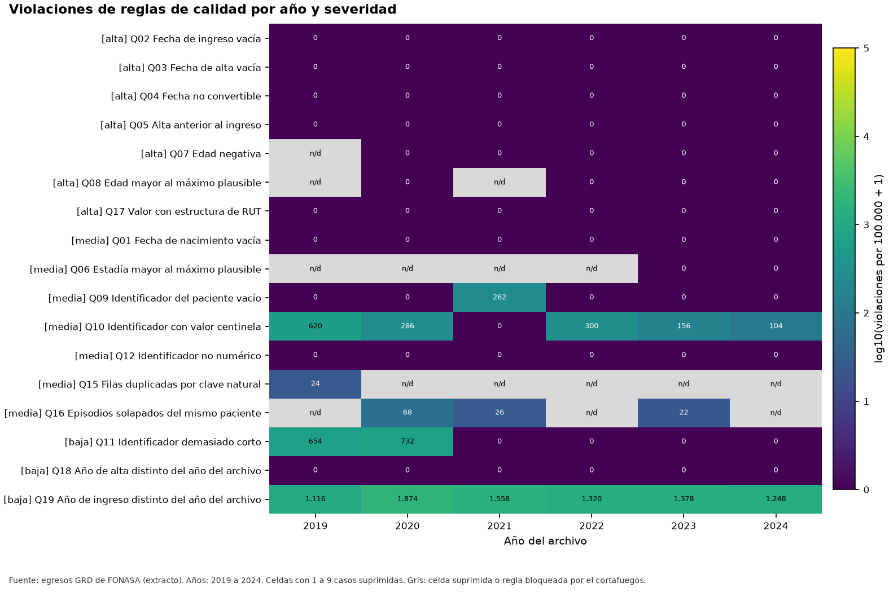
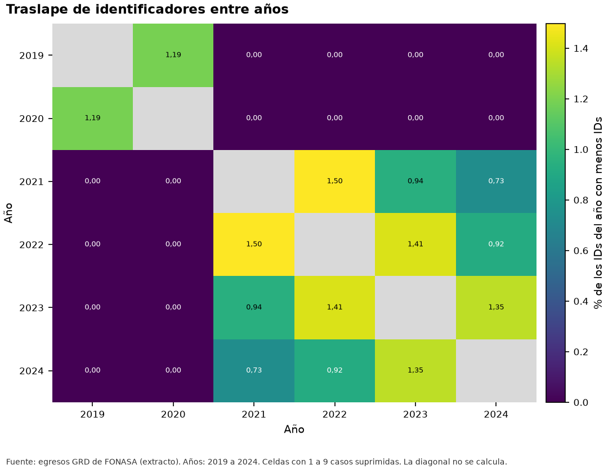
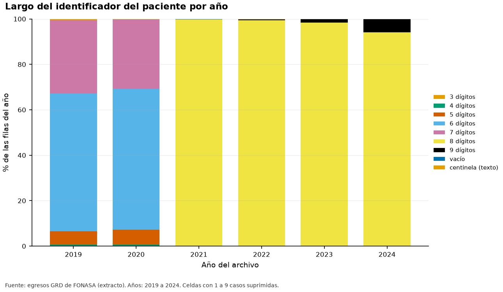
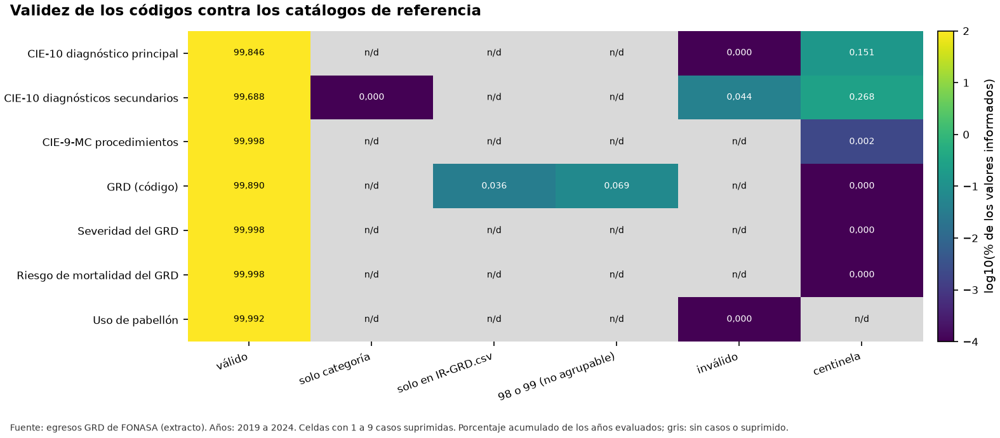
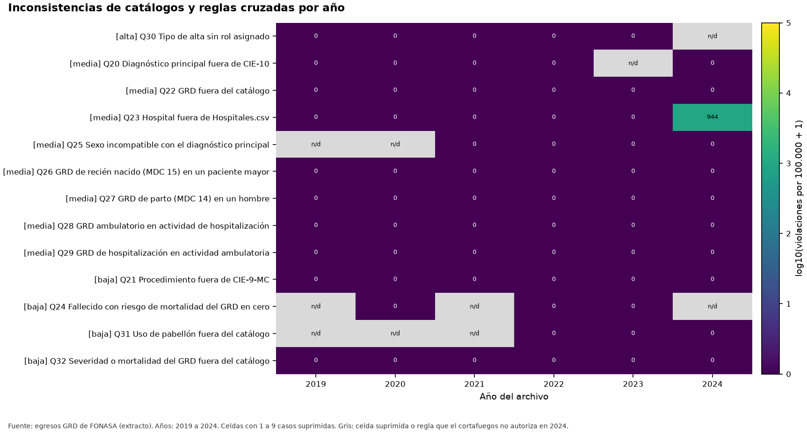

# Informe de calidad de los datos (CRISP-DM 2.4)

**Fuente de los datos: extracto.** Los extractos son una fracción menor de los datos y no son una muestra aleatoria simple: sirven para desarrollar y probar, no para conteos absolutos.

Este informe reúne la calidad de los datos: fechas, identificadores y duplicados (Tarea 5) y catálogos y consistencia cruzada (Tarea 6). Cada cifra sale de las tablas de la corrida.

## 1. Reglas de calidad: fechas, identificador y duplicados

Se evaluaron 19 reglas declarativas (8 de severidad alta). Cada regla devuelve solo conteos; las que leen columnas de resultado de 2024 lo hacen con autorización del cortafuegos y entregan únicamente violaciones.

*Figura F05_01. Violaciones de reglas de calidad por año y severidad. Datos de origen: `tablas/t24_reglas.csv`.*

| Regla | Nombre | Severidad | Acción | Violaciones | Evaluados | Proporción |
|---|---|---|---|---|---|---|
| Q01 | Fecha de nacimiento vacía | media | informar | 0 | 299.994 | 0,00 % |
| Q02 | Fecha de ingreso vacía | alta | informar | 0 | 299.994 | 0,00 % |
| Q03 | Fecha de alta vacía | alta | anular | 0 | 299.994 | 0,00 % |
| Q04 | Fecha no convertible | alta | anular | 0 | 899.980 | 0,00 % |
| Q05 | Alta anterior al ingreso | alta | anular | 0 | 299.992 | 0,00 % |
| Q06 | Estadía mayor al máximo plausible | media | informar | 23 | 299.992 | 0,01 % |
| Q07 | Edad negativa | alta | anular | <10 | 299.992 | n/d |
| Q08 | Edad mayor al máximo plausible | alta | anular | <10 | 299.992 | n/d |
| Q09 | Identificador del paciente vacío | media | informar | 131 | 299.994 | 0,04 % |
| Q10 | Identificador con valor centinela | media | recodificar | 733 | 299.994 | 0,24 % |
| Q11 | Identificador demasiado corto | baja | informar | 690 | 299.130 | 0,23 % |
| Q12 | Identificador no numérico | media | informar | 0 | 299.994 | 0,00 % |
| Q15 | Filas duplicadas por clave natural | media | informar | 34 | 299.130 | 0,01 % |
| Q16 | Episodios solapados del mismo paciente | media | informar | 73 | 299.128 | 0,02 % |
| Q17 | Valor con estructura de RUT | alta | informar_fonasa | 0 | 12.400.935 | 0,00 % |
| Q18 | Año de alta distinto del año del archivo | baja | informar | 0 | 299.994 | 0,00 % |
| Q19 | Año de ingreso distinto del año del archivo | baja | informar | 4.247 | 299.992 | 1,42 % |

*Violaciones totales por regla (años evaluados).* *Tabla completa en `tablas/t24_reglas.csv`*

## 2. Identificador del paciente: regímenes y traslape

El traslape de identificadores entre años consecutivos permite detectar si cambió el espacio de IDs. Un par de años tiene quiebre si su traslape es menor a 0,10 veces la mediana de los demás pares. Quiebres encontrados: 2020 a 2021. Regímenes de IDs: 2019 a 2020; 2021 a 2024.

*Figura F05_02. Traslape de identificadores entre años. Datos de origen: `tablas/t24_id_traslape.csv`.*

*Figura F05_03. Largo del identificador del paciente por año. Datos de origen: `tablas/t24_id_largo.csv`.*

| Régimen | Desde | Hasta | Años | Etiqueta |
|---|---|---|---|---|
| 1 | 2.019 | 2.020 | 2019, 2020 | 2019 a 2020 |
| 2 | 2.021 | 2.024 | 2021, 2022, 2023, 2024 | 2021 a 2024 |

*Regímenes de identificadores.* *Tabla completa en `tablas/t24_id_regimenes.csv`*

## 3. Consistencia del identificador dentro de cada régimen

| Régimen | Grupo de IDs | IDs con 2 o más episodios | Nacimiento inconsistente | IDs con sexo conocido en 2 o más episodios | Sexo inconsistente |
|---|---|---|---|---|---|
| régimen 2019 a 2020 | todos los IDs | 2.986 | 46 | 2.986 | 24 |
| régimen 2019 a 2020 | IDs con 5 o más dígitos | 2.963 | 45 | 2.963 | 24 |
| régimen 2019 a 2020 | IDs con menos de 5 dígitos | 23 | <10 | 23 | 0 |
| régimen 2021 a 2024 | todos los IDs | 5.989 | 117 | 5.989 | 41 |
| régimen 2021 a 2024 | IDs con 5 o más dígitos | 5.989 | 117 | 5.989 | 41 |
| régimen 2021 a 2024 | IDs con menos de 5 dígitos | 0 | 0 | 0 | 0 |

*Identificadores con más de una fecha de nacimiento o de sexo.* *Tabla completa en `tablas/t24_id_consistencia.csv`*

## 4. Duplicados y episodios solapados

| Año | Filas duplicadas por clave | Filas con ID válido | Solapes | Evaluados | Duplicados exactos (ID y fechas) |
|---|---|---|---|---|---|
| 2019 | 12 | 49.689 | <10 | 49.689 | 16 |
| 2020 | <10 | 49.856 | 34 | 49.856 | <10 |
| 2021 | <10 | 49.868 | 13 | 49.868 | <10 |
| 2022 | <10 | 49.849 | <10 | 49.849 | <10 |
| 2023 | <10 | 49.921 | 11 | 49.921 | <10 |
| 2024 | <10 | 49.947 | <10 | 49.945 | <10 |

*Duplicados por clave natural y solapes.* *Tabla completa en `tablas/t24_duplicados.csv`*

## 5. Valores con estructura de RUT

Se buscó por patrón, en las columnas de los archivos, cualquier valor con forma de RUT. Solo se guardan conteos por columna y año; nunca el valor. Cualquier hallazgo se informa a FONASA por un canal formal (decisión 11).

| Columna | Año | N |
|---|---|---|

*Valores con estructura de RUT.* *Tabla completa en `tablas/t24_rut_por_columna.csv`*

## 6. Validez contra los catálogos de referencia

Los códigos de CIE-10, CIE-9-MC, GRD, severidad, mortalidad y pabellón se contrastaron con los catálogos de la raíz del proyecto. Un código es válido si existe en el catálogo; si solo existe su categoría, se informa aparte. Los centinelas no cuentan como inválidos.

*Figura F06_01. Validez de los códigos contra los catálogos de referencia. Datos de origen: `tablas/t24_validez_codigos.csv`.*

## 7. Catálogo de GRD: planilla del oficio frente a IR-GRD.csv

La planilla del oficio tiene 1.058 códigos y IR-GRD.csv tiene 1.066, tras restituir los ceros a la izquierda que ese archivo pierde. 22 códigos están solo en la planilla y 30 solo en el archivo CSV.

| Dónde está | Código GRD | Etiqueta |
|---|---|---|
| solo_en_ir_grd_csv | 011133 | PH LIBERACIÓN DE TÚNEL DEL CARPO W/MCC |
| solo_en_ir_grd_csv | 051011 | PH TRASPLANTE CARDIACO Y/O PULMONAR |
| solo_en_ir_grd_csv | 071011 | PH TRASPLANTE HEPÁTICO |
| solo_en_ir_grd_csv | 071012 | PH TRASPLANTE HEPÁTICO W/CC |
| solo_en_ir_grd_csv | 123120 | PA OTROS PROCEDIMIENTOS SOBRE APARATO GENITAL MASCULINO |
| solo_en_ir_grd_csv | 158013 | PH NEONATO CON TRASPLANTE DE ÓRGANO U OXIGENACIÓN POR MEMBRANA EXTRACORPÓREA W/MCC |
| solo_en_ir_grd_csv | 158021 | PH NEONATO, PESO AL NACER <1000 GR CON PROCEDIMIENTO MAYOR |
| solo_en_ir_grd_csv | 158022 | PH NEONATO, PESO AL NACER <1000 GR CON PROCEDIMIENTO MAYOR W/CC |
| solo_en_ir_grd_csv | 158042 | PH NEONATO, PESO AL NACER 1000-1499 GR CON PROCEDIMIENTO MAYOR W/CC |
| solo_en_ir_grd_csv | 158051 | PH NEONATO, PESO AL NACER 1500-1999 GR CON PROCEDIMIENTO MAYOR |
| solo_en_ir_grd_csv | 161101 | PH TRASPLANTE ALOGÉNICO DE MÉDULA ÓSEA |
| solo_en_ir_grd_csv | 161102 | PH TRASPLANTE ALOGÉNICO DE MÉDULA ÓSEA W/CC |

*Códigos presentes en uno solo de los catálogos.* *Se muestran las primeras 12 de 52 filas. Tabla completa en `tablas/t24_catalogo_grd_comparacion.csv`*

## 8. Hospitales frente a Hospitales.csv

En los archivos aparecen 72 códigos de hospital distintos; 1 no figuran en Hospitales.csv y 0 figuran con nombre de clínica o sanatorio (tipo inferido por el nombre, porque el catálogo no trae el tipo ni el nivel de complejidad). Las tablas por hospital usan códigos y no nombres.

| Año | Estado | Códigos | Egresos |
|---|---|---|---|
| 2019 | en_catalogo_publico_probable | 65 | 49.999 |
| 2020 | en_catalogo_publico_probable | 65 | 49.999 |
| 2021 | en_catalogo_publico_probable | 65 | 49.999 |
| 2022 | en_catalogo_publico_probable | 65 | 49.999 |
| 2023 | en_catalogo_publico_probable | 68 | 49.999 |
| 2024 | en_catalogo_publico_probable | 71 | 49.527 |
| 2024 | fuera_de_catalogo | 1 | 472 |

*Códigos de hospital por año frente al catálogo.* *Tabla completa en `tablas/t24_hospitales_resumen.csv`*

## 9. Etiquetas de TIPOALTA frente a los roles de la Fase 1

Se observaron 11 etiquetas de TIPOALTA en 2019 a 2023, de las cuales 2 no coinciden exactamente con el archivo de roles por estar cortadas; se asignan por prefijo. 0 etiquetas quedan sin rol. Una unión exacta pierde 0,72 % de los egresos de ese período.

| Etiqueta en los datos | Largo | Egresos | Etiqueta en roles | Método | Rol | Unión exacta pierde |
|---|---|---|---|---|---|---|
| DOMICILIO | 9 | 224.254 | DOMICILIO | exacta | NO_EVENTO | no |
| FALLECIDO | 9 | 7.748 | FALLECIDO | exacta | EVENTO | no |
| HOSPITALIZACIÓN DOMICILIARIA | 28 | 5.520 | HOSPITALIZACIÓN DOMICILIARIA | exacta | CENSURADO | no |
| DERIVACIÓN OTRO HOSPITAL DEL SERVICIO | 37 | 4.910 | DERIVACIÓN OTRO HOSPITAL DEL SERVICIO | exacta | CENSURADO | no |
| ALTA VOLUNTARIA | 15 | 2.681 | ALTA VOLUNTARIA | exacta | NO_EVENTO | no |
| DERIVACIÓN OTRO HOSPITAL DE LA RED NACIONAL | 43 | 1.888 | DERIVACIÓN OTRO HOSPITAL DE LA RED NACIONAL | exacta | CENSURADO | no |
| DERIVACIÓN A OTROS CENTROS (CÁRCEL, HOGAR DE | 44 | 1.018 | DERIVACIÓN A OTROS CENTROS (CÁRCEL, HOGAR) | por_prefijo | CENSURADO | si |
| FUGA DEL PACIENTE | 17 | 862 | FUGA DEL PACIENTE | exacta | NO_EVENTO | no |
| DERIVACIÓN INST. PRIVADA (COMPRA DE SERVICIOS | 45 | 779 | DERIVACIÓN INST. PRIVADA (COMPRA DE SERVICIOS) | por_prefijo | CENSURADO | si |
| DERIVACIÓN INST. PRIVADA (VOLUNTARIO) | 37 | 330 | DERIVACIÓN INST. PRIVADA (VOLUNTARIO) | exacta | CENSURADO | no |
| NO IDENTIFICADA | 15 | <10 | NO IDENTIFICADA | exacta | CENSURADO | no |
| (no aparece en los datos) | 0 | 0 | DESCONOCIDO | sin_datos | n/d | no |

*Etiquetas de TIPOALTA y su rol.* *Tabla completa en `tablas/t24_tipoalta_etiquetas.csv`*

## 10. Reglas cruzadas

Las reglas cruzadas verifican la coherencia entre columnas: sexo y diagnóstico, edad y MDC 15, tipo de GRD y actividad, y riesgo de mortalidad del GRD y desenlace. La regla que cruza el desenlace no se evalúa en 2024.

*Figura F06_02. Inconsistencias de catálogos y reglas cruzadas por año. Datos de origen: `tablas/t24_consistencia_cruzada.csv`.*

| Regla | Nombre | Severidad | Acción | Violaciones | Evaluados | Proporción |
|---|---|---|---|---|---|---|
| Q20 | Diagnóstico principal fuera de CIE-10 | media | informar | <10 | 299.531 | n/d |
| Q21 | Procedimiento fuera de CIE-9-MC | baja | informar | 0 | 2.440.112 | 0,00 % |
| Q22 | GRD fuera del catálogo | media | excluir | 0 | 299.779 | 0,00 % |
| Q23 | Hospital fuera de Hospitales.csv | media | informar | 472 | 299.994 | 0,16 % |
| Q24 | Fallecido con riesgo de mortalidad del GRD en cero | baja | informar | <10 | 7.746 | n/d |
| Q25 | Sexo incompatible con el diagnóstico principal | media | informar | <10 | 299.973 | n/d |
| Q26 | GRD de recién nacido (MDC 15) en un paciente mayor | media | informar | 0 | 7.760 | 0,00 % |
| Q27 | GRD de parto (MDC 14) en un hombre | media | informar | 0 | 33.114 | 0,00 % |
| Q28 | GRD ambulatorio en actividad de hospitalización | media | informar | 0 | 299.779 | 0,00 % |
| Q29 | GRD de hospitalización en actividad ambulatoria | media | informar | 0 | 299.779 | 0,00 % |
| Q30 | Tipo de alta sin rol asignado | alta | excluir | 0 | 249.995 | 0,00 % |
| Q31 | Uso de pabellón fuera del catálogo | baja | informar | 11 | 143.570 | 0,01 % |
| Q32 | Severidad o mortalidad del GRD fuera del catálogo | baja | informar | 0 | 599.978 | 0,00 % |

*Violaciones totales de las reglas de catálogos y consistencia cruzada.* *Tabla completa en `tablas/t24_consistencia_cruzada.csv`*

| Tipo de GRD | Actividad | Egresos |
|---|---|---|
| ambulatorio | CIRUGÍA MAYOR AMBULATORIA (CMA) | 40.447 |
| ambulatorio | HOSPITALIZACIÓN DIURNA | 2.397 |
| hospitalizado | HOSPITALIZACIÓN | 254.565 |
| hospitalizado | HOSPITALIZACIÓN EN URGENCIA | 2.366 |
| otro | CIRUGÍA MAYOR AMBULATORIA (CMA) | 187 |
| otro | HOSPITALIZACIÓN | 0 |
| otro | HOSPITALIZACIÓN EN URGENCIA | 0 |

*Tipo de GRD frente a TIPO_ACTIVIDAD (años acumulados).* *Tabla completa en `tablas/t24_grd_tipo_actividad.csv`*
